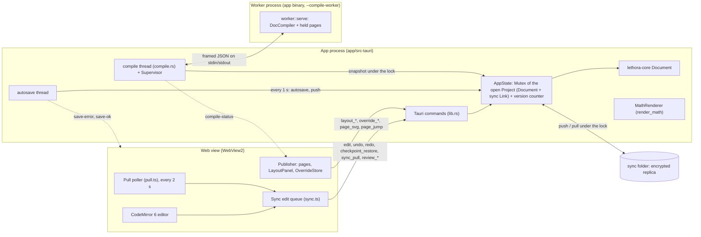
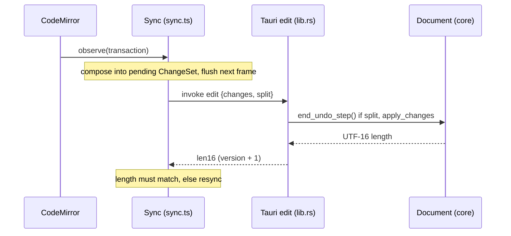
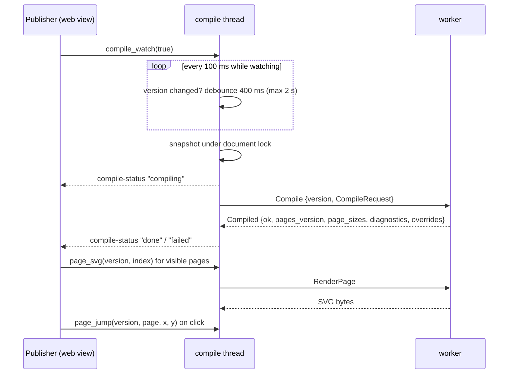
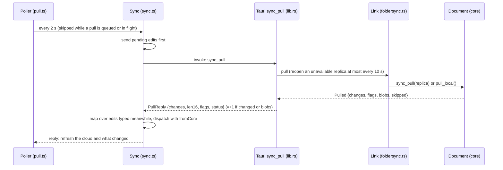
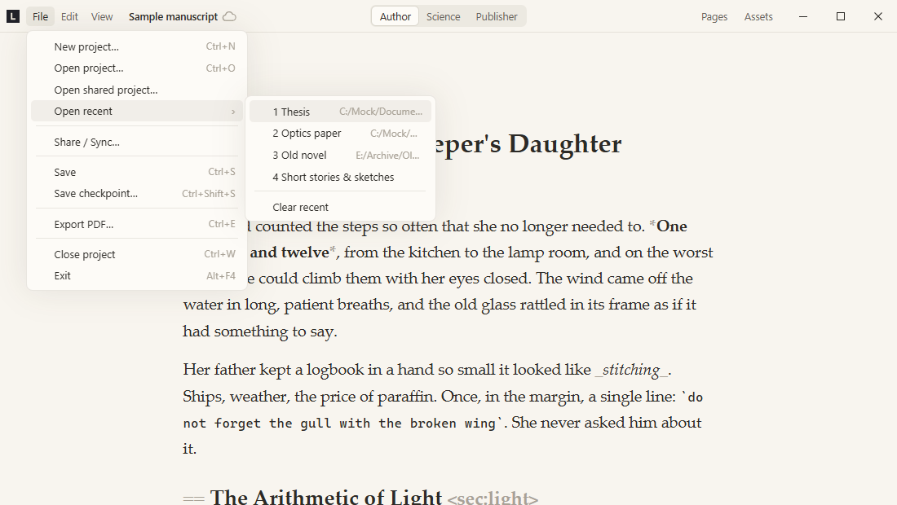
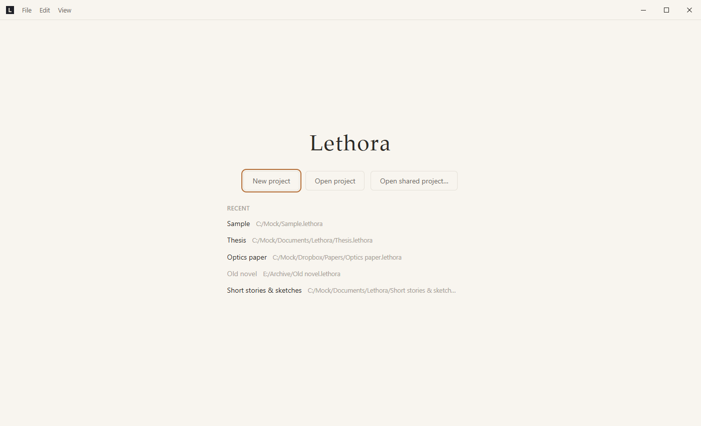

# Lethora architecture

For contributors and future Claude Code sessions: enough to change the code
safely and to find your way around fast. It is not an API reference; the doc
comments in the code are. Paths are relative to the repository root.

Related files: [README.md](https://github.com/BechtStudio/lethora/blob/main/README.md) (overview, setup),
[issue tracker](https://github.com/BechtStudio/lethora/issues) (open work),
[known-issues.md](known-issues.md) (known limitations),
[CHANGELOG.md](https://github.com/BechtStudio/lethora/blob/main/CHANGELOG.md) (history, decisions, measurements),
[CLAUDE.md](https://github.com/BechtStudio/lethora/blob/main/CLAUDE.md) (working rules and stack decisions).

## 1. Overview

Lethora is a local-first desktop writing editor for book-size texts. The
text is plain Typst markup (a subset). It is the single source of truth;
everything else is derived from it or stored next to it.

Three views of the same text:

- **Author view**: the text with softened markup, focus and typewriter
  modes, checkpoints. No layout.
- **Science view**: the same editor plus rendered math, citations and
  references, figures sized against the layout's text column.
- **Publisher view**: the typeset pages (Typst), the layout panel,
  exceptions (anchored overrides) with markers, PDF export. The same page
  view can also show in a split pane beside the author or science view
  (F6).

### Layering rule

```text
content (author + science constructs, one text)
  -> layout layer (preset + settings + expert Typst + anchored overrides)
    -> render (Typst pages, SVG, PDF)
```

Lower layers never depend on upper ones, and content never contains layout.
The content holds *what* and *relative size* (`width: 80%`, captions,
labels, a figure's own `placement:` wish). Page, margins, typography and all
global style live in the layout layer, which is stored in the Loro document
as structured settings and turned into a generated Typst preamble only at
compile time. Overrides are injected into a compiled copy of the text, never
into the stored text.

### Workspace

| Path | What it is |
| --- | --- |
| `crates/core` (`lethora-core`) | UI-free document model: Loro document, undo/redo, checkpoints, anchors, persistence (`src/lib.rs`), the `Storage` trait (`src/storage.rs`), folder sync: the encrypted replica, push, pull, join, live import (`src/sync.rs`), server sync: the sans-I/O client `ServerSync`, share, join, push, pull, members, presence, authors (`src/server.rs`), author trust (`src/trust.rs`), the review document: comments, marks, suggestions (`src/review.rs`). Re-exports `lethora-protocol` as `lethora_core::protocol`. |
| `crates/protocol` (`lethora-protocol`) | What devices and the server share, without Loro, storage or network: device keys and sealed epoch keys (`keys.rs`), envelopes v1–v4 (`envelope.rs`), log framing (`frame.rs`), the members log and its verifier (`members.rs`), invite links (`invite.rs`), the server's wire messages (`wire.rs`), the feature level `LEVEL` (`lib.rs`, "Versions"). |
| `crates/server` (`lethora-server`) | The sync server binary: config, WebSocket connections, HTTP routes, projects, storage (section 3, "Server sync"). Depends only on `lethora-protocol`. Running it: [server.md](server.md). |
| `crates/convert` (`lethora-convert`) | UI-free import and export: one document model between all formats, the format registry, readers (Markdown, plain text, DOCX), writers (Markdown, plain text, HTML, EPUB, DOCX) and the model → Lethora markup writer (section 3, "Import and export"). No Typst, no Loro. |
| `crates/typeset` (`lethora-typeset`) | UI-free typesetting: math formulas, sources (hayagriva), layout schema and presets, preamble generator, whole-document compiler, overrides, image downscaling, exports (the document compiled for Typst's HTML target and walked into the convert model, `src/export.rs`), the worker process and its supervisor. Independent of the core. |
| `app/src-tauri` (`lethora-app`) | Tauri 2 shell: commands over core and typeset (`src/lib.rs`), the compile thread (`src/compile.rs`), the autosave thread, folder sync in the app (`src/foldersync.rs`: the open replica, project keys, sync status, sync apps, finding a project by its code, the default projects folder), server sync in the app (`src/serversync.rs`: one async task per shared project driving `ServerSync` over WebSocket and HTTP). The same binary is the compile worker (`src/main.rs`, `--compile-worker`). |
| `app/src` | The web view: TypeScript, CodeMirror 6, no framework. |
| `vendor/loro-internal` | `loro-internal` 1.16.2 with a fix for quadratic checkout/revert/undo across one long insert span (diff in `vendor/loro-internal-fix.patch`). Wired in by `[patch.crates-io]` in the root `Cargo.toml`; `loro` is pinned to `=1.16.2` in `crates/core/Cargo.toml` so an update can't silently drop the patch. Remove once upstream ships a fix (see [#32](https://github.com/BechtStudio/lethora/issues/32)). |

## 2. Processes and threads



**Web view.** `app/src/main.ts` sets up one CodeMirror `EditorView`, the
command list behind the menus and shortcuts, and the title-bar row, and
wires everything to Tauri (`invoke`, `listen`). All other modules get their
backend injected (see section 7).

**Commands and state** (`app/src-tauri/src/lib.rs`). Commands are `async`
and thin. `AppState` holds the open `Project` (path, `Document` and its
folder-sync `Link`) behind one `Mutex` and an `AtomicU64` document version. `AppState::with` runs a read;
`change`/`try_change` run a change and count a new version (also on undo
or redo with nothing to undo). Opening another project, and `compile_now`
with `force`, count a version too. Math rendering has its own lock
(`TypesetState.math`), so it doesn't block editing.

**Autosave thread** (`autosave_loop` in `lib.rs`). Every second
`Document::autosave`; every 60 s `maybe_auto_checkpoint` (the core makes one
only if 10 minutes have passed since the last checkpoint and the document
changed). Failures go to the window as `save-error` (once per distinct
message), recovery as `save-ok`. After each autosave, `Link::push` copies
what is new into the sync folder if encrypted sync is set up (nothing is
written when nothing is new); push failures go to the sync status, never to
`save-error`. The project is also saved (and pushed, `Project::save`) when it
is replaced, on Close project (`project_close`) and on `RunEvent::Exit`; the
web view drains its edit queue on every close request (at most 5 s): the
own close button, File → Exit and Alt+F4 all go through it.

**Folder sync** (`app/src-tauri/src/foldersync.rs`, section 3 "Folder
sync"). Pushes run in the autosave thread (above). Pulls are requested by the
web view: a `Poller` (`app/src/pull.ts`) calls `sync_pull` every 2 s through
the `Sync` FIFO (`Sync.apply`), never two at once, so pending edits are sent
first and edits typed while the pull is in flight are transformed over its
changes, exactly like a checkpoint restore; a pull started from the Rust
side could not do that. Setup, push, pull and the attempt to reopen an
unavailable sync folder (at most every 10 s, on the pull path) run under the
document lock (`with_link`); `sync_apps` and `sync_find` don't need it
(`sync_find` takes it only to read the open project's path), and
`sync_join` builds the new project before `install` takes the lock.

**Server sync** (`app/src-tauri/src/serversync.rs`, section 3 "Server
sync"). A project shared on a server has a `ServerLink` instead of a folder
`Link`: an async task on Tauri's tokio runtime holds the WebSocket and
makes the HTTP requests; pushes, pulls and saves run under the document
lock like folder sync's. Remote changes are pulled by the web view through
the same FIFO, at once on a `remote-changes` event (the 2 s poll stays on
for the status).

**Compile thread** (`app/src-tauri/src/compile.rs`). Owns a `Supervisor` and
takes `Job`s over a channel (`Watch`, `Now`, `Page`, `Pdf`, `Export`, `Jump`,
`Fonts`).
While watching (the page view is shown) it polls the version every 100 ms
and compiles once changes settle: 400 ms after the last change, at most 2 s
after the first one while changes keep coming. Only the latest version is
compiled. `snapshot()` copies text, layout/meta maps, expert code and the
resolved overrides under the document lock, then releases it; the compile
itself never holds the lock.

**Worker and supervisor** (`crates/typeset/src/supervisor.rs`,
`crates/typeset/src/worker.rs`). The app starts itself with
`--compile-worker` (no console window on Windows). Frames are
`[u32 LE length][JSON]`; page SVG, PDF and export answers carry a second
frame with the bytes (an export's side files follow its file in that frame,
their paths and lengths in the answer). One request at a time. Requests:
`Compile`, `RenderPage`, `ExportPdf`, `Export {version, format, stem}`
(answered `Exported {version, warnings, files}`), `Jump`, `Fonts`,
`Shutdown` (and test hooks in debug builds). The worker keeps a
`DocCompiler` (the last Typst `Source`, so recompiles are incremental) and
the last good compiled document ("held version") for page SVGs, clicks, PDF
and exports, with the request it was compiled from (an export compiles it
again, for HTML). It trims Typst's
memo cache when idle (250 ms after a compile, or right before the next
compile).

The supervisor starts the worker on first use and restarts it on the next
request after a failure:

- **Timeouts**: 60 s for a request, plus 20 s per MB of text for a compile;
  PDF export gets 120 s, other exports 180 s (they compile again). On
  timeout the worker is killed (`Error::Timeout`).
- **Memory cap**: 60% of physical memory, at least 2 GB. Windows: a job
  object with a process memory limit, kill-on-close and
  die-on-unhandled-exception. Linux: `setrlimit(RLIMIT_AS)` in `pre_exec`
  (not tested yet, see [#47](https://github.com/BechtStudio/lethora/issues/47)). macOS: none (it rejects `RLIMIT_AS` below
  the process's reserved address space with EINVAL); only the timeout
  applies.
- **Crashes**: a dead pipe or a malformed or unexpected answer gives
  `Error::Crashed`; it is reported as out of memory if the worker's stderr
  said `memory allocation of` or its peak was at 95% of the cap.
  `Error::Failed` (e.g. a version no longer held) keeps the worker running.

After a timeout or crash no pages are held; the status says `timeout` or
`crashed` and the UI keeps showing the old page images.

## 3. Data model

### The Loro document (`crates/core/src/lib.rs`)

| Container | Type | Holds |
| --- | --- | --- |
| `content` | `LoroText` | The text (Typst markup). |
| `layout` | `LoroMap` | Layout settings, flat dotted keys (`page.size`, `text.font`, ...) plus `preset` and `schema`. Only the keys that differ from the preset are stored. |
| `meta` | `LoroMap` | Title, subtitle, author, date, contact. |
| `overrides` | `LoroMap` | Anchored exceptions, flattened: `<id>.kind`, `<id>.anchor`, `<id>.<param>`. |
| `layout_custom` | `LoroText` | Expert Typst code. |

Map values are JSON scalars only (null, bool, number, string); the core does
not know their schema (`MapName`, `map_update`, `map_replace`). The schema
lives in `crates/typeset/src/layout.rs` (settings, presets `paper`, `novel`,
`thesis`, `manuscript`; default `paper`) and
`crates/typeset/src/overrides.rs` (override kinds). Stored values are
untrusted: `layout::resolve` validates each one again and ignores what fails,
and the preamble generator never interpolates raw text (enums, re-printed
lengths, escaped string literals via `typst_str`).

### Content: Typst markup

The content is a Typst markup subset. The web view styles it with its own
CodeMirror stream tokenizer (`app/src/typst.ts`); the compiler and the
override planner parse it with Typst's own parser (`typst::syntax`).

### Persistence

A project is a folder (the app adds `.lethora` to new ones), format 2. Each
device (`DeviceId`, 32 hex characters) writes only its own files, so
folder-sync tools never see two writers on one file
(`docs/dev/collaboration.md`, section 7). The core does all I/O through the
`Storage` trait (`crates/core/src/storage.rs`, `FsStorage` for folders);
`Document::create/open(dir, device)` wrap `create_in/open_in(storage,
device)`.

| File | Role |
| --- | --- |
| `project.json` | `{"format": 2}`. Written last on create/convert; its presence marks a project. Other formats fail with `Error::UnsupportedFormat`. |
| `main/<device>.snapshot` | The device's full history as one Loro export. Written atomically (temp file, fsync, rename; directory fsync on Unix). |
| `main/<device>.log` | The device's append-only records `[u32 LE len][u32 LE crc32][Loro update]`, one per autosave, `sync_data` after each. |
| `review/<device>.snapshot`, `review/<device>.log` | The same for the `review` document (see "Review"), loaded, saved and compacted with `main`. |
| `checkpoints/<device>.json` | The device's automatic checkpoints, written atomically (named ones live in the document, see "Checkpoints"). |
| `<device>.lock` | Held with an exclusive OS lock while this device has the project open (`Error::Locked`). Taken before any read or repair. Other devices may have it open at the same time. |
| `references.bib` | Mirror of the bibliography for Zotero/JabRef (see "Bibliography"). |
| `state/<device>.json` | The device's own state, written atomically: `mirror`, what it last mirrored into `references.bib` (crc32, length, version), and `sync` (`SyncSettings`: `{"folder", "project"}`, the sync folder holding the replica and the replica's project id; see "Folder sync"). Either part may be missing. |
| `assets/<64 hex>` | Image blobs, named by keyed SHA-256, never changed or deleted (see "Assets"). |
| `backup/assets/` | Loose image files taken into the index (moved out of `assets/`). |
| `format1-backup/` | The old files of a converted format-1 project (`snapshot.loro`, `updates.log`, `checkpoints.json`, `lock` in the root). |

Notes:

- Snapshots are `ExportMode::all_updates()`, not Loro's fast snapshot: in
  Loro 1.16.2 the first edit after loading a fast snapshot of a large,
  heavily edited text stalls (see CHANGELOG, "Decided").
- **Open**: the own snapshot and log first, then every other device's
  snapshot and log, read-only, in name order. Another device's files never
  fail the open: a torn tail ends its log, data Loro rejects skips the rest
  of that device, and changes whose history is missing wait inside Loro.
  While the project is open, what other devices add later arrives through
  pulls every 2 s: from the replica when encrypted sync is set up, else from
  their plain files in the project folder (`pull_local`, which continues
  from what opening read; see "Folder sync").
- **Self-contained own files**: the persisted version is that of the own
  files alone, so the next autosave also writes what came from other devices
  into the own log. A device that never edited still gets a full copy.
- **Compaction**: when the own log passes 4 MiB, a new own snapshot is
  written first and the log truncated after. Re-importing updates already in
  the snapshot is idempotent, so a crash in between is safe. Snapshots are
  written only at compaction (and on create/convert), not on a timer.
- **Crash recovery**: a short record or CRC mismatch in the own log ends the
  replay and the tail is truncated. A record that passes the CRC but that
  Loro rejects makes `open` fail; the app then offers "Open at the last good
  state" (R5b; hand test [#6](https://github.com/BechtStudio/lethora/issues/6)).
- **Format 1** is converted on open under the device lock: the old history
  and checkpoints become the opening device's files, `project.json` is
  written, then the old files move to `format1-backup/` (best effort).
- **Timestamps**: Loro records the time of each change
  (`set_record_timestamp`, not persisted by Loro, so set on every document).
  Loro merges a peer's consecutive changes within 1000 s into one change
  with one timestamp.
- **App config directory** (Tauri's `app_config_dir`), never inside a
  project or sync folder:

  | File | Role |
  | --- | --- |
  | `device.json` | `{"id"}`, created on first start with a random id (`getrandom`); a corrupt file gets a new id. |
  | `profile.json` | `{"user", "name"}`, created the same way. With `device.json` it forms the core's `Identity`, passed to `Document::create/open` (see "Attribution"). |
  | `recent_projects.json` | `{"paths", "reopen"}`: up to 10 recently opened projects, newest first, and whether the next start reopens the newest (see 4 (k)). Replaces `last_project.json` (`{"path"}`), which is read once on upgrade and deleted on the first write. |
  | `keys/<project id>.key` | The project key of a synced project (64 hex characters), by the replica's project id. Written at setup, join and code entry; deleted by Stop. |
  | `notices.json` | `{"dismissed": [<project folder>]}`: projects whose plain-sync notice was dismissed. |

- **Default projects folder** (`default_projects_dir` in
  `foldersync.rs`): `<Documents>/Lethora`, or `<home>/Lethora` when a sync
  client syncs Documents (OneDrive's or iCloud's Documents backup) and not
  home, so projects never sync in plain text by default; created when a
  project is made in it. New and joined projects go there as
  `<name>.lethora`: the name made safe for every system (`safe_name`:
  `\/:*?"<>|` and control characters become `-`, no trailing dots or spaces,
  at most 100 characters, reserved Windows names get `_`, `Untitled` if
  empty), numbered `<name> 2.lethora`, ... if taken.

### Checkpoints

A checkpoint stores encoded Loro frontiers of the whole document (`Checkpoint`
in `crates/core/src/lib.rs`): named (Ctrl+Shift+S) or automatic. `text_at`
forks the document at that version to preview the text. `restore` applies
the difference to that version (`LoroDoc::diff` + `apply_diff`, which is
what `revert_to` does) as a **new change**, one undo step; history is kept.
Restore covers every container of `main` except the core's bookkeeping
maps (`BOOKKEEPING`: `peers`, `checkpoints`), so layout, metadata and
overrides go back too (and newer checkpoints stay), while the preview shows
only the text. The `review` document is never touched. Old automatic checkpoints are never pruned yet.

Where they live:

- **Named** checkpoints are shared through the core map `checkpoints`: key =
  id in decimal, value = a Loro map value `{"name", "created", "version"
  (binary frontiers), "user", "device"}`. Written like `peers` entries
  (own commit, origin `lethora:sys`, so creating one is not undoable) and
  autosaved at once. Entries are untrusted; one whose version the document
  doesn't contain yet (its history hasn't arrived) is not listed, and
  `text_at`/`restore` on it fail with `NotFound`.
- **Automatic** ones stay in the own `checkpoints/<device>.json`; other
  devices' are never read. `maybe_auto_checkpoint` measures the interval
  from the latest checkpoint of either kind (future-dated ones skipped) and
  ignores bookkeeping changes when deciding whether the document changed.
- **Ids** are below 2^53 (JS-safe) and never 0: SplitMix64 seeded with the
  session's random Loro peer id, skipping ids in use.
- **Migration**: named checkpoints found in the own file (format 1 or part
  1a) move into the map on open (the one case where opening writes):
  persisted first, file rewritten after; a crash in between is resolved on
  the next open by matching name, time and version (not id, since part 1a
  numbered each device's checkpoints from 1).

### Attribution

The core map `peers` (not a `MapName`) records who each Loro peer is: key =
peer id in decimal, value = a Loro map value `{"user", "device"}`
(`UserId`, `DeviceId`). A session writes its entry lazily, right before its
first local change of any kind, in a commit of its own with the origin
`lethora:sys`; the `UndoManager` excludes that origin, so Ctrl+Z never
removes it and opening without editing writes nothing. Converting a format-1
project registers all of its old peers to the converting identity.
`Document::author_at(pos_utf16)` returns the user, device and time
(`Authorship`) of the character there, `None` for an unknown peer; entries
are untrusted and invalid ones count as unknown. In a server-shared project
an author is also grounded in the stream that brought the op (section 3,
"Server sync", **Authors**). The time is the start of
the Loro change holding the insertion (a peer's changes within 1000 s merge
into one), `None` for format-1 history. `Document::authors_in(range)` gives
runs of the same user (UTF-16 offsets); the UI is View → Show authors in server-shared
projects (section 3, "Server sync").

### Bibliography

The sources (BibLaTeX) live in the `bibliography` text (content: undo,
restore and checkpoints cover them; `\n` line breaks, no byte order mark,
at most `MAX_BIBLIOGRAPHY_BYTES` = 16 MiB). `Document::set_bibliography`
changes only the differing lines (Loro `update_by_line`, whole replace if
the diff takes over 2 s) and is an undo step of its own (`Part::Sources`).
The compile request carries the text; the worker serves it as the virtual
`references.bib`.

`references.bib` in the project root is a **mirror** for Zotero, JabRef and
hand edits. Its first line is a marker, `% Lethora mirror crc32=<8 hex>;
...`, the crc32 of the rest (the text):

- **Writing** (in `autosave`, after the log): when the text differs from
  what this device last mirrored (`state/<device>.json`), not merely
  because the file differs, so a newer mirror from another device stays.
  Skipped when the file already holds that text; a file without a valid
  marker (an outside edit) is never overwritten here.
- **Merging** (`merge_bibliography_mirror`, run by `bib_entries` on project
  load, window focus and F5): a file with a valid marker, from any device,
  is never imported. Otherwise (Zotero export, hand edit, a project from
  before part 1d) the file text is merged against the version this device
  last mirrored: unchanged in Lethora since then (or no base) → applied as
  an ordinary undo step; both changed → a fork at the base takes the file
  text and its change is imported under a new peer registered to this
  identity, so both sides' additions survive (not undoable). The mirror is
  rewritten with a marker right away.
- A Zotero auto-export replaces the whole file, so sources added only in
  Lethora are removed by the next export (as before, when the export
  overwrote the file).

### Assets

Images are immutable blobs `assets/<64 hex>`: SHA-256 of (project key ‖
bytes), written atomically, never changed or deleted. The project key (32
random bytes, `getrandom`) lives in the bookkeeping map `project`
(`asset_key`), created on the first blob write; if two devices create one
at once, Loro's last writer wins and older blobs stay valid (the index
stores blob names), only identical content may then be stored twice. The
content map `assets` maps the path used in the text (`assets/foo.png`) to
its blob; the text is unchanged. Folders come from the paths
(`assets/figures/ch1/x.png`); empty folders are kept by markers in the same
map (key = folder path ending in `/`, value `true`; ancestors implied), and
every write putting an item into a folder writes its marker if missing, so
emptying a folder never removes it. `assets()` lists only blob entries,
`asset_folders()` the markers. `put_asset` is its own undo step
(`Part::Assets`), and so are `add_asset_folder` and `remove_assets`
(refused while the text uses an item; blobs stay). `move_assets(&[(old,
new)])` renames entries and markers and rewrites every exact literal
`"old"` in the content text to `"new"` in one step (content part); it
refuses missing sources, existing targets and folders moved into
themselves. `stage_blob` writes a blob without touching the index (an
unindexed blob is harmless, blobs are never deleted);
`insert_with_assets(pos, text, &[(path, blob)])` then indexes staged
blobs (new or changed entries plus missing folder markers) and inserts
`text` as one commit and one undo step (content part), refusing an invalid
position, a folder path, a blob not stored or a path indexed with another
blob, with nothing changed. Usage (`asset_usage`) counts those literals in
the content text only: the expert code and paths built from parts don't
count.
`asset_sizes` stats the blobs (`Storage::size`) without reading them.
Restore keeps index updates but drops index deletions, so a replaced image
goes back but no entry disappears (a checkpoint from before the index
still finds its images, and removed or moved entries come back).

Asset types come from one table per side: `TYPES` in
`crates/typeset/src/assets.rs` (kind, extensions, import check: allowed
extension and size; only `image` now) and `ASSET_TYPES` in
`app/src/assettypes.ts` (label, icon, preview kind, the snippet a figure
inserts). Paths are validated there too: names are free (spaces, Unicode,
case; they never reach the disk) but refuse `"`, `\`, `:`, control
characters, empty, `.`/`..` components and leading or trailing spaces or
dots; a renamed item keeps its format in a lowercase extension
(`validate_rename`), folders are checked by `validate_folder`. Imports
keep sanitized names (`sanitize_stem`). Loose files in `assets/` (older
projects, hand copies) are taken in on open and on F5 (`compile_now` with
`force`): indexed in a `lethora:sys` commit (not undoable), persisted, then
moved to `backup/assets/`; a loose file whose path is indexed with other
content is a stale copy (the index wins). The compile request carries the
index; the worker reads blobs via `assets::read_blob`.

New content under the same path (`asset_update`, "Replace…" in the asset
explorer) is `put_asset` with the new bytes: every figure naming the path
shows the new file, one undo step, the old blob stays for undo and
checkpoints; the picked file must be of the path's format
(`assets::same_format`, jpg and jpeg are one), since Typst decodes by
extension. `asset_save` writes a blob's bytes to a file the user picks
(`write_atomic`, like the PDF export).

### Import and export

`crates/convert` (`lethora-convert`) converts between files and the text,
hub and spoke: every format reads into or writes from one document model,
so a bug in one format stays in its module and a new format is one module
plus one registry line (the crate docs, "Adding a format").

- **Model** (`src/model.rs`, serde, so it can cross a process boundary):
  `Doc {meta, blocks, resources}`. `Meta`: title, subtitle, authors, date,
  lang. Blocks: paragraph, heading (level, label), list (ordered, start,
  items of blocks), quote, code, display math (label, number), figure
  (image or table body, caption, label, number), table (columns, header
  rows, rows of cells with col/row spans, HTML-style), rule. Inlines: text,
  emphasis, strong, underline, strike, super, sub, code, line break, link,
  math, inline image, footnote (blocks), citation (items with key and
  locator, plus the text as written or as typeset), cross-reference. Math
  always keeps its Typst source, optionally MathML and a rendered image
  with its size (`MathSize`: width, height, baseline in points); images
  name a `Resource {name, mime, bytes, fallback}` (`fallback`: a PNG twin
  of an SVG, for Word). Content only: fonts, sizes and page setup never
  get in. The model grows only additively (new fields `#[serde(default)]`
  and left out of JSON when empty).
- **Formats** (`src/lib.rs`, `src/registry.rs`): a `Reader` takes bytes and
  `ReadOptions` (the file name and a resolver for files the input names,
  such as Markdown images next to it) and returns `Imported {doc,
  warnings}`; a `Writer` takes the model and `WriteOptions` (the output's
  file stem, for side files; the time of writing in UTC, EPUB's and DOCX's
  modified time, empty for the clock's; `page: Option<PageHints>`, the
  layout's look for writers that set up pages: body font and size, heading
  sizes, page size and margins, two-sided, justification, hyphenation,
  first-line indent, paragraph spacing, line spacing, chapter page breaks,
  the default image width and caption positions, in points; defaults A4,
  Times New Roman 11 pt) and returns `Written {bytes, files,
  warnings}` (`files`: side files by relative `/`-path, such as Markdown's
  images). `registry::FORMATS` lists id, name, extensions, sniffing,
  reader/writer, `math_images` (the writer wants formulas rendered as
  images) and `raster_fallbacks` (it wants a PNG twin of every SVG; both
  DOCX); `reader_for(name, bytes)` picks by extension, else
  by content (plain text last), `import_filters` gives the open dialog's
  filters and `export_filters` the save dialog's (one per writer, with its
  id; Word and EPUB first, then the others in registry order; Word only as
  `.docx`).
- **Readers**: Markdown (`src/markdown.rs`, `pulldown-cmark`: CommonMark,
  tables, footnotes, strikethrough, task lists, math, heading ids, YAML
  front matter; Pandoc citations; LaTeX math through a small converter,
  `src/latex.rs`, unknown commands kept as a Typst string; an image alone
  in a paragraph becomes a figure captioned by its alt text, remote images
  links; raw HTML dropped), plain text (`src/text.rs`: blank lines
  separate paragraphs; UTF-8, UTF-16 with a byte order mark, else
  Windows-1252) and DOCX (`src/docx.rs`, also `.docm`, `.dotx`, `.dotm`;
  sniffed as a zip with `word/document.xml`). DOCX keeps content only:
  - Parts found through the package's relationships (`_rels/.rels`,
    `word/_rels/document.xml.rels`, the notes' own), XML via `roxmltree`
    (namespaces by URI, transitional and strict; no DTDs, so no entity
    tricks), media types from `[Content_Types].xml`.
  - Headings by built-in heading style *name* through `basedOn` (style ids
    are localized, `berschrift1`) or outline level (levels 7–9 become 6);
    Title and Subtitle paragraphs give `meta.title`/`subtitle`, else
    `docProps/core.xml` (title, creator split at `;`, created date,
    language; the styles' default language last).
  - Bold, italic, underline, strike/dstrike, super/subscript from direct
    formatting and character styles (`Strong`, `Emphasis`), not paragraph
    styles (layout); equal runs merged, spaces moved out of spans, a wholly
    bold heading unwrapped; hidden text dropped. `w:br` a line break (page
    and column breaks dropped), tabs spaces, `w:sym` (Symbol font mapped to
    Unicode), non-breaking and soft hyphens.
  - Lists from `word/numbering.xml`: `numPr` (direct or the paragraph
    style's) → `num` → abstract numbering (also through `numStyleLink`) →
    level format (bullet, else numbered; `none` a plain paragraph) and
    start. Consecutive paragraphs of one `numId` form a list, nested by
    `ilvl`; numbers continue as Word counts them (per abstract numbering,
    `startOverride` restarts), so a list resumed after a paragraph starts
    at its number. Headings with numbering stay headings.
  - Footnotes and endnotes (separators skipped) become footnotes; a
    missing note stays as `[id]`. Hyperlinks (`w:hyperlink` to an external
    target, `HYPERLINK` fields) become links; internal ones their text.
  - Tables: `gridSpan` colspans, `vMerge` rowspans, leading `tblHeader`
    rows the header, `gridBefore` an empty cell; a table in a cell is
    flattened into its paragraphs.
  - Images (`a:blip`, the SVG of `asvg:svgBlip` first) become resources
    named by their part's file name; width `wp:extent cx` over the
    section's text width (`pgSz` minus margins), at most 100%; alt from
    `wp:docPr`. Inline ones stay in the line; one alone in a paragraph, or
    a floating one (`wp:anchor`, placed after its paragraph), becomes a
    figure. A Caption paragraph next to it (below an image, above a table,
    else the other way round) becomes the figure's caption, without its
    "Figure 1:" label (the `SEQ` field and what precedes it); a captioned
    table becomes a table figure. EMF/WMF and VML pictures, charts, shapes,
    OLE objects and `altChunk`s are left out with a warning.
  - Word equations (`src/omml.rs`): `m:oMath` inline, `m:oMathPara`
    display math (the paragraph is split around it). Runs (single letters,
    numbers, upright words and Typst's operator names, `m:nor` text as
    strings, double-struck/script/fraktur/bold), fractions (bar, linear,
    no bar), scripts (`attach` for bases of more than one atom),
    pre-scripts, roots, n-ary operators with limit placement, delimiters
    (matched pairs as written, others `lr`; a matrix in them
    `mat(delim: …)`, a no-bar fraction in parentheses `binom`, an equation
    array in a brace `cases`), functions, accents, bars, group characters
    (braces; with a limit `overbrace(x, n)`), lower/upper limits, matrices,
    equation arrays (`&`, `\`), boxes and phantoms. Escaping and argument
    handling are shared with the LaTeX converter; unknown elements keep
    their text.
  - Fields keep their result, instructions dropped: `TOC`/`INDEX`/`TOA`
    results dropped; citation and bibliography fields of Zotero, Mendeley,
    EndNote, Citavi and Word kept as text with a warning. Tracked changes
    accepted (`w:ins`/`moveTo` kept, `w:del`/`moveFrom` and deleted rows
    dropped), comments and non-empty headers/footers dropped with a
    warning, text boxes' paragraphs placed after their anchoring
    paragraph; content controls, smart tags and custom XML unwrapped;
    `mc:AlternateContent` read as the first choice whose required
    namespaces are understood (Word 2010+ shapes and drawings, math), else
    the fallback.
- **Model → markup** (`src/typst.rs`, `to_markup`): the forms the app
  itself writes (headings, `*…*`/`_…_` or `#strong[…]`/`#emph[…]` next to
  letters, `#underline[…]` and the other calls, `- `/`+ ` lists, figures
  as `figures.ts` inserts them with `width: 80%` unless known, tables as
  `tables.ts` writes them, bare `#table(` without a caption, `$x$` and
  `$ x $`, `#footnote[…]`, `#link(…)[…]`, labels). Text is escaped wherever
  Typst would read markup (always the backslash, `*`, `_`, `#`, `$`, `@`,
  `<`, brackets, backticks and `~`; line-start markers, `//`, `/*`, `*/`,
  `--`, `...`; a `(`, `;` or `.name` right after a call; a key character
  right after `@key`). Citations are written only for keys of the
  project's sources (or labels of the document), others stay as the text
  they were written as; images only for resources the caller gave an
  asset path.
- **Writers** (exports, section 4 (n)): HTML and EPUB share one
  serializer for blocks and inlines (`src/xhtml.rs`, `Markup` with a
  `Target`): polyglot markup, well-formed XML and HTML5 at once (void
  elements closed with ` />`, `&<>"` escaped everywhere and no entities
  but XML's five, MathML used only if it parses as one `<math>` element and
  given its namespace, else the Typst source as code with a `typst-math`
  warning), labels as ids (each once), references linking to their
  label's file and id or kept as text (`unknown-citation`). HTML
  (`src/html.rs`: one self-contained HTML5 file, `lang` and title, a small embedded stylesheet,
  a header with title, subtitle, authors and date, headings `<h2>`–`<h6>`
  under it with labels as ids, images as `data:` URLs, MathML inline (the
  Typst source as code where there is none), figures with `<figcaption>`
  ("Figure 1: …", tables captioned above), tables with
  `thead`/`colspan`/`rowspan`, references linking to their label if the
  document has it, citations as `<span class="citation">`, footnotes as
  numbered endnotes with links both ways); EPUB 3.3 (`src/epub.rs`: a zip
  through `src/zip.rs`, `mimetype` first and stored, then
  `META-INF/container.xml` and under `OEBPS/` `content.opf`, `nav.xhtml`,
  `toc.ncx`, `style.css`, `titlepage.xhtml` (title, subtitle, authors,
  date; only with a title), `chapter-N.xhtml` and `images/`. Chapters
  start at level-1 headings (what precedes the first is a chapter too),
  headings from `<h1>`; the table of contents (nav and NCX, spine
  `toc="ncx"`) holds the top-level headings of levels 1–3, nested,
  unlabelled ones getting `toc-N` ids, plus landmarks (toc, title page,
  body); the nav is in the spine, `linear="no"`. References link across
  files (`chapter-3.xhtml#label`), relative links become text. Footnotes
  are pop-up notes: `<a epub:type="noteref" role="doc-noteref">` and an
  `<aside epub:type="footnote" role="doc-footnote">` at the end of the
  chapter, numbered through the book, with a back link. Images of the core
  types (PNG, JPEG, GIF, SVG, WebP) become `images/<file name>` (safe
  characters, numbered if taken; only those shown), others are left out
  (`image-left-out`, the alt text in brackets stays), missing ones
  `missing-image`; a figure's image without alt text gets its caption.
  The bibliography (a bulleted list after a heading ending a document
  that cites) is `class="bibliography"`, without bullets. Package
  metadata: `dc:identifier` a `urn:uuid:` (version 8) hashed from title
  and authors (stable across exports), title (subtitle refined by
  `title-type`), creators (`aut`), language (`en` if none), `dc:date` if
  the date is W3CDTF or names one year, `dcterms:modified`, and
  accessibility metadata (access modes, `structuralNavigation`,
  `tableOfContents`, `MathML`, `alternativeText` when every image has
  one, hazard none, a summary). Manifest `properties`: `nav`, `mathml` on
  the files with MathML, `svg` with inline SVG. A small stylesheet without
  colours (borders in the text colour, so dark modes work), a serif stack
  the reading system can override. `epub::check` tests the structure, as
  epubcheck would first; see section 8); Markdown
  (`src/markdown_write.rs`: CommonMark + GFM, everything the reader reads
  back: YAML front matter, `{#label}` heading ids, `[^n]` footnotes, a
  figure as its image with caption (and number) as alt text, images in
  `<stem>_images/` as side files, formulas as their Typst source in
  `$…$`/`$$…$$` with a warning (no Typst → LaTeX), `<sup>`/`<sub>`,
  underline dropped with a warning, tables with merged cells or blocks in
  cells simplified with a warning, two lists in a row kept apart by
  `<!-- -->`, text escaped where Markdown would read markup, citations
  with a typeset text as that text, others in Pandoc's form); plain text
  (`src/text.rs`: title block, blocks separated by blank lines, headings
  as their text (numbers as compiled), `- `/`1. ` lists, `> ` quotes,
  table rows tab-separated, `[n]` footnotes with the notes at the end,
  `[Image: alt]`, formulas as Typst source, links `text (url)` where they
  differ); DOCX (`src/docx_write.rs`, the writer on the reader's `Docx`,
  manuscript level: a clean document people go on editing, on Word's own
  styles):
  - Parts: `[Content_Types].xml`, `_rels/.rels`, `docProps/core.xml`
    (title, creator from the authors joined by `; `, language,
    `dcterms:modified`) and `app.xml`, `word/document.xml`, `styles.xml`,
    `numbering.xml`, `footnotes.xml` (with the separator and continuation
    separator notes), `settings.xml` (mirrored margins when two-sided,
    hyphenation, the footnote properties, justified lines not stretched
    before a line break, compatibility mode 15), the document's and
    footnotes' relationships and `word/media/imageN.*`, zipped by
    `src/zip.rs`.
  - Styles from the page hints: document defaults (body font, size,
    language as Word has it, `en` → `en-US`; paragraph spacing; line
    spacing), Normal, Body Text (first-line indent, justified) and First
    Paragraph (no indent; a paragraph not after a paragraph, as Typst
    indents), Title, Subtitle, Author, Date, `heading 1`–`6` (`Heading1`…,
    bold, sizes from the hints, deeper levels the level-3 size, keep with
    next, `w:outlineLvl` so the navigation pane and a table of contents
    work, a page break before level 1 when chapters start pages), caption,
    Figure, Equation (centre and right tab stops), footnote text and
    reference, Quote, Source Code and Verbatim Char (Courier New), Hyperlink,
    Table Grid (thin lines, its first row bold), Bibliography (hanging
    indent), List Paragraph, Compact (table cells). `w:sectPr`: page size
    and margins (inside left, outside right).
  - Content: a title block from the metadata when there is a title;
    headings with their numbers as text; runs bold, italic, underlined,
    struck, super-/subscript, code in Verbatim Char; line breaks; links as
    `w:hyperlink` with an external relationship (spaces and non-ASCII
    percent-encoded); references as internal hyperlinks (`w:anchor`) to a
    bookmark on the labelled heading, figure caption or equation (labels
    made into bookmark names: ASCII letters, digits and `_`, starting with a
    letter, at most 40, unique regardless of case; an unknown label stays
    text, `unknown-citation`); citations as their text; footnotes as Word's
    (a note in a note goes in parentheses where it was, `nested-note`);
    lists through `numbering.xml` (abstract numbering 0 bullets • ◦ ▪, 1
    numbers `%n.`, nine levels; a `w:num` per list, an ordered one with a
    `startOverride` of its start; nesting by `w:ilvl`, deeper than nine
    stays on the ninth; further paragraphs of an item indented to it);
    quotes as Quote paragraphs; code blocks as one Source Code paragraph
    with line breaks; a rule as a paragraph with a bottom border; tables
    with Table Grid, equal columns over the text width, `gridSpan`,
    `vMerge` restart/continue (covered slots computed from the HTML-style
    rows), padded rows, `tblHeader` header rows; figures as the image (a
    Figure paragraph) or table and a caption paragraph "Figure 1: …" (the
    number a `SEQ Figure` field Word can renumber, as text if it isn't a
    word and a number), above or below as the hints say (tables above,
    images below by default), the bookmark on the caption; the
    bibliography (found as `xhtml::bibliography`) as Bibliography
    paragraphs.
  - Images: PNG, JPEG, GIF and SVG as inline `wp:inline` pictures (others,
    WebP, left out with `image-left-out`, the alt text in brackets), as
    wide as their share of the text width (the hints' default without one;
    an image in a line, an icon, as tall as the text), height from the
    aspect ratio read from the file (PNG `IHDR`, GIF screen, JPEG
    start-of-frame, SVG `width`/`height`/`viewBox`), no taller than the
    text area; alt text in `wp:docPr descr` (a figure's caption without
    one). An SVG is the `asvg:svgBlip` extension (Word 2016+) with its PNG
    twin as the main `a:blip` (the SVG itself without one).
  - Math as images: each formula's rendered SVG (with its twin) at its
    rendered size, lowered by `w:position` (half-points) by its depth below
    the baseline, so inline formulas sit on the line and a display
    formula's number on its baseline; display formulas centred in an
    Equation paragraph with the number at the right margin; the Typst
    source is the alt text. Without an image: the source as code
    (`typst-math`).
  - `docx::check` tests the structure (see section 8).
- **Warnings**: every reader and writer and the markup writer report what
  they dropped or approximated as `Warning {kind, count, example,
  message}`, one per kind (`WarningKind`, stable kebab-case codes:
  `encoding`, `html`, `front-matter`, `task-list`, `math`, `remote-image`,
  `missing-image`, `image-left-out`, `unknown-citation`,
  `missing-footnote`, `unused-footnote`, `citation-field`, `contents`,
  `tracked-change`, `comment`, `header-footer`, `break`, `text-box`,
  `nested-table`, `object`, `not-exported`, `typst-math`, `formatting`,
  `table-simplified`, `nested-note`), so twelve dropped tags read "Dropped 12 pieces of
  HTML (e.g. <div>)."
- **Zip** (`src/zip.rs`, on `flate2`'s pure-Rust backend): a reader
  (central directory as the truth, entries read lazily by name, stored and
  deflate, CRC-32 checked, names UTF-8 or code page 437; ZIP64, split and
  encrypted archives refused) and a writer (stored and deflate, entries in
  the order added, a fixed date, so the same input gives the same bytes;
  EPUB and DOCX export).
- **Limits**: `MAX_INPUT_BYTES` (64 MB) and `MAX_DEPTH` (64 levels of
  nesting, readers and writer); hostile input fails with `Error::TooLarge`
  or `TooDeep`, never a panic. The LaTeX and OMML converters cap their own
  nesting (the rest becomes `""`). Zip: at most 20,000 entries, 256 MiB
  per entry and 1 GiB in all (as declared; an entry inflating to more or
  less than it declares is an error), a compression ratio of at most 200:1
  for entries over 1 MiB. XML parts: at most 8 million nodes and 120
  levels of elements (checked before parsing: the parser recurses).
- **Export from the compiled document** (`crates/typeset/src/export.rs`,
  `DocCompiler::export_model` and `export`): exports read what Typst made
  of the text, not the markup, so citations, the bibliography, numbering,
  cross-references and footnotes come out resolved. The source is the
  pages' (content, expert code, bibliography) with
  `layout::export_preamble` instead of the paged preamble: language,
  heading/figure/equation numbering, caption positions, table styles, the
  default image width and `styled`, without page, text and paragraph look,
  chapter page breaks and front matter (`set page` inside the chapter
  break rule and the title page's `page()` are errors under HTML), and
  without overrides. It is compiled for Typst 0.15's HTML target (the
  shared `Library` has the HTML feature on; paged compiles are unchanged)
  and the DOM (`typst_html::HtmlNode`s, not a string) is walked into the
  model:
  - Elements map one to one (`<p>`, `<h2>`–`<h6>` back to levels 1–5,
    `<strong>`, `<em>`, `<s>`, `<sub>`, `<sup>`, underline spans, lists
    with `start`, `<blockquote>`, `<pre>`/`<code>` with `data-lang`,
    external links, `<br>`, `<hr>`, tables with `thead`/spans, term lists
    as a bold term paragraph and the description); containers and spans
    that only style (small caps, highlight, raw colouring) give their
    content; internal links their text; `<nav>` (an outline) is dropped
    with a `contents` warning.
  - The DOM's introspection tags (an element's start and end, carrying the
    Typst element) give the labels of headings, figures and equations,
    references (`Inline::Ref` with the typeset text, "Figure 2"), citation
    groups (`Inline::Cite`: keys and supplements from the `CiteGroup`, the
    typeset text "(Doe & Roe, 2020)" from the DOM) and footnotes: Typst
    puts the notes at the end (`<section role="doc-endnotes">`), the
    reference's link finds its note, which goes back into
    `Inline::Footnote` at the reference.
  - Figures: the image or table body, the caption without its generated
    prefix ("Figure 1: ", detached-span text) whose number goes to
    `number`; other bodies (code) as their blocks and a caption paragraph.
    An image alone is a figure without a caption, as readers do.
  - Math: `<math>` as MathML (the MathML namespace added), its Typst
    source from the equation's span; display equations are numbered
    "(n)" when the layout numbers them (Typst's HTML shows no number).
  - Images: the `data:` URLs decoded into resources named after the file
    the `image` call names (deduplicated); width from a `width: N%` style.
    `html.frame` drawings become SVG images.
  - The bibliography is its heading and a list of entries.
  - Typst's "… was ignored during HTML export" warnings (a `#line`, a
    `#pagebreak`) become `not-exported`; other errors fail the export.
  - For writers with `math_images`, every formula is rendered to an SVG
    resource by `MathRenderer` in the body text size (`Math.image`, its
    size and baseline in `Math.size`).
  - For writers with `raster_fallbacks`, every SVG resource (images,
    drawings, formulas) gets a PNG twin rendered by `resvg` (the version
    Typst's PDF export already brings) at 300 dpi, at most 4096 px a side,
    named after it (`plot.png`), linked by `Resource::fallback`; images an
    SVG refers to by file are not loaded, text renders only as paths
    (Typst's own SVGs are paths).
  - Every writer gets `WriteOptions::page` from the layout
    (`export::page_hints`): lengths in points (`em` against the body
    size), the page size as `layout::page_size`, line spacing as a
    multiple of Word's single spacing ((0.7 em + leading) / 1.15 em: Typst's
    leading runs from baseline to cap height), paragraph spacing as what
    exceeds the leading.
  The writer runs in the worker too (`Request::Export`), so a writer's
  crash can't take the app down. Typst's HTML export is experimental
  (0.15) and bit in places: it needs the library feature (else an error)
  and always warns that it is experimental (ignored); page rules inside
  show rules are errors, not warnings; heading numbers and figure numbers
  arrive as text (headings keep theirs, the model has no number field),
  numbered equations show none; labels reach the DOM only as ids of
  referenced elements (hence the tags); the DOM's shape may change with a
  Typst update, which the golden tests catch.

### Folder sync

The project stays a plain local folder. Encrypted sync keeps a **replica**,
an end-to-end encrypted copy, in a separate folder that a sync tool shares
(Dropbox, OneDrive, Syncthing, a USB stick); the project and the replica may
never be nested (`nesting_error`). The format is described in the module
docs of `crates/core/src/sync.rs` (authoritative); the app side is `Link` in
`app/src-tauri/src/foldersync.rs`. Decisions: `docs/dev/collaboration.md`.

**Replica layout** (format 1; as in the project, each device writes only its
own files; no lock files). The replica folder is named
`<project>.lethora-sync` (` 2`, ` 3`... before the suffix if taken):

| File | Role |
| --- | --- |
| `replica.json` | `{"format": 1, "project": <32 hex, random>, "check": <hex envelope of an empty payload, kind check>}`. `check` tells a wrong code from damaged data. Written atomically and last at setup: its presence marks a complete replica. A newer format fails with "update Lethora". |
| `main/<device>.snapshot` | One envelope (kind `snapshot`) with everything the device knew, written atomically at setup and at compaction. |
| `main/<device>.log` | Append-only records in the local log's framing, `[u32 LE len][u32 LE crc32][envelope]`, each (kind `log`) a Loro update: what the device's document gained since its previous push, other devices' changes included, so a device's replica files are self-contained. |
| `review/<device>.snapshot`, `review/<device>.log` | The same for the `review` document (comments, marks, suggestions); a replica made before them gets them on the next open. |
| `assets/<64 hex>` | One envelope (kind `asset`) per blob under its local name, written atomically, never changed or deleted. |

Not in the replica: automatic checkpoints, `state/`, `references.bib`,
`backup/`, lock files.

**Envelope**: `[u8 version = 3][u32 LE epoch = 1][u32 LE level][24-byte
nonce][ciphertext + 16-byte tag]`, XChaCha20-Poly1305 (`chacha20poly1305`)
with the project key (32 random bytes) and a random nonce; `level` is the
feature level the payload needs. Associated data: version, epoch and level,
then `lethora-replica-1`, the project id and the kind (`check`, `snapshot`,
`log`, `asset`), each followed by a zero byte, then the name (the device id
for `main`'s `snapshot`/`log`, `review/<device id>` for `review`'s, the blob
name for `asset`, nothing for `check`). A record copied into another
device's file, the other document or another project, or a blob under
another name, fails to open. Version 1 (the same without the level, written
before levels) reads as level 1; other versions and epochs are a newer
version's (`UnsupportedFormat`); the epoch is for key rotation. Older
records of a device can be replayed (importing them again changes nothing).

**Levels** (folder sync has no members log): a device writes at the
project's level, the highest level of the records it read or the one it
raised the project to (`Document::sync_require`, kept as `level` in its own
`state/<device>.json` sync settings; no shared file changes), never above
`LEVEL`. A record or snapshot of a newer version or a higher level is never
skipped: reading that device stops before it (earlier records imported, the
offset at its start) until its files change, and `Replica::needs_update`
gives the message, which the app shows as the `needsUpdate` state. Pushes
go on (older-level data stays valid). Own replica files of a newer version
make `sync_open` fail rather than be rewritten.

**Project code** (`ProjectCode`): the key for humans and the recovery key.
The 32 key bytes plus 3 check bytes (SHA-256 of `lethora-project-code-1` ‖
key) in Crockford base32: 56 characters, shown as 14 groups of 4 joined by
`-`. Parsing ignores case, spaces and dashes, reads `O` as `0` and `I`/`L`
as `1`; the check bytes catch typos (`InvalidCode`) before the key is tried
(`WrongCode`). `Debug` never prints the key.

**Reading other devices.** Per other device a reader keeps (in memory, per
open replica or document; `Reads`) the snapshot's size and the log's size
and offset. A pull lists `main/` and `review/` and stats each device's two files; unchanged
sizes are not read, so a pull with nothing new costs a listing and two
stats per device. A changed snapshot size or a log shorter than the offset
(the device compacted) re-reads that device from scratch (snapshot, then the
log from 0); else the log is read from the offset (`Storage::read_from`). A
record cut short (a torn tail, still syncing) ends the read and is retried
from the same offset. An invalid record (crc, decryption, data Loro rejects)
re-reads the device from scratch once, then skips the rest until its files
change. Changes whose history is missing wait inside Loro. A record of a
newer version stops the device instead (see "Levels"). A freshly opened
replica (`sync_open`) has no read state, so its first pull reads every
device once.

**Push** (`Document::sync_push`): autosaves, writes the indexed blobs the
replica lacks (before the records naming them; the replica's `assets/`
listing is refreshed first, another device may have written them; blobs not
here yet are tried on the next push), then per document one sealed log
record with `ExportMode::updates(pushed_vv)` if it gained anything. When the
replica log passes the compaction threshold (4 MiB, as locally) or the own
replica snapshot was unreadable, a new snapshot is written first and the log
truncated after. Opening a replica reads the own replica files for the
version they hold (a torn tail is truncated), so a reopened replica pushes
only what is new.

**Pull** (`Document::sync_pull`): commits pending local changes (they must
not share a commit with the imports), imports what is new (above), then
copies the indexed blobs missing locally from the replica into `assets/`:
the envelope, whose associated data names the blob, is the integrity check;
a blob not in the replica yet is tried on the next pull, one that fails to
open is reported once and tried again when its size changes. Blob work is
skipped while the document version is the one at which all blobs were
pushed or pulled. Remote changes never land on the undo stack (Loro's
`UndoManager` tracks local changes only; the next autosave writes them into
the own log), and after a pull that changed something the next local edit
starts a new undo step. The result, `Pulled`:

| Field | Meaning |
| --- | --- |
| `changed` | The document changed at all (bookkeeping such as `peers` included). |
| `review` | The `review` document changed (folder sync, server sync and `pull_local`). |
| `changes` | Content text changes, CodeMirror semantics, UTF-16 offsets into the text before the pull (from `doc.diff`). |
| `settings` | `layout`, `meta` or `overrides` map, or the expert code changed. |
| `bibliography`, `assets`, `checkpoints` | That part changed (`assets`: the index). |
| `blobs` | How many blobs arrived locally. |
| `skipped` | Devices and blobs that could not be read, with the reason (logged by the app; each reported once). |

**Setup** (`Document::sync_setup(storage)`): fails with `AlreadyExists` if
the folder holds a replica; autosaves; a new random key and project id; the
own snapshot sealed, an empty own log, every indexed blob; `replica.json`
last. Returns the open `Replica` and the code.

**Join** (`Document::sync_join(local, replica, code, identity)`): opens the
replica with the code first (failing like `sync_open`: `NotFound`,
`UnsupportedFormat`, `WrongCode`) before writing anything; refuses a
`local` folder holding a project; reads every device's replica files (the
own too, if this device was in the project before) into a new document,
writes the own snapshot, an empty log and checkpoints file, copies the
indexed blobs, and writes `project.json` last. It adds no change of its own.

**Plain projects inside sync apps** (`Document::pull_local`): the same
import without decryption, from the other devices' plain files in the
project folder itself (their blobs are already in `assets/`), continuing
from what `open` read.

**Without opening anything**: `replica_project(storage, code)` reads only
`replica.json` and returns the project id if the code unlocks it (`None` if
not), to find a project by its code; `stored_sync_settings(storage, device)`
reads a closed project's `state/<device>.json` to tell where it syncs. Both
write nothing.

**In the app** (`Link`, one per open project):

- **Open** (`Link::open` in `install`): if the project has `SyncSettings`,
  the key is read from `keys/<project id>.key` and the replica opened
  (`open_replica`): no `replica.json` → `unavailable`; the code doesn't
  unlock it or no key → `needsCode`; another project id than the settings
  name → `error`. Failures never fail opening the project; they become the
  status.
- **Status** (`sync_status`, also in every pull reply): `mode` is `off`,
  `encrypted` (settings exist; with `folder`, `state` = `ok` /
  `unavailable` / `needsCode` / `error`, `message`, `lastSync` in Unix ms)
  or `plain` (no settings, but the project folder lies in a sync client's
  folder or other devices' files are in it), plus `provider` and, until
  dismissed, `notice`.
- **Pull** (`Link::pull`): from the replica if one is open, else
  `pull_local` (also while encrypted sync is unavailable). With settings but
  no open replica after `unavailable` or `error`, it first reopens the
  replica, at most every 10 s. A failed push or pull drops the replica if
  its folder is gone (`unavailable`), else shows the error.
- **Sync client detection** (`sync_provider`, for `plain` and the notice):
  the nearest ancestor named like a client's folder (`Dropbox`, `OneDrive`,
  `OneDrive - <org>`, `iCloudDrive`, `iCloud Drive`, `Mobile Documents`,
  `Google Drive`, `My Drive`, `GoogleDrive`, `Box`, `Box Sync`) or holding
  `.stfolder` (Syncthing) or `.dropbox`.
- **Sync apps** (`sync_apps`, the one-click targets; only files and folders
  are looked at): Dropbox (`info.json` personal and business paths, else
  `~/Dropbox`), OneDrive (`%OneDriveConsumer%`, `%OneDriveCommercial%`,
  `%OneDrive%`; macOS `~/Library/CloudStorage/OneDrive-*`), iCloud Drive
  (`~/iCloudDrive`; macOS `~/Library/Mobile Documents/com~apple~CloudDocs`),
  Google Drive (Windows: the first drive with `My Drive`, `G:` first;
  macOS `~/Library/CloudStorage/GoogleDrive-*/My Drive`). Existing folders
  only, each once; ids `dropbox`, `onedrive-2`, ...
- **Finding by code** (`find`): in each sync app's `Lethora/` folder and
  its top folder (or the folder the user chose), a folder is a candidate if
  it holds `replica.json`, else its `*.lethora-sync` subfolders are;
  `replica_project` checks each. Several matches: the newest (latest
  modification of `replica.json` and `main/*`) wins. A newer replica format
  is reported only if nothing matched. `local` names a known project
  (`known_projects`: the open one, the recent ones, the `*.lethora`
  folders in the default projects folder) whose stored settings for this
  device name the same project id.
- **One local copy per device**: a second local copy of a synced project
  would write the same `main/<device>.*` files in the replica (two writers),
  so `sync_find` reports it and `join` refuses it ("already on this
  device").

### Server sync

A project shared through `lethora-server`: every record sealed and signed
by its device, members and roles in a signed log the server can check
without reading content. Formats are described in the module docs
(authoritative): `crates/protocol/src/*.rs`, `crates/server/src/project.rs`
and `crates/core/src/server.rs`. Decisions: `docs/dev/collaboration.md`
(sections 4–9); key rotation: [key-epochs.md](key-epochs.md); running the
server: [server.md](server.md).

**Protocol** (`crates/protocol`, no Loro, no I/O; the core re-exports it as
`lethora_core::protocol`, so the app and the server use the same code):

| Module | Holds |
| --- | --- |
| `keys.rs` | Device keys: Ed25519 to sign (every signature over a domain tag and the message), X25519 for key exchange; sealed epoch keys (an ephemeral X25519 key per epoch entry, HKDF-SHA256, XChaCha20-Poly1305); low-order exchange keys refused. |
| `envelope.rs` | Envelopes v3 (folder sync, unsigned, epoch 1, with a level; above) and v4 (server sync): `[4][u32 epoch][u32 level][16-byte signer device id][nonce][ciphertext + tag][Ed25519 signature]`, the associated data and the signature binding the header (the level too), project, document, kind and name, so the server checks who wrote an envelope and where it belongs without the key. v1 and v2 (the same without the level, written before levels) still open, as level 1. `Keyring`: one key per epoch; sealing uses the newest, opening the envelope's own. |
| `frame.rs` | The `[u32 len][u32 crc32][payload]` record framing of every log; a short last record is a torn tail. |
| `members.rs` | The members log: JSON bodies signed raw, `seq` and a `prev` hash chain; ops `genesis`, `invite`, `revoke`, `join`, `role`, `remove`, `profile`, `epoch`, `require` (the project's minimum level and its first app version; only raised, by a device whose role writes). `Members::apply` is the incremental verifier (roles, devices, invites, head; `may_write(device, document)`, `needs_rotation`, `required_level`/`required_app`); an entry that follows the chain, signed by its device, but of an op or with fields it doesn't know is `Error::Newer` ("needs a newer app"), not corruption. |
| `invite.rs` | Invite links `https://<host>/join/<project>/<invite>#<secret>`; HKDF of the secret gives the invite's signing, exchange and wrap keys; the wrapped keyring the server keeps per invite; `server_origin` normalizes server URLs (plain http only for local network hosts). |
| `wire.rs` | The WebSocket messages: own binary encoding, protocol version 2 (decoded: `MIN_VERSION..=VERSION`), decoding never panics; challenge and refusal have a frozen layout, decoded under any version byte. Challenge → signed hello (device, invitee, create, each with the client's level and app version) → welcome (with the server's version and the devices' last levels); subscribe and catch-up, appends with batch ids, acks, members records, presence, ping; per document and device a stream with generations (compaction); the signed `deletion_body`. |

**Server** (`crates/server`, tokio + axum, HTTP/1, depends only on the
protocol):

| Module | Role |
| --- | --- |
| `config.rs` | `Config` and `Limits`: `lethora-server.toml`, then `LETHORA_*` variables (`Config::load`). Reference: server.md, section 3. |
| `lib.rs` | `start` (listener, router, a sweeper every 30 s that unloads idle projects and deletes closed invites' keys) and `App`, the shared state: loaded projects, HTTP tokens, per-IP connection and creation counters, `client_ip` (`X-Forwarded-For` only from `trusted_proxies`), the normalized public URL. |
| `conn.rs` | One WebSocket connection: challenge, hello as a device, an invitee (members log, wrapped key and its own `join` only) or a creator (genesis), welcome with a token, the own streams' positions, the server's version and the devices' last levels; then subscribe, append, members appends, presence (forwarded, never stored) and ping. A protocol version outside the range or a level below the project's minimum is refused with `Version` and a readable message. Token buckets per connection (over-rate messages read later, presence dropped); idle connections closed. |
| `http.rs` | The routes: `/v1/ws`, snapshot GET/PUT (compaction with `covers`), assets GET/PUT, invite keys GET/PUT, `DELETE /v1/projects/{project}` (owner-signed), `/healthz` (`ok` with the server's version, protocol range and level, also printed at startup); the bearer token; refusals mapped to statuses. |
| `project.rs` | One project: its files, loading (torn tails cut, a crashed compaction finished), one mutex for all its writes, broadcasts and catch-ups, per-connection read positions and hello levels, compaction, the quota, invite keys, each device's last level and app version (`meta.json`). Checks: every appended record is an envelope v2/v4 by the appending device for its own stream, `may_write` allows the document and its level is not above the project's minimum; members records go through `Members::apply` with the server's clock for joins (a stale head is refused; an op it doesn't know is refused, "This server needs an update"). A stored `require` closes the connections below the new level (`Version`) before anything else goes out. |
| `store.rs` | The `Store` interface over relative paths and `FsStore`, its filesystem backend (appends synced, atomic writes through a synced temp file). |

**Tokens live with their connection.** The welcome carries a random HTTP
bearer token (`App::issue_token`). The connection owns it as an
`IssuedToken`, which removes it from `App` when dropped, so a token is
valid exactly while its WebSocket is open: a reconnect gets a new one, and
a device that is removed or a project that is deleted loses HTTP access
when its connections close.

**Client** (`ServerSync` in `crates/core/src/server.rs`, sans I/O, no
tokio). The app feeds it the server's messages (`handle`), HTTP results
(`http_result(id, …)`), `connected`/`disconnected` and the clock (`tick`,
`presence_tick`), and carries out what `take_actions` returns:

| Action | The app does |
| --- | --- |
| `Send(Message)` | Sends it on the WebSocket (hello, subscribe, append, members appends, presence, ping). |
| `Http(HttpRequest)` | One request, answered by `http_result`: snapshot GET (a stream compacted past what this device read), snapshot PUT with `covers` (compaction; generation 1 when sharing), blob HEAD/PUT/GET, invite key PUT (the creator) and GET (an invitee), `DELETE` of the project (the owner). |
| `RemoteChanges` | Tells the web view to pull (`remote-changes`). |
| `Push` | Pushes soon (new batch, blobs first). |
| `Reconnect` | Closes and connects again (backoff). |
| `Presence` | Others' presence changed (`presence-changed`). |

The document is touched only in calls that take it, made under the
document lock: `server_share`, `server_open`, `server_join`,
`server_push`, `server_pull`, `server_save`, `server_forget`,
`server_set_presence`, `server_presence`, `server_authors`.

- **Streams:** per document (`main`, `review`) a device's stream holds
  only its own peers' changes (exported as `updates_in_range` of its own
  peers since the pushed version); one batch in flight per document, batch
  ids from one counter (so a `Nack` names one stream), resolved by the
  welcome after a reconnect; past the compaction threshold, or for a change
  too large for a message, a snapshot PUT instead, holding what the stream
  holds (the own changes; the sharer's first snapshot everything). Sharing
  uploads `review` as a snapshot too if it holds anything. Incoming records
  are verified (envelope v2/v4 of the stream's document, a member device, the
  stream's device) and queued; `server_pull` imports both documents
  through the web view's FIFO, never onto the undo stacks. Blobs (`main`
  only): `HEAD`, then `PUT` before the records naming them; missing ones
  fetched by the pull.
- **Roles:** a device pushes a document only while its role writes it;
  changes made under a role that allowed them stay unpushed (no retries)
  until a role allows them again. Incoming records and snapshots of a
  document are taken only from devices that may write it, or could at some
  point of the members log and haven't lost the right before this device's
  last catch-up (`revoked` in the state), so joiners still take a demoted
  editor's earlier changes.
- **Members:** the log is kept in `server/members.log` in the project
  folder, each record checked by `Members::apply`; a server log that
  doesn't continue it stops the sync with an error. Changes (`invite`,
  `set_role`, `remove_user`, `remove_device` (leave = the own device),
  `revoke`, `set_colour`, `delete_project`) are checked locally first, so
  refusals carry the protocol's reason, then sent; `change_result(id)` and
  `invite_result` say how they went. Queries: `member_list` (profiles,
  roles, devices, removed), `open_invites`. Profiles are sealed
  `{"name", "colour"}`, the colour one of `PALETTE` (8): the first free one
  at share or join, then the member's own pick.
- **Key epochs:** after a removal, the first current device that is caught
  up writes the next `epoch` entry (key-epochs.md); the keyring gains every
  epoch sealed to this device or its invite.
- **Levels:** everything is sealed at `project_level()` (the members log's
  `require`d level or the highest level read, never above `LEVEL`). A
  record or snapshot of a newer envelope version or a higher level stops
  its stream before it (earlier records imported, the read position at its
  start; damaged or forged ones are still skipped) and the sync with
  `ServerState::NeedsUpdate` ("This project now needs Lethora <app> or
  later"), as do a `Version` refusal and a members entry that is
  `Error::Newer`; no retries, editing goes on as offline. `require(level,
  app)` appends the entry (writes follow once it is in the log);
  `devices_below(level)` lists devices whose last hello (the welcome's) was
  lower, for a warning dialog when the first feature needs it;
  `server_version()` is the welcome's. `set_reader_level` plays an older
  client in tests.
- **Presence:** one entry per device in a Loro `EphemeralStore` (view and
  the selection as two anchors), sealed (kind `presence`) and sent as
  `Presence` at most every 100 ms, with a keep-alive every 10 s; incoming
  entries only from current member devices, only the sender's own entry,
  stamped with the local arrival time and dropped after 30 s without a
  refresh or when the connection ends. `server_presence` lists the others
  with profile, role, view and selection in the current text.
- **Authors:** `server_authors(from, to)` gives `authors_in` runs with the
  users' profiles, this device's user marked. An op counts as a user's only
  if its peer's `peers` entry names a device of that user and the op came
  in that device's own stream (signed by it), or was made here; per peer
  the core keeps which device's stream brought how many of its ops
  (`crates/core/src/trust.rs`). A forged entry or op (another device
  writing under a peer) is an unknown author, in `main` and in `review`,
  where authors also decide who may edit a comment; a device whose current
  peer receives forged ops switches to a fresh one. Local-only and
  folder-sync projects keep the `peers` map as it is.
- **State:** `state/<device>.json` gains `"server"` (`ServerSettings`:
  server, project, user, read positions, pushed version and own stream of
  both documents, members log length, peer origins, revoked streams),
  written by `server_save` only after the autosave it covers. Keys: `keys/<project>.key` in the app's config folder, one
  `epoch:hex` line per epoch.

**In the app** (`app/src-tauri/src/serversync.rs`):

- `ServerLink`: one async task per open shared project (and per join or
  reopen in progress). It connects to `<server>/v1/ws` (`wss://` for
  `https://`, `ws://` for `http://`; `tokio-tungstenite`, the OS's TLS),
  lets the core say hello and subscribe, pings every 30 s, reconnects with
  backoff (1 s doubling to 60 s, with jitter), pushes 200 ms after the last
  edit (`ServerLink::edited`), and makes the HTTP requests with `reqwest`
  (HTTP/1, 300 s timeout). Events: `remote-changes`, `presence-changed`,
  and `server-left` when the sync stops as removed (left, removed, deleted):
  the project then turns local (`forget_server`: settings cleared, key and
  remembered entry forgotten).
- Lock order: the document lock before the sync's own lock, never the
  other way round; incoming messages need only the sync's lock.
- Config files: `servers.json` (the last 5 servers), `server_projects.json`
  (projects shared or joined here, to reopen from the server),
  `profile.json` (the display name).
- Rights per document: the role reaches `Document::set_role` in `install`
  and with every server pull and save, so a role change applies live.
  `main` is written by Owners and Editors (`is_writable`), `review` by
  Owners, Editors and Reviewers (`is_review_writable`); every entry that
  changes a read-only document refuses (`Error::ReadOnly`). The web view keeps `readOnly` (the role that
  makes `main` read only: Reviewer, Reader) and `reviewReadOnly` (Reader),
  each with a `WriteGuard` over its write controls; the badge shows
  "Reviewer" or "Read only · Reader" (section 4 (l)).
- Web view: `syncdialog.ts` (Share / Sync → "Lethora server": address,
  name, Share; the shared screen with Members…, Invite people…, Add my
  other device…; the members screen with roles, removals, revokes, leave,
  delete by typing the title, the own colour swatches and the "Removed
  (N)" fold; "Open shared project…" takes an invite link or a code and
  lists remembered projects to reopen), `presence.ts` (remote carets and
  selections, the online row in the title bar via `TopBar.setOnline`) and
  `authors.ts` (View → Show authors: backgrounds, legend, tooltips; asked
  for the visible range only, 300 ms after edits, scrolls and pulls).
  Offsets from the core are mapped to the editor's by `Sync.toEditor`.

### Review

Comments, marks (highlights) and suggestions live in a second Loro
document, `review`, with its own files (`review/<device>.*`, see
"Persistence"), its own undo history, its own stream per device in server
sync and its own folder in the folder-sync replica (`review/`). Format,
anchors, authors, the permission table, the suggest-mode merge rules and
undo are described in the module docs of `crates/core/src/review.rs`
(authoritative); decisions and the user's view: `docs/dev/collaboration.md`,
sections 4 and 10.

- **Items** are one map each in `items`, never deleted (`removed` flag,
  so undoing a removal brings back the same item and its author). The kind
  follows from the content: a `state` makes a suggestion, messages a
  comment, a colour alone a mark.
- **Anchors**: two Loro cursors into `main`'s `content`, on the first
  character (`Side::Middle`) and the last one (`Side::Right`), so text
  typed at either end stays outside. A range whose text is all deleted
  resolves empty and is *detached*: still listed, where its text was.
- **Authors** come from Loro, never from a stored field: the peer that
  created the item's or message's map, through `review`'s `peers` map
  and, in server-shared projects, the trust check (see "Server sync",
  **Authors**). An unknown author has no author's rights.
- **Rights**: every entry that changes `review` needs it writable
  (`Error::ReadOnly`); author-only entries fail with `Error::NotAuthor`.
  `review_items` lists the items with resolved UTF-16 ranges, authors and,
  for a suggestion, whether it is `stale` (its text changed or is gone).
- **Accept** (`accept_suggestion`) replaces the range with the suggested
  text as a `main` change and a `main` undo step; the state `accepted` is
  written as bookkeeping (not undoable). A stale suggestion can't be
  accepted. Reject and everything else change `review` only.
- Checkpoints and restore never touch `review`.

### Undo and redo

Loro's `UndoManager` (in memory, per session, at most 1000 steps) covers all
containers, so text and layout share one history. Grouping
(`Document::commit_edit`):

- Edits closer together than 1 s (`UNDO_MERGE_INTERVAL_MS`) merge into one
  step.
- `end_undo_step()` makes the next edit start a new step; internally
  `commit_as_new_step` sets the merge interval to 0 for one commit.
- Switching between content and settings (`Part::Content` /
  `Part::Settings`) always starts a new step, so undoing a setting never
  takes typing with it.
- Undo, redo and restore end the step.
- Override commands and `layout_apply_preset` call `end_undo_step` before
  and after, so each is a step of its own. `layout_set`, `meta_set` and
  `layout_custom_set` merge with directly preceding settings edits within
  1 s.
- The web view ends steps too (`app/src/sync.ts`): on cursor moves by the
  user, after a line break, and around paste, drop, cut, selection delete
  and paragraph joins (`OWN_STEP`). The flag travels as `split` with the next
  `edit` batch.
- `review` has an `UndoManager` of its own (`review_undo`, `review_redo`):
  each review entry is a step, consecutive suggestions merge like typing,
  and `end_undo_step` ends the review's step too (`split` of
  `review_suggest`). Accepting a suggestion is a `main` step.

`undo`/`redo` return the text changes they made (derived from Loro text
events in `Document::track`). An undo that changed only settings returns an
empty change list; the web view takes that as "a layout change" and reloads
the layout panel and exceptions (`undoMessage` in `app/src/status.ts`). A
step that changed the asset index (compared before and after in the app)
carries `assets: true` and is named "an asset change" instead.

### Anchored overrides

An override is anchored at a character with an encoded Loro cursor
(`Document::anchor_at`, `Side::Middle`, stored as hex in `<id>.anchor`). It
follows that character through edits, undo/redo, checkpoints and reopening;
`resolve_anchor` returns UTF-16 and byte positions and `detached` when the
character was deleted (it then applies where the character was).

Kinds (`overrides::Kind`):

| Kind | Params | Anchor | Compile-time effect |
| --- | --- | --- | --- |
| `page_break` | `to_odd` | start of the paragraph/block | `#pagebreak(weak: true)` (optionally `to: "odd"`) on its own line |
| `column_break` | none | start of the paragraph/block | `#colbreak(weak: true)` |
| `space_before` | `length` | start of the paragraph/block | `#v(length)` |
| `figure_placement` | `placement` (top/bottom/here/auto) | the `#figure(` call | sets or replaces the call's `placement:` argument |
| `image_quality` | `quality` (original/print/screen/email) | the `image(` call | nothing in the pages; applied at PDF export |

Block kinds need a line at block level in top-level markup
(`Scan::is_block_level`; not inside raw text, a comment, math, code or a
content argument). Paragraph starts follow Typst: lines joined by a space or
a `\` belong to one paragraph (`block_start_in`). Adding an override of the
same kind at the same block, figure or image replaces the old one
(`add_override` in `lib.rs`).

States shown in the UI (`rowState` in `app/src/exceptions.ts`):

- **detached**: its anchored text was deleted; it still applies at that spot.
- **not applied**: the last compile could not inject it there
  (`OverrideStatus.applied == false`, with a diagnostic at
  `Location::Override`).
- **invalid**: the stored entries don't parse or the anchor is not valid
  (`OverrideInfo.error`); it can only be removed.

With each block override, an invisible `#metadata(...) <lethora-override>`
is injected; after compiling, `overrides::locate` reads where those tags and
the overridden figures (matched by span, so the user's labels stay
untouched) ended up. That fills `page`, `x_pt`, `y_pt`, `width_pt`,
`height_pt` of `OverrideStatus` for the markers. Tests check that markers
change no layout.

## 4. Key flows

### (a) An edit



1. CodeMirror dispatches a transaction; the update listener in `main.ts`
   passes every transaction to `Sync.observe` (selection-only ones too, for
   undo-step splits). Transactions annotated `fromCore` are skipped.
2. `Sync` composes changes into `pending` and schedules a flush on the next
   animation frame (with a 100 ms timer fallback).
3. One FIFO, at most one request in flight. `sendPending` turns `pending`
   into `TextChange`s (UTF-16, CodeMirror change-set semantics) and calls
   `edit(changes, split)`. Edits typed meanwhile compose onto a fresh set.
4. `Document::apply_changes` validates the whole batch (sorted,
   non-overlapping, in bounds, no split surrogate pair) before touching the
   text, applies it with `splice_utf16` in descending order and commits once.
5. The reply is the new UTF-16 length; a mismatch throws and `Sync.resync`
   reloads the core's text (minimal diff) and reports it. In development
   builds, `verify` also compares an FNV-1a hash of the text with
   `text_hash` (at most once a second, only when nothing is pending).

### (b) Undo and redo

1. Ctrl+Z / Ctrl+Y / Ctrl+Shift+Z, and the WebView's own `historyUndo`/
   `historyRedo` input events, call `sync.undo()` / `sync.redo()`. In the
   publisher view and the split pane (when it has focus), the window-level
   key handler in `main.ts` does the same.
2. `Sync.coreOp` sends pending edits first, then calls the command.
3. The core undoes one step and returns `Reply {changes, len16}` relative to
   the text before the undo.
4. `Sync` checks the length, maps the reply over edits typed while the
   request was in flight, and dispatches it to the editor with `fromCore`.
5. `afterUndo` in `main.ts` shows "Undid a layout change" for an empty change
   list and reloads the layout panel and exceptions.

Known edge ([#35](https://github.com/BechtStudio/lethora/issues/35)): keystrokes typed within one round-trip after
Ctrl+Z are sent before the undo and undone with it.

### (c) Compile and the page view



1. `Publisher.setActive("tab" | "split")` calls `compile_watch(true)`; the
   compile thread compiles right away if this version wasn't attempted.
2. On each settled change, `snapshot()` builds a `CompileRequest`: resolved
   `Layout` and `Meta`, expert code, content, today's date, and overrides
   with anchors resolved to byte offsets (`resolve_overrides`).
3. In the worker, `DocCompiler::compile_with`
   (`crates/typeset/src/compile.rs`):
   - `layout::preamble` generates the Typst rules and front matter.
   - Expert code with syntax errors is left out and its errors reported, so
     an unclosed bracket can't swallow the document.
   - `overrides::plan` turns overrides into edits of a compiled copy of the
     content.
   - `compile_source` assembles rules, expert code, front matter, content
     with edits, and `#bibliography(...)` if the request's bibliography text
     is not blank and the text cites a source. The `SourceMap` maps positions back.
   - Typst compiles on a large-stack thread (panics caught). Diagnostics are
     mapped to `Location::Content` (byte and UTF-16 offsets), `Custom`,
     `Preamble`, `File`, `Override` or `Unknown`.
   - Files: only the virtual `references.bib` (the request's bibliography
     text, 16 MB cap) and `assets/...` resolved through the request's
     `assets` map (path → blob, `assets::read_blob`); no packages, no other
     Typst files.
4. A failed compile keeps the previously held pages (`pages_version`).
5. `Publisher.onStatus` hands the new version and page sizes to `PageCache`
   (`app/src/pages.ts`). Only pages in or near the viewport exist in the DOM;
   `PageCache` fetches their SVG a few at a time (3 by default) into Blob URLs
   for `` elements, keeps an old version's image until the new one
   arrives, and evicts beyond 48 pages. If a fetch fails for the latest
   version, it calls `compile_now` once.
6. Markers: `MarkerPositions` and `markersByPage` (`app/src/markers.ts`)
   take positions from the compile whose pages are shown and draw a dashed
   rule (break), margin bracket (space) or outline (figure, image) with a
   chip.
7. Clicks: `page_jump(version, page, x_pt, y_pt)` asks the held document
   where a point leads (`CompiledDocument::jump`): the text there via
   `typst_ide::jump_from_click`, else the figure whose box contains it, else
   the nearest line within about one line height (never from page furniture
   into the body). The answer has UTF-16 offsets including the block start,
   the enclosing figure and image. If that version is gone, the publisher
   retries on the latest. A left click in the split pane selects the clicked
   word in the editor; diagnostics jump to the text (the Publisher tab
   switches to the science view).
8. F5 / Compile calls `compile_now(force: true)`: a new version, so the
   document is compiled again and images are re-read; the web view first
   refreshes the sources, which merges outside edits of `references.bib`.

### (d) A layout panel change

1. `LayoutPanel.apply` (`app/src/layoutpanel.ts`) parses the control
   (`fromControl`), skips it if it equals the core's current value, and
   drains the edit queue so undo order matches what the user did.
2. `layout_set(changes)` (or `meta_set`, `layout_custom_set`,
   `layout_apply_preset`): the app validates every change
   (`validate_changes`, all or nothing; fonts against the worker's font
   list), adds `schema`, and writes through `map_update`.
3. The command returns the new `LayoutState` (preset, resolved layout, keys
   overridden, meta, expert code, text area); the panel re-renders from it.
   `onState` also gives the science view's figures the new text area.
4. The version changed, so the compile thread recompiles.

Changing the preset asks first if settings were overridden, then replaces
the whole `layout` map (one undo step).

### (e) Exceptions

1. Right-click (or the menu key / Shift+F10) on a page: `Publisher.openMenu`
   calls `page_jump` and refreshes the overrides; `menuModel`
   (`app/src/pagemenu.ts`) builds the items for the block, figure or image
   (existing ones checked); `PageMenu` shows them.
2. Choosing an item runs `OverrideStore.add` → `override_add(kind, params,
   pos_utf16)`. The core anchors it (section 3) as one undo step and returns
   its id.
3. Editing: a marker click, the menu's "Edit…" or a diagnostic naming an
   override opens `ExceptionEdit` (`app/src/exceptionedit.ts`), a popover at
   the marker. The Exceptions drawer (`ExceptionsDrawer`,
   `app/src/exceptionsdrawer.ts`, F7) lists all of them grouped by chapter
   with page numbers, filters and search. Single edits go through
   `override_update` / `override_remove`.
4. Bulk edits in the drawer (Remove, "Set value…") go through
   `overrides_batch(ops)`: all operations validated first, all or nothing,
   one undo step.
5. `OverrideStore` (`app/src/exceptions.ts`) serializes its requests, drains
   the edit queue before each change and reloads the list after (also on
   failure). After each compile it takes the per-override statuses and
   messages from `compile-status`.

### (f) PDF export

1. Ctrl+E or File → Export PDF… (any view), or "Export PDF" in the
   publisher view's row: save dialog, drain, then `export_pdf(path)`.
2. The compile thread compiles the latest version first if it isn't held; if
   it still isn't, the error names the first problem.
3. The worker exports the held document (`CompiledDocument::export_pdf`).
   With an image quality other than Original (layout key
   `export.image_quality`, or a per-image `image_quality` override),
   `images::downscale` (`crates/typeset/src/images.rs`) replaces raster
   images larger than their largest placement needs (Print 300 dpi, Screen
   150, Email 96; 10% slack) with downscaled copies. Pages and layout stay as
   laid out. JPEG stays JPEG (quality 90/85/75), everything else becomes PNG
   with alpha; a copy that isn't smaller is dropped; ICC profiles and EXIF
   orientation are respected; vector images are untouched.
4. The app writes the file atomically.

### (g) Checkpoints

1. The drawer (Ctrl+., `app/src/checkpoints.ts`) lists `checkpoints`;
   creating one drains first, then `checkpoint_create(name)` (autosaves,
   stores the frontiers).
2. Preview: `checkpoint_text(id)` in a read-only editor over the live one,
   which is made `inert` meanwhile.
3. Restore: `sync.restore(id)` (drains first) → `checkpoint_restore` →
   `Document::restore` → a `Reply` the queue applies like an undo. Ctrl+Z
   undoes the restore.

### (h) Sources and figures

- **Sources** live in the document's `bibliography` text (see
  "Bibliography" in section 3); `references.bib` is a mirror for Zotero and
  JabRef. `Library` (`app/src/sources.ts`) caches `bib_entries` (which
  first merges an outside edit of the mirror; hayagriva parse with per-entry
  fallback) and refreshes on project load, window focus, F5, and after
  undo/redo of a non-text step and restore. `bib_format` formats one
  reference in a CSL style (`bib_styles`, 10 curated). `bib_import` /
  `bib_import_file` merge BibLaTeX, skip known keys and set the
  bibliography (one undo step, a new version). `@` completion, hover
  cards and unknown-reference underlines are in `app/src/refs.ts`. The
  compiler reads the file on every compile.
- **Math** in the science view: `render_math` renders single formulas in the
  app process (`MathRenderer`, `crates/typeset/src/math.rs`): no file or
  package access, a syntax guard, 8 KiB cap, a 2000-entry cache. The web view
  shows them as `` data URLs, never inline SVG (`app/src/math.ts`).
- **Figures**: Ctrl+Shift+G picks an image; `asset_stage` stores it as a
  blob and proposes a unique safe path `assets/<stem>[-N].<ext>` (unique
  against the index and the paths already proposed for the same insert;
  identical content of the same format in the same folder reuses its path),
  then the web view builds `#figure` markup with a label around the image
  type's snippet (`figureText`, `figureLabels` in `app/src/figures.ts`,
  `assettypes.ts`) and `figure_insert {pos, text, assets}` indexes the
  staged files and inserts the text (`Document::insert_with_assets`): one
  undo step, applied through `Sync.apply`; a proposed path given other
  content meanwhile fails with "try again".
- **Drag & drop** (`app/src/drop.ts`; Tauri's native file-drop handler is
  off, so HTML5 drag events reach the web view). Files dragged over the
  author or science editor, and items dragged from the asset explorer
  (`application/x-lethora-asset`; folders also carry
  `application/x-lethora-folder` and are refused, the Sources aren't
  draggable), show a marker line at the nearest paragraph boundary
  (`boundariesAround`: the start or end of the text, or the first blank
  line after a block where `topLevelAt` in `typst.ts` says the line starts
  in the document's own markup, not inside a call, content block, math,
  raw text or comment; nearest by height on screen). A drop puts one figure
  per file or item there, as blocks of their own: files are read in the web
  view (`File.arrayBuffer()`), staged with `asset_stage_bytes` into the
  explorer's open folder (remembered while it is closed; `assets/` if that
  folder is gone) and inserted with `figure_insert` (one undo step); an
  explorer item is a plain edit with its path (`input.drop`, a step of its
  own). Unsupported or too large files (`supportedFiles`, by the
  `ASSET_TYPES` table) are skipped with one message. Files dropped on the
  explorer are imported with `asset_import_bytes`, one undo step each, into
  the folder under the pointer (tree node or folder tile, highlighted) or
  else the open folder; the last one is selected. A window-wide guard
  refuses file drops nothing takes (`dropEffect` "none"), so a stray drop
  never navigates the web view. Drops on pages are not handled yet. "Replace
  image…" in the page right-click menu (Publisher tab and split pane, when
  the click hits an image with a literal `assets/` path) calls
  `asset_replace {path, source, pos}`: the new file is stored under a path
  of its own (named like an import, any format) and only the clicked image
  call's path is changed to it (`Document::repoint_asset`: index entry and
  text in one undo step; the old entry stays for other figures and
  checkpoints; labels untouched). The reply (text changes + new path) is
  applied like a restore's (`Sync.apply`). `asset_bytes` serves raw bytes (through
  the index, blob confined to `assets/`, 50 MB cap) for the science view's
  preview,
  which sizes the image against the layout's text column (`layout_get`'s
  `text_area` and `figures.default_width`) and shows its placement or a
  publisher exception as a badge.
- **Asset explorer** (`AssetsPanel`, `app/src/assetspanel.ts`; pure parts
  in `assets.ts`): a panel docked under the editor, pages or split pane in
  every view (F8 or "Assets"; its top edge resizes it, also with Up/Down).
  Left the folder tree from `asset_list` (folders plus those above item
  paths), right the open folder (the Sources first in the root, then
  subfolders, then items) as preview tiles with a size slider or a list
  (name, type, size, used by, status; a header click sorts); search and
  "Unused" look in all folders. Each item shows a status cloud
  (`STATUSES`: available, missing; sync states go there). Previews are a
  separate `AssetCache` (the figure preview's Blob URL cache) fed by an
  `IntersectionObserver`; non-previewable or missing items show the type's
  icon class (`ASSET_TYPES[kind].icon`, CSS masks). The context menu is a
  `PageMenu` (generic over its action type): Replace… (`asset_update`),
  Rename (inline, F2; `renameTarget` keeps the folder and the format, then
  `asset_move`), Save as… (`asset_save`), Show usages (`findUsages`: the
  literals as the core pairs quotes; a click selects one, from the
  publisher view in the last text view), Insert as figure (author and
  science views), Remove (only unused; folders only if nothing inside is
  used). Moving: HTML5 drag and drop inside the panel (private type
  `application/x-lethora-asset`) onto a folder tile or tree node, or
  Ctrl+X/Ctrl+V into the open folder. `asset_move` replies go through
  `Sync.apply`; every other step drains the edit queue first. After a step
  the figure previews reload (as after undoing an asset change); the
  listing reloads when the panel opens and, while open, ~300 ms after any
  edit, undo/redo, restore or F5. Height, grid/list, tile size and the open
  folder are kept in `localStorage`.

### (i) Folder sync

The UI is `app/src/syncdialog.ts` (`SyncCloud`, `SyncDialog`, `SyncNotice`)
with pure parts in `app/src/pull.ts`; the data model is in section 3
("Folder sync").

**Setup.** The sync cloud next to the project name (hidden without a
project) opens the dialog for the current `sync_status`. With sync off it
shows "Share / Sync": one button per sync app found (`sync_apps`: Dropbox,
OneDrive, iCloud Drive, Google Drive) and "Other folder…" (any folder:
Syncthing, a network drive, a USB stick).

1. A sync app button calls `sync_setup_app(id)`: the app's folder is looked
   up again, `<app folder>/Lethora/` created if missing, then the same as
   `sync_setup(folder)` with that folder. "Other folder…" asks for a folder
   and calls `sync_setup(folder)`.
2. `Link::setup` (under the document lock) refuses a project that syncs
   already, a chosen folder that is itself a replica ("use Open shared
   project… instead"), a missing folder and nesting; picks
   `<folder>/<project>.lethora-sync` (numbered if taken); runs
   `Document::sync_setup` (full snapshot and all blobs); writes the key to
   `keys/<project id>.key` and `SyncSettings` to `state/<device>.json`.
3. The reply carries the code and the status; the dialog shows "Sync is on"
   with the folder and the code (Copy; "also the recovery key"). "Show
   project code" (`sync_code`) shows it again later.

**Join by code** ("Open shared project…": File menu, the start screen's
button, and in the Share / Sync dialog while sync is off; the same box
takes an invite link, joined through the server, section 3 "Server sync").

1. The user pastes the code; `sync_find(code)` parses it (typos fail here)
   and searches the sync apps' `Lethora/` and top folders.
2. `local` set → "Already on this device" with "Open it"
   (`project_open`); a second copy would write as the same device.
3. Nothing found → the message names where it looked and "Choose folder…"
   appears: `sync_find(code, folder)` with the replica folder or one holding
   it.
4. Found → `sync_join(replica, code)`: the new project goes to the default
   projects folder named after the replica folder (`Novel.lethora-sync` →
   `Novel.lethora`, numbered if taken). `foldersync::join` checks the code,
   that the folder holds `replica.json`, the "already here" case and
   nesting before anything is written, then `Document::sync_join`, stores
   the key and the settings; `install` opens it with the joined `Link` (no
   second replica open). The web view switches to it like `project_new`.

**A remote change arrives.**



1. `load` in `main.ts` starts a `Poller(pull)` per project
   (`startSync`; stopped on the start screen or the next load) and shows
   the status and, for a `plain` project, the one-time notice.
2. `pull()` runs `sync.apply(() => invoke("sync_pull"))`: queued in the
   `Sync` FIFO like a restore, so local edits reach the core first, typing
   during the request is transformed over the remote changes, and the length
   check applies. A reply for a project no longer open is ignored.
3. `sync_pull` logs `skipped` entries, counts a new version if the
   document changed or blobs arrived (the page view recompiles), and
   reports `assets` when the index changed or blobs arrived.
4. The web view sets the cloud from `status`, then refreshes only what
   changed: `settings` → the layout panel and exceptions
   (`publisher.refreshLayout`) while the page view shows, else the science
   view's figure layout and exceptions (`refreshFigures`); `bibliography` → the sources library; `assets` → figure
   previews and the asset panel; `checkpoints` → the checkpoint drawer.
5. Remote changes are not on the local undo stack: Ctrl+Z undoes only the
   user's own steps, and the next own edit starts a new step.

**Push.** Every second the autosave thread autosaves, then `Link::push` →
`Document::sync_push`: new blobs, then one record with what is new (section
3). Success sets `lastSync`; failure sets the status (below).

**Sync folder unavailable / needs code.** At open, or when a push or pull
fails because the sync folder is gone, the replica is dropped and the
status becomes `unavailable` (warning cloud; the dialog says "Lethora keeps trying. Your work
is saved in the project folder meanwhile."); the pull path reopens it at
most every 10 s and the status returns to `ok`. Without a stored key, or
with one that doesn't unlock the replica, the status is `needsCode`: the
dialog asks for the code (`sync_enter_code`), which is checked against the
replica (and its project id) and then stored.

**Stop.** "Stop syncing…" asks first, then `sync_stop`: the settings are
cleared, the replica closed and the key file deleted; the replica stays in
the sync folder and other devices keep syncing with it. The project falls
back to `pull_local` (and `plain` if it lies in a sync client's folder).

**Plain projects inside sync apps.** A project with no encrypted sync is
pulled with `pull_local` every 2 s anyway (cheap when nothing changed), so
devices sharing the project folder itself through Dropbox and the like see
each other's changes live. If the folder lies in a sync client's folder,
`SyncNotice` shows once ("…syncs in plain text. Encrypted sync keeps it
private.") with "Set up encrypted sync…" and "Don't show again"
(`sync_notice_dismiss`, stored in `notices.json`).

### (j) Commands, menus and the title bar



**One command list** (`Command` in `app/src/commands.ts`, the list itself in
`main.ts`): every menu item and every shortcut is a command (`id`, `label`
with `&` before the mnemonic, `keys`, `run`, optional `enabled`, `checked` /
`radio`, `children` for a submenu, `detail`). There are no shortcut-only
features. The same list will feed the macOS menu and a command palette
later. `commands.ts` is pure (no DOM), so `node --test` covers it.

- **Keys** are written as shown (`"Ctrl+Shift+S"`, `"F5"`, `"Ctrl+Plus"`);
  menus show the first. Ctrl also matches Cmd. Shortcuts are shown as
  "Ctrl+…" on every system for now.
- **`local`** commands (undo/redo, clipboard, select all, zoom, Exit's
  Alt+F4) show their keys in the menu but are never matched window-wide:
  CodeMirror's keymap, text fields, the page preview routing in `main.ts`
  or the OS handle them where they apply.
- **F-keys** (`keyAction`): a command's F-key runs it without modifiers and
  is only swallowed with them, so Ctrl+F5 never reloads the web view;
  a command that names the combination wins (`Ctrl+F4` closes the
  project).
- **`BLOCKED`** (`Ctrl+R`, `Ctrl+Shift+R`) are swallowed: reloading would
  lose unsent edits.
- The window-wide `keydown` handler (capture phase, so it works on the
  start screen and before CodeMirror) asks in order: the menu bar
  (`MenuBar.key`), the Escape chain (menus, popovers, drawers, palette,
  assets panel), the publisher/assets Ctrl routing (zoom, undo/redo), then
  `keyAction`. Disabled commands neither show as enabled nor run.

**Menu bar** (`MenuBar`, `app/src/menus.ts`): File / Edit / Format / View /
Help (About Lethora) as
`MenuDef`s (a label and command ids, `null` = separator), VS Code style. A
menu is rendered each time it opens, so enabled, checked and submenu
contents are current.

- ARIA: `menubar` with `menuitem` buttons; dropdowns are `menu`s with
  `menuitem`, `menuitemcheckbox` or `menuitemradio` (the three views),
  `aria-keyshortcuts`, `aria-haspopup`/`aria-expanded` on submenu items.
- Mouse: click opens/closes, hovering switches menus once one is open, a
  click outside closes.
- Keyboard: Alt alone (on release) or F10 focuses the bar, Alt+letter
  opens a menu (not AltGr), Left/Right between menus, Up/Down, Home/End,
  Enter/Space or the mnemonic letter run an item, Esc and Tab close.
  Mnemonics are underlined while Alt is held or the bar has the keyboard.
  Ctrl shortcuts still work while the bar has the focus (it lets go
  first).
- Submenus (`children`, e.g. Open recent): open on hover after 250 ms or on
  click; Right/Enter/Space/mnemonic open one with its first item focused,
  Left/Esc go back to its item. A submenu without items is greyed out.
- Focus return: on opening, the bar remembers the focused element
  (`returnTarget`) and gives the focus back before an item runs, so Edit →
  Cut/Copy/Paste/Undo act on the field or editor the user was in
  (`editTarget` in `main.ts`; `refocus` calls `view.focus()` for the
  editor). Paste reads `navigator.clipboard`.

**The title-bar row** (`#bar` in `app/index.html`; `TopBar` in
`app/src/chrome.ts`): always shown, no auto-hide. Left: the app icon, the
menu bar, the project name with the sync cloud, word count and status
(compile status in the publisher view, passing messages, sticky errors).
Centre: the Author / Science / Publisher switch, fixed in the exact centre
(it gives way last). Right: per-view tools (Science: Formulas, Figure,
Sources; Publisher: zoom, Compile, Export PDF; author and science views:
Pages; all: Assets), then the window buttons. Everything else (Focus,
Typewriter, Checkpoints, Markers, Exceptions, panels, zoom, Compile) is in
the View menu. Focus mode hides the row's tools (not in the publisher
view). On the start screen only the menus and window buttons show. Below
1100 px the word count goes first and the tools tighten; the row fits down
to 800 px.

**Window chrome per OS.** `tauri.conf.json` sets `decorations: false`, so
Windows and Linux have no native title bar: the row is the title bar.
`data-tauri-drag-region="deep"` on `#bar` makes its empty and
non-interactive parts drag the window (double-click maximizes); buttons
stay clickable and `#menubar` opts out (`data-tauri-drag-region="false"`).
`WindowButtons` (`chrome.ts`) draws minimize, maximize/restore and close in
the Windows 11 look through Tauri's window API (`WindowControls`, injected
from `getCurrentWindow()`); the maximize glyph follows `isMaximized` on
resize. They are not tab stops, like native caption buttons. Close goes
through the close request (edits drained first). The permissions are in
`app/src-tauri/capabilities/default.json` (`core:window:allow-minimize`,
`-toggle-maximize`, `-is-maximized`, `-start-dragging`, `-close`, ...).
macOS turns decorations back on in `run()` (`set_decorations(true)`) and
gets no own buttons (the web view checks the user agent); its native
global menu from the command list and an overlay title bar wait for a Mac
([#14](https://github.com/BechtStudio/lethora/issues/14)). `tauri-plugin-decorum` was rejected (CHANGELOG, "Decided").
Windows 11's Snap Layouts flyout on Maximize comes from a transparent
native child window over the web button (`app/src-tauri/src/snap.rs`,
Windows only) that answers `WM_NCHITTEST` with `HTMAXBUTTON` and sends
`snap-maximize` events (`hover`, `leave`, `press`, `click`) back; the web
view (`snapLayouts` in `chrome.ts`) keeps it on the button through
`snap_rect` and shows the hover and pressed looks. Details and the options
not taken: [snap-layouts.md](snap-layouts.md).

### (k) Start screen, recent projects, Close project



**Recent projects** (`Recent` in `app/src-tauri/src/lib.rs`, stored as
`recent_projects.json` in the app config directory): up to 10 paths, newest
first, each once (`same_path`), plus a `reopen` flag. `install` puts every
opened, created or joined project first and sets `reopen` (`remember`).
`project_last` reopens the newest one at start only while `reopen` is set.
Close project clears it, and so does taking the newest one off the list.
On upgrade, `last_project.json` becomes a one-entry list with `reopen`
set; the first write deletes it. A write failure is only logged.
`projects_recent` lists the projects without the open one, with `exists`
(the folder is there); `project_open` of a missing folder takes it off the
list and fails with "Not found…". `projects_recent_remove` and
`projects_recent_clear` (keeps the open project) return the new list. The
recent projects also feed the "already on this device" check of folder
sync (`known_projects`, section 3 "Folder sync").

**In the web view** (`app/src/recent.ts`): File → Open recent is a submenu
from `recentItems` (mnemonics 1–9, then 0; the path as `detail`; Clear
recent). The start screen (`#empty`: New project, Open project, Open shared
project…) shows `RecentList`: click or Enter opens, × or Delete takes a
project off the list (not off the disk), Up/Down move; missing folders are
dimmed. The list is refreshed on every load and when the start screen
shows.

**Close project** (File, Ctrl+W, Ctrl+F4; `closeProject` in `main.ts`):

1. `sync.suspend()` sends every pending edit; the page view stops
   watching.
2. `project_close` saves the project (and pushes), counts a version, drops
   it (its lock is released, sync stops), clears `reopen` and resets the
   window title. If saving fails the project stays open and the web view
   resumes.
3. The web view disposes the `Sync`, resets the publisher, panels, sources,
   palette, assets and figures, gives the editor an empty state and shows
   the start screen (focus on New project).

File → Exit closes the window like the close button (same close request).

### (l) Review tools

The UI is `ReviewPanel` (`app/src/reviewpanel.ts`) with the pure parts in
`app/src/review.ts`; the data model is in section 3 ("Review"); what the
user sees: `docs/dev/collaboration.md`, section 10.

**Rights.** `main.ts` takes two states from the sync status: `readOnly`,
the role that makes `main` read only (Reviewer, Reader; `readOnlyRole` in
`pull.ts`), and `reviewReadOnly` (Reader). Each has a `WriteGuard`
(`readonly.ts`): one over the text's write controls, one over the panel's
`[data-write]` controls. `access()` gives the panel `{main, review}`;
`itemRights`, `messageRights` and `suggestionRights` mirror the core's
permission table to choose a card's buttons. The core checks again.

**Requests through the queue.** Every `review_*` command but
`review_accept` goes through `Sync.call`: it runs in the edit FIFO once
the edits before it are sent and nothing is in flight, so `Sync.toCore`
(offsets sent) and `Sync.toEditor` (offsets listed) map exactly while it
runs. The panel lists the items (`review_list`) after each of its writes,
500 ms after edits (`REFRESH_DELAY_MS`: detached items, others' items),
when a pull reply has `review: true` (folder or server sync brought review
changes), when it opens or a project loads, and when the project starts or
stops being shared on a server (the members' names). Review writes count no
document version (nothing to typeset) but mark the project edited, so
server sync pushes soon.

**Ranges in the text.** `reviewField`, a CodeMirror `StateField`, holds
the items' ranges in editor offsets (`marksOf`, mapped over edits until
the next list) and the active card. It draws highlights
(`cm-review-<colour>`), comment ranges and open suggestions (the range
struck through, the inserted text as a widget, both in the author's
colour), only while the panel shows and only for the items the filter
shows. A selection made by the user activates the innermost item under
its head; the panel's own selections (user event `select.review`) don't.

**Cards.** `ReviewPanel.layout` places the cards in CodeMirror's measure
cycle (`view.requestMeasure`). `read` takes each card's height and the top
of its line (`coordsAtPos` in the viewport, `lineBlockAt` outside) and
runs `stackCards`: each card at its line, pushed down below the one above;
the active card stays at its line and the ones above it move up; nothing
runs past the document's end if there is room. `write` sets each card's
`translateY`. The track moves with the editor's scroll (`documentTop`),
and the wheel over the cards scrolls the editor.

**Suggest mode.** `suggesting()` in `main.ts`: always for a Reviewer,
Edit → Suggest changes (Ctrl+Shift+X) for Owners and Editors, never for a
Reader.

1. `suggestMode` (`review.ts`) is an `EditorState.transactionFilter` in a
   compartment of its own (for a Reviewer it takes the read-only
   extension's place). It replaces each transaction that changes the text
   (not `fromCore`) by one that keeps the text and only moves the caret.
   The changes travel as `SuggestCall`s in an effect (`suggestCalls`:
   last change first, so each call's offsets hold when the core takes
   it), with `split` for paste, cut and the other `OWN_STEP` events.
2. The filter runs a TypeScript port of the core's three merge rules
   (`suggestInto`: type, shrink, widen; `Document::suggest_change`) over
   the listed items, so keystrokes show at once (`ReviewPanel.suggested`)
   and the caret lands where the core's result puts it (`suggestCaret`):
   after typing it stays and the typed text shows before it; after a
   replacement at the range's end; after Backspace at the deletion's
   start (repeating widens the struck range) unless it took back typed
   text; after Delete at its end. Edits with several changes (Replace
   all, formatting both ends) keep the selection.
3. The update listener passes the calls to `sendSuggestions`: one
   `review_suggest {from, to, insert, split}` per call, in order, each
   through `Sync.call`. The first carries `split` when the caret moved (a
   `select` user event) or the transaction asked for it; the command then
   calls `end_undo_step` before `suggest_change`, so a new review undo
   step starts. Calls not sent yet are mapped over the core's changes
   meanwhile (`unsent`).
4. Once every call is answered (`suggestSettled`) the panel lists the
   items at once; lists answered while calls are pending are dropped
   (they miss the newest suggestions).

**Accept** (`review_accept`) is a `main` edit: queued through `Sync.apply`
like a restore, its `Reply {changes, len16}` applied like an undo's, and
it counts a new version (the page view recompiles).

**Undo.** `historyTarget` routes Ctrl+Z / Ctrl+Y: a text field keeps its
own; the focus in the panel, suggest mode, or a Reviewer anywhere get the
review's (`review_undo` / `review_redo` through `Sync.call`); anything
else gets `main`'s. After a post or an undo the focus stays in the panel
(the new card, else the panel), so Ctrl+Z goes on there.

**Menus.** Edit → New comment (Ctrl+Alt+M; needs a selection), Highlight
▸, Suggest changes; View → Review (also "Review" in the title bar). The
editor's right-click menu (`openEditorMenu`, a `PageMenu`) adds New
comment and Highlight and, on an open suggestion shown in the text
(`ReviewPanel.suggestionAt`), Accept suggestion and Reject suggestion,
disabled (with the reason as the tooltip) where the role or the
suggestion doesn't allow them.

### (m) Import

File → Import… makes a new project from a file, Edit → Insert file…
inserts one at the cursor (`importProject`, `insertFile` in `main.ts`; pure
parts in `app/src/imports.ts`).

1. The open dialog's filters come from `import_formats` (the registry).
2. `import_read {path, stage}` reads the file (at most 64 MB), picks the
   reader (`reader_for`), resolves images next to the file (at most an
   image's import size) and writes the markup, citing only the open
   project's source keys. With `stage`, each image the project can hold
   (`assets::check_import`) is stored as a blob under a proposed path
   `assets/<file stem>/<image>` (`stage_asset`, as for figures; unique
   against the index); the others are left out with a warning. It answers
   `{format, text, assets, warnings, title, author}`; no version.
3. Import: a first `import_read` without staging (no project needed) gives
   the title (else the file name) and author for the New project dialog;
   once `project_new` has made and opened the project, a second one with
   staging is inserted at 0 as below.
4. Insert file: `figure_insert {pos, text, assets}` through `Sync.apply`
   (pending edits first), at the cursor if it starts a block or sits on a
   blank line, else after its paragraph (`importPos`: no word, label or
   call is split): the text as blocks of their own (`importText`,
   blank lines towards neighbouring text, like figures) and the images'
   index entries in one undo step. In suggest mode the text (read without
   staging, so without images) goes in like a paste and becomes a
   suggestion. Disabled while read only or behind a checkpoint preview
   (`formatting`).
5. The title bar shows "Imported <file>." and the warnings' messages
   (`bar.info`); the full list goes to the console.

### (n) Export

File → Export… (`exportFile` in `main.ts`; pure parts in
`app/src/exports.ts`) writes the compiled document in another format;
Ctrl+E Export PDF stays.

1. The save dialog's filters are `export_formats` (the registry's writers:
   Word, EPUB, Markdown, plain text, HTML) with PDF right after EPUB
   (`exportFilters`); the default name is the title's (or the project's),
   with the first format's extension (`.docx`).
2. The chosen file's extension picks the format (`exportTarget`; none: the
   first format's added; an unknown one is an error). PDF goes to
   `export_pdf` (flow (f)).
3. After a drain, `export_file {path, format}`: the compile thread compiles
   the latest version first if the worker doesn't hold it, then asks the
   worker for `Export {version, format, stem}` (the file's stem names the
   side files). The worker compiles the held request for HTML, walks the
   DOM into the model and runs the writer (section 3, "Import and
   export").
4. The app writes the side files (Markdown's `<stem>_images/…`, plain
   relative paths only) and then the file, each atomically, and answers
   the warnings.
5. The title bar shows "Exported <file>." and the warnings' messages; the
   full list goes to the console.

## 5. Frontend module map

All in `app/src`. Test files (`*.test.ts`) sit next to the module they test.

| Module | Purpose |
| --- | --- |
| `main.ts` | App shell: editor setup, the command list and menu definitions, the window-wide key handler, dialogs, view switching, split pane width, Close project, recent projects, wiring all modules to Tauri (also the sync `Poller`, `pull()` and its refreshes). |
| `sync.ts` | `Sync`: the edit queue between CodeMirror and the core (batching, one request in flight, transform of core changes, resync, dev hash check); `apply` queues other commands whose reply changes the text (figure inserts, asset moves, folder-sync pulls, accepting a suggestion) like a restore; `call` queues requests that read or send offsets (the review's) behind pending edits, so they map exactly. |
| `commands.ts` | The `Command` type and key logic (pure): parsing and matching shortcuts, `keyAction` (F-key rules, `local`, `BLOCKED`), mnemonics. |
| `menus.ts` | `MenuBar`: File / Edit / View dropdowns from `MenuDef`s (ARIA menubar, keyboard model, mnemonics, submenus, focus return). |
| `chrome.ts` | `TopBar` (the title-bar row: project name, who else is online, word count, toggle states, view switch, status, sticky errors) and `WindowButtons` (minimize, maximize/restore, close on Windows and Linux), `snapLayouts` (keeps the Snap Layouts overlay on the maximize button, Windows). |
| `recent.ts` | Recent projects: the Open recent submenu (`recentItems`, pure) and the start screen's `RecentList`. |
| `typst.ts` | Typst markup subset as a CodeMirror `StreamLanguage` (decorations only), `modeAt` (markup/math/code/raw), `topLevelAt` (a line starts in the document's own markup). |
| `breaks.ts` | Enter / Shift+Enter / Backspace / Delete in Typst terms (paragraph breaks, `\`, list items). |
| `theme.ts` | The writing column's CodeMirror theme (colours from CSS variables in `style.css`). |
| `focus.ts` | Focus mode (dim all but the paragraph) and typewriter mode. |
| `words.ts` | Word count over a CodeMirror document, chunk by chunk. |
| `checkpoints.ts` | `CheckpointPanel`: list, create, read-only preview, restore. |
| `imports.ts` | File → Import… and Edit → Insert file…, pure: the `import_read` reply types, `importPos` (where imported blocks go), `importText` (imported blocks placed apart from the text around them), `importNotice`, file names. |
| `exports.ts` | File → Export…, pure: the save dialog's filters (the writers, then PDF), `exportTarget` (the format by the chosen file's extension), `baseName` (the default file name), `exportNotice`. |
| `newproject.ts` | `NewProjectDialog` (prefilled by an import): a name (the project goes to the default projects folder shown in the dialog, `projects_folder`; the name follows the title until edited) or a place from "Choose location…", preset cards, optional title and author. |
| `about.ts` | `AboutDialog` (Help → About Lethora: `app_info`'s facts, "Copy diagnostic info"), `aboutFacts`, `diagnosticText`. |
| `pull.ts` | Folder and server sync, pure: `SyncStatus`/`PullReply` types, the status cloud's kind and tooltip, "not found" messages, joined project names, roles, members and invite labels, invite link and plain-http checks, `Poller` (one pull every 2 s, never two at once). |
| `syncdialog.ts` | `SyncCloud` (the bar's status cloud), `SyncDialog` (Share / Sync: "Lethora server" (address, name, Share), sync app buttons, "Other folder…", the project code, code entry, stop; the shared screen, the members screen (roles, removals, revokes, leave, delete, own colour, "Removed (N)"), invites; "Open shared project…": invite link or code, find, "Choose folder…", "already on this device", projects to reopen from a server), `SyncNotice` (the plain-sync notice). Commands come in through `SyncApi`. |
| `presence.ts` | Live presence: `PresenceSender` (this device's view and selection, at most every 100 ms), remote carets and selections with name flags (a CodeMirror field), `onlineUsers`/`onlineRow` for the title bar's online row. |
| `authors.ts` | View → Show authors: author runs as faint backgrounds with name and time tooltips, the legend. |
| `review.ts` | Review tools, pure (section 4 (l)): the `review_list` types, rights (`itemRights`, `messageRights`, `suggestionRights`), the Open / Resolved / All filter, Ctrl+Z routing (`historyTarget`), names and relative times, `reviewField` (ranges, highlights, suggestions, the active card), `stackCards`, suggest mode (`suggestMode`, the merge-rule port `suggestInto`, `suggestCaret`). |
| `reviewpanel.ts` | `ReviewPanel` (View → Review): cards beside their lines (threads, reply, edit, delete, resolve, recolour, remove, Accept/Reject), the filter, new comments and highlights, card placement, suggestions shown before the core lists them. Commands come in through `ReviewApi`. |
| `math.ts` | Rendered formulas in the science view (`MathCache`, widgets, live preview tooltip). |
| `palette.ts` | `Palette` of formula snippets; inline/display math insert, `<eq:N>` labels. |
| `refs.ts` | Labels in the document, `@` completion, reference hover cards and underlines. |
| `bib.ts` | Sources data types, search, BibLaTeX for the "Add source" form (pure). |
| `sources.ts` | `Library` (cached sources, style, formatted references) and `SourcesPanel` (the drawer). |
| `figures.ts` | Finding `#figure(...)`, insert snippet (`figureText` for one or several figures, `figureLabels`), `AssetCache` (image Blob URLs), the figure preview sized against the layout. |
| `drop.ts` | Drops into the editors: paragraph boundaries, the marker line, what a drag carries, supported files (pure parts tested). |
| `assettypes.ts` | `ASSET_TYPES`: asset kinds by extension (label, icon class, preview kind, size limit, inserted snippet), the web view's half of `assets::TYPES`. |
| `assets.ts` | Asset explorer logic (pure): folder tree and contents, search and "Unused", sorting, grid keyboard moves, usages, rename and move targets, panel height. |
| `assetspanel.ts` | `AssetsPanel` (F8): the bottom panel (tree, tiles or list, previews, status clouds, menu, rename, drag and drop, desktop file drops, large preview). |
| `publisher.ts` | `Publisher`: the page view (virtualized pages, zoom, status, diagnostics, markers, right-click menu, clicks) in the Publisher tab or the split pane. |
| `pages.ts` | Page layout math, zoom steps, visible range, `PageCache` (page SVG fetching and Blob URLs; pure). |
| `layoutpanel.ts` | `LayoutPanel`: preset, grouped settings, metadata, expert code; the field table (`GROUPS`). |
| `status.ts` | Compile status text, diagnostics, offset conversion, undo messages (pure). |
| `markers.ts` | Exception markers' geometry and chips, `MarkerPositions` (pure). |
| `pagemenu.ts` | `menuModel` (pure) and `PageMenu`: the right-click menu on a page (generic over the action type; the asset explorer's menu too). |
| `exceptions.ts` | `OverrideStore`, labels, row states and badges, parameter editors, `ExceptionsSummary` in the layout panel. |
| `exceptionedit.ts` | `ExceptionEdit`: the edit popover at a marker. |
| `exceptionsdrawer.ts` | `ExceptionsDrawer` (F7): chapter groups, filters, search, keyboard tree, bulk edits. |
| `split.ts` | Split pane width as a clamped fraction of the window (pure). |
| `devmock.ts` | Development only: in-memory mock backend for a plain browser. |

**Dev mock.** `main.ts` imports `devmock.ts` only when `import.meta.env.DEV`
is set and `__TAURI_INTERNALS__` is missing, so it is never in a production
build. It uses `@tauri-apps/api/mocks` (`mockIPC`) with a sample manuscript,
sample sources and fake compile results; unknown commands throw. `?book=1`
loads a ~5M-character manuscript for performance checks (it has no
exceptions). File → Import… and Edit → Insert file… read any file as the
same short Markdown note (one staged image, one warning); File → Export…
writes nothing (Markdown answers a Typst-math warning). A new command
needs a handler there for the browser preview to
use it. It seeds five recent projects (one missing from disk; opening another one
shows the same document under its name), supports Close project, and
answers the window
commands (the buttons do nothing in a browser; maximize only switches its
icon). Build and serve it as described in section 8.

## 6. Command and event reference

All commands are in `app/src-tauri/src/lib.rs`. Tauri maps camelCase
arguments from JavaScript (`posUtf16`, `xPt`) to the snake_case parameters.
Errors are user-facing strings. "v+1" marks commands that count a new
document version (and so trigger a recompile while the page view shows).

**Projects**

| Command | Purpose |
| --- | --- |
| `project_new(path?, name?, preset?, meta?)` | Create a project at `path` (adds `.lethora`), or without one as `<name>.lethora` in the default projects folder (made safe, numbered if taken), with preset and metadata already saved, so there is nothing to undo back to. Returns `Opened`. v+1 |
| `project_open(path)` | Open a project (or return the open one if it is the same path); a missing folder is taken off the recent list. v+1 |
| `project_last()` | The open project (after a web view reload) or the newest recent one unless it was closed (`reopen`), else `null` (the start screen). |
| `project_close()` | Save and close the open project (lock released, sync stopped); the next start shows the start screen. Fails, leaving it open, if saving fails. v+1 |
| `projects_recent()` | The recent projects without the open one, newest first: `[{name, path, exists}]`. |
| `projects_recent_remove(path)` | Take a project off the list (not off the disk); returns the new list. |
| `projects_recent_clear()` | Empty the list but for the open project; returns the new list. |
| `snap_rect(x, y, width, height)` | Windows only: put the Snap Layouts overlay over the maximize button (physical pixels from the web view's top left; empty hides it). Sync, so it runs on the main thread. |
| `projects_folder()` | The default projects folder (`<Documents>/Lethora` or `<home>/Lethora`), shown in the New project dialog. |

**Folder sync** (`Status` = `{mode: "off" \| "encrypted" \| "plain", folder?, state: "ok" \| "unavailable" \| "needsCode" \| "needsUpdate" \| "error", message?, lastSync?, provider?, notice?: {provider}}`; a code is the 56-character project code, typed in any case, with or without dashes)

| Command | Purpose |
| --- | --- |
| `sync_status()` | The open project's `Status`. |
| `app_info()` | Help → About Lethora: `{version, git, protocol, level, os, arch, server?}`: the workspace version, the build's short git hash (`build.rs`, `-dirty` with changes, `unknown` without git), the wire protocol and feature level, the OS, the open project's server's version once known. |
| `sync_setup(folder)` | Start encrypted sync in a new `<project>.lethora-sync` inside `folder`; stores key and settings. Returns `{code, status}`. Refused if synced already, `folder` is a replica, missing, or nested with the project. |
| `sync_setup_app(id)` | The same in `<sync app folder>/Lethora/` (created if missing) for an `id` from `sync_apps`. |
| `sync_apps()` | The sync apps' folders on this device: `[{id, label, path}]` (Dropbox, OneDrive, iCloud Drive, Google Drive; `onedrive-2` etc. for more). |
| `sync_find(code, folder?)` | Find the replica the code unlocks: in `folder` (a replica, or a folder holding replicas) if given, else in the sync apps' `Lethora/` and top folders. Returns `{replica?, searched: [labels], local?}`; `local` is a project on this device syncing with it already. Writes nothing. |
| `sync_join(replica, path?, code)` | Join the replica as a new local project at `path` (default: the default projects folder, named after the replica folder) and open it; stores key and settings. Refused if `local` would be set. Returns `Opened`. v+1 |
| `sync_code()` | The project code, to show again (fails without encrypted sync or a known code). |
| `sync_enter_code(code)` | Connect with a typed code (none stored, or a wrong one) and store it. Returns `Status`. |
| `sync_stop()` | Stop encrypted sync on this device: settings cleared, key deleted, the replica stays. Returns `Status`. |
| `sync_pull()` | Import what other devices wrote (replica, else `pull_local`). Returns `PullReply {changes, len16, changed?, settings?, bibliography?, assets?, checkpoints?, review?, status}` (flags only when true; `review`: review items arrived or changed; `assets` also when blobs arrived), applied through `Sync.apply`. v+1 if changed or blobs arrived |
| `sync_notice_dismiss()` | Never show the plain-sync notice for this project folder again (`notices.json`). |

**Server sync** (`Status` gains `mode: "server"` with `server`, `role` and `state` `online` / `connecting` / `offline` (with `retryAt`) / `removed` / `needsCode` (no key here) / `needsUpdate` (a newer Lethora is needed, see the message) / `error`; `sync_status` and `sync_pull` serve both kinds; roles are `owner`, `editor`, `reviewer`, `reader`)

| Command | Purpose |
| --- | --- |
| `server_recent()` | The servers used last and the display name, to prefill the forms: `{servers, name}`. |
| `server_share(url, name)` | Share the open project on the server at `url` as its owner and wait until it is there. Refused while folder sync is on. Returns `Status`. |
| `server_invite(role?, days, uses)` | An invite link: for a new member with `role` (owners only), or without one for another device of this user. |
| `server_join(link, name, path?)` | Join through an invite link as a new local project (default: the default projects folder, named after the title) and open it. Refused if the project is on this device already. Returns `Opened`. v+1 |
| `server_members()` | The members screen: members (name, colour, role, devices, removed), open invites, this user and device, the title, the palette. |
| `server_set_role(user, role)` | Change a member's role (the owner). |
| `server_set_colour(colour)` | This user's colour in the project (one of the palette). |
| `server_remove(user?, device?)` | Remove a member with its devices (the owner), or one device (the owner's, or one of this user's). |
| `server_revoke(invite)` | Revoke an invite (the owner or its creator). |
| `server_leave()` | Remove this device; the copy turns local. Returns `Status`. |
| `server_delete()` | Delete the project from the server (the owner, online); every copy stays, this one turns local. Returns `Status`. |
| `server_remembered()` | Projects shared or joined here whose local copy is gone and whose key is here. |
| `server_reopen(project, path?)` | Rebuild a remembered project from its server as a new local project (this device still a member) and open it. Returns `Opened`. v+1 |
| `presence_set(view, anchor, head)` | Publish this device's view and selection (UTF-16 offsets into the core's text); nothing outside server-shared projects. |
| `presence_get()` | The other devices' presence: device, user, name, colour, role, view, selection. |
| `authors_get(from, to)` | Who wrote that range: `{runs: [{from, to, user, time}], authors: [{user, name, colour, you}]}`. |

**Review** (offsets are UTF-16 into the core's text, sent through `Sync.call`; every write needs `review` writable and follows the permission table, see section 3 "Review"; only `review_accept` counts a version)

| Command | Purpose |
| --- | --- |
| `review_list()` | `{me, items, undo, redo}`: this device's user, the items in text order (`id`, `kind`, `from`, `to`, `detached`, `colour`, `resolved`, `author`, `created`, `messages`, `suggestion {insert, original, state, stale}`), whether review undo and redo can act. |
| `review_comment(from, to, text)` | A comment on the range with its first message; returns its id. |
| `review_mark(from, to, colour)` | A highlight (`yellow`, `green`, `blue`, `pink`); returns its id. |
| `review_reply(item, text)` | A message on the item (a highlight becomes a comment); returns its id. |
| `review_edit(item, message, text)` / `review_delete(item, message)` | Edit (its author) or delete (its author, an Owner or Editor) a message. |
| `review_resolve(item, resolved)` | Resolve or reopen. |
| `review_colour(item, colour)` | Another highlight colour (its author). |
| `review_remove(item)` | Remove an item (its author, an Owner or Editor). |
| `review_suggest(from, to, insert, split)` | Suggest mode: suggest replacing the range with `insert`, merged into the own open suggestion next to it; `split` ends the undo step first. Returns the suggestion made or extended, or `null`. |
| `review_accept(item)` | Accept a suggestion (Owner, Editor; not stale): the `main` edit as a `Reply`, applied through `Sync.apply`. v+1 |
| `review_reject(item)` | Reject a suggestion (its author, an Owner or Editor). |
| `review_undo()` / `review_redo()` | One step of the review's own history; whether there was one. |

**Editing**

| Command | Purpose |
| --- | --- |
| `text()` | The full text (for resync). |
| `edit(changes, split)` | Apply one change batch; `split` starts a new undo step first. Returns the UTF-16 length. v+1 |
| `undo()` / `redo()` | One step; `Reply {changes, len16}` or `null`. v+1 |
| `save_now()` | Autosave now (Ctrl+S). |
| `text_hash()` | FNV-1a of the text's UTF-16 units. Debug builds only. |

**Checkpoints**

| Command | Purpose |
| --- | --- |
| `checkpoints()` | List (id, name, auto, created). |
| `checkpoint_create(name?)` | Named or automatic checkpoint of the current version. |
| `checkpoint_text(id)` | The text at a checkpoint (preview). |
| `checkpoint_restore(id)` | Restore as a new, undoable change; returns a `Reply`. v+1 |

**Science view**

| Command | Purpose |
| --- | --- |
| `render_math(source, display, size_pt, color)` | One formula as SVG with width, height, baseline, or an error. |
| `bib_entries()` | Merges an outside edit of `references.bib`, then the parsed bibliography. |
| `bib_import(text)` / `bib_import_file(path)` | Merge BibLaTeX into the bibliography, skipping known keys. |
| `bib_format(key, style)` | One reference as plain text in a CSL style. |
| `bib_styles()` | The citation styles. |
| `asset_import(path, folder?)` | Store an image as a blob and index it in `folder` (default `assets/`, marker included); returns the path. One undo step, new version. |
| `asset_import_bytes` | The same for bytes the web view read (drag & drop): raw IPC body, `x-file-name` and optional `x-folder` headers (percent-encoded). |
| `asset_stage(path, folder?, taken)` | Store an image as a blob only and propose its path in `folder` as `asset_import` would, never one of `taken`; returns `{path, blob}`. No version. |
| `asset_stage_bytes` | The same for bytes the web view read: headers as `asset_import_bytes`, plus `x-taken` (the proposed paths, each percent-encoded, joined by `,`). |
| `figure_insert(pos, text, assets)` | Insert `text` at `pos` and index the staged `assets` (`[{path, blob}]`, folder markers included) in one undo step; returns a `Reply`. A path given other content meanwhile fails ("try again"). v+1 |
| `asset_list()` | `{folders, items: [{path, kind, size, used_by, status}]}`; `status` is `available` or `missing` (no blob yet), `size` null when missing. |
| `asset_move(from, to)` | Rename/move an item, or a folder (path ending in `/`) with everything below it; rewrites the text's literals; returns text changes + new path. One undo step, new version. |
| `asset_remove(path)` | Remove an item, or a folder with everything below it, from the index; refused if an item is used. One undo step, new version. |
| `asset_folder_create(path)` | Keep an empty folder (a marker); an existing folder changes nothing. |
| `asset_replace(path, source, pos)` | Store `source` under its own path and repoint the image call at `pos` (reading `path`) to it; returns text changes + new path. One undo step, new version. |
| `asset_bytes(path)` | Raw bytes of an indexed asset (binary response). |
| `asset_update(path, source)` | New content for `path` from the file `source` (same format, jpg = jpeg); figures using the path show it. One undo step, new version. |
| `asset_save(path, target)` | Write the asset's bytes to the file `target` (atomically). |

**Import** (section 3, "Import and export"; section 4 (m))

| Command | Purpose |
| --- | --- |
| `import_formats()` | The open dialog's filters: `[{name, extensions}]`, all supported files first. |
| `import_read(path, stage)` | Read a file with the registry's reader and convert it to markup: `{format, text, assets, warnings, title, author}`. With `stage` (needs a project) its images are stored as blobs and proposed under `assets/<file stem>/`, for `figure_insert`; citations keep only the project's source keys. No version. |

**Layout layer**

| Command | Purpose |
| --- | --- |
| `layout_get()` | `LayoutState`: preset, resolved layout, overridden keys, meta, expert code, text area. |
| `layout_set(changes)` | Override settings by dotted key (`null` resets to the preset); all or nothing. v+1 |
| `layout_apply_preset(id)` | Switch preset, dropping all setting overrides (one undo step). v+1 |
| `layout_presets()` | The presets (id, name, description). |
| `layout_fonts()` | Embedded and system font families (asked from the worker once). |
| `meta_set(changes)` | Title, subtitle, author, date, contact; all or nothing. v+1 |
| `layout_custom_set(text)` | Replace the expert Typst code (max 256 KB). v+1 |

**Overrides (exceptions)**

| Command | Purpose |
| --- | --- |
| `overrides_get()` | All overrides with anchor preview, position, detached, applicable (last compile), error; sorted by position. |
| `override_add(kind, params, pos_utf16)` | Add (or replace the same kind at the same place); returns the id. One undo step. v+1 |
| `override_update(id, params)` | New parameters; kind and anchor stay. One undo step. v+1 |
| `override_remove(id)` | Remove. One undo step. v+1 |
| `overrides_batch(ops)` | `[{op: "update", id, params} \| {op: "remove", id}]` as one undo step, all or nothing. v+1 |

**Compilation**

| Command | Purpose |
| --- | --- |
| `compile_watch(active)` | Compile after changes (debounced) while active. |
| `doc_version()` | The current version; a `compile-status` with this version describes the current text. |
| `compile_now(force)` | Compile now (or repeat the last status); `force` (F5) counts a new version first. |
| `page_svg(version, index)` | One page of a held version as SVG bytes; fails if that version is gone. |
| `page_jump(version, page, x_pt, y_pt)` | Where a click leads (`JumpResult`). |
| `export_pdf(path)` | Export the latest version as PDF (compiled first if needed). |
| `export_formats()` | The save dialog's filters for the formats Lethora writes: `[{id, name, extensions}]` (PDF aside). |
| `export_file(path, format)` | Export the latest version (compiled first if needed) in a registry format through the worker; writes the side files (Markdown's images) next to `path`, then `path`, atomically. Returns the warnings. |

**Events** (app → web view)

| Event | Payload |
| --- | --- |
| `compile-status` | `state` (`compiling`, `done`, `failed`, `timeout`, `crashed`), `version`, `pages_version`, `pages`, `page_sizes`, `diagnostics`, `overrides` (per-override status and position), `duration_ms`, `message`. |
| `save-error` | Message string; autosave failed (or saving the previous project). |
| `save-ok` | No payload; autosave works again. |
| `remote-changes` | No payload; server sync queued remote changes, the web view pulls now. |
| `presence-changed` | No payload; others' presence changed, the web view asks `presence_get`. |
| `server-left` | Message string; this device left or was removed, or the project was deleted: the project is local now. |

Folder sync has no events: the web view polls `sync_pull` (section 4 (i)).

## 7. Invariants and conventions

- **Every edit goes through the Rust core.** CodeMirror's history extension
  is not loaded; Ctrl+Z/Y and the WebView's native undo are routed to the
  core. Inserts (palette, figures, citations, breaks) are ordinary editor
  transactions that sync like typing. Never change the editor text without
  going through `Sync` (or annotate core changes with `fromCore`).
- **Content never contains layout.** Layout settings, overrides and expert
  code live in their own containers. Overrides are injected only into the
  compiled copy; stored text is never changed by the layout layer.
- **Views never move things.** The science view sizes figures against the
  layout's text column and shows placements as badges; only the paged
  publisher output places floats. Exceptions are made and edited in the
  page view only (Publisher tab or split pane).
- **One user action = one undo step.** Override commands and preset changes
  are wrapped in `end_undo_step`; bulk edits use `overrides_batch`; text and
  settings never share a step. Quick successive settings edits within 1 s
  can merge (see section 3).
- **Every shortcut is a command.** Menus and keys come from one command
  list (`commands.ts`, section 4 (j)); no feature is reachable by a
  shortcut alone, and a new shortcut goes into the list (with a menu
  entry), not into a separate key handler.
- **Drain before a non-text change.** Layout, override, checkpoint and
  export actions call `drain()` first, so the core sees edits in the order
  the user made them.
- **Restore is never destructive.** `restore` is a new change; history and
  checkpoints are kept.
- **Offsets.** At the UI boundary every text offset is UTF-16 (CodeMirror):
  `TextChange`, `pos_utf16`, `JumpResult`, `Location::Content.start_utf16`.
  In the core, Loro positions are Unicode scalars; `apply_changes` uses
  `splice_utf16`, anchors convert with `convert_pos`, `to_changes` turns Loro
  deltas into UTF-16. The typeset crate works in UTF-8 bytes (Typst spans,
  `ResolvedOverride.content_byte_offset`); `add_utf16`/`to_utf16` in
  `crates/typeset/src/compile.rs` fill in UTF-16 for the UI, and
  `utf16_to_byte`/`byte_to_utf16` in `app/src-tauri/src/lib.rs` convert for
  `override_add`. `Location::Custom` stays in bytes of the expert code and is
  converted in the web view (`customRange`/`utf8ToUtf16` in `status.ts`).
  Positions inside a surrogate pair are rejected.
- **No Tauri imports outside `main.ts` (and `devmock.ts`).** Other modules
  get their backend injected (`Backend`, `PublisherHost`, `OverrideApi`,
  `LayoutHost`, ...) so they run under `node --test`. Keep pure logic
  (models, geometry, parsing) separate from DOM classes.
- **Untrusted input.** Stored settings are re-validated on read; generated
  Typst never interpolates raw text; the compiler reads only the request's
  bibliography (as `references.bib`) and indexed blobs in `assets/`; math
  formulas are guarded; asset paths and blobs are confined to `assets/`.
- **Each device writes only its own files**, in the project folder and in
  the replica (`main/<device>.*`); shared files (`replica.json`, blobs) are
  written once and never changed. Hence **one local copy per synced project
  per device**: a second copy would be a second writer of the same replica
  files (`sync_find`/`join` refuse it).
- **Keys never in a project or sync folder.** The project key lives only in
  the app config directory (`keys/<project id>.key`); the project folder
  holds only where it syncs (`SyncSettings`), the replica only envelopes.
- **Remote changes never on the local undo stack.** Imports are not local
  changes for Loro's `UndoManager`; Ctrl+Z undoes only the user's steps.
- **Review requests through the FIFO.** `review_*` commands go through
  `Sync.call` (accepting through `Sync.apply`), so the offsets they send
  and get back match the core's text; a suggest-mode edit never changes
  the editor's text.
- **Pulls only through the FIFO.** `sync_pull` is called only through
  `Sync.apply` (the `Poller` in `main.ts`), so its text changes are ordered
  with local edits and transformed like a restore's. Never pull from the
  Rust side into an open editor.
- **Sync never fails the project.** Opening, saving and editing work without
  the sync folder; sync problems become the sync status, push failures
  never `save-error`.
- **Book size first.** Nothing per keystroke may scan the whole text
  (label scans are cached per document version and lazy; tokenizing stops at
  the viewport; the page view keeps only a few pages in the DOM).
- **LF line endings** everywhere (`.gitattributes`: `* text=auto eol=lf`;
  the vendored patch must apply as-is).
- **Bookkeeping.** A done item closes its issue and gets a CHANGELOG.md
  entry; see [CONTRIBUTING.md](https://github.com/BechtStudio/lethora/blob/main/CONTRIBUTING.md).

## 8. Testing and benchmarks

Commands (see [CONTRIBUTING.md](https://github.com/BechtStudio/lethora/blob/main/CONTRIBUTING.md)):

```bash
cargo test --workspace                     # Rust tests
npm --prefix app test                      # web tests (node --test, Node 24+)
cargo clippy --workspace --all-targets -- -D warnings   # one known warning from vendor/loro-internal
cargo fmt --check
npm --prefix app run build                 # type check (tsc --noEmit) + Vite build
```

What is covered where:

| Where | Covers |
| --- | --- |
| `crates/core/tests/document.rs` | Editing, change sets and UTF-16 validation, undo grouping, settings maps, anchors, autosave, compaction, crash recovery (torn tails), checkpoints and restore, the project lock, the big-paste regression. |
| `crates/core/tests/review.rs` | The review document: anchors following the text, detaching, empty ranges, UTF-16 positions, threads, marks and kinds, the suggest-mode merge rules (own open suggestions only), accept/reject with stale and detached suggestions, review undo separate from `main`'s, restore leaving the review alone, persistence and compaction, two devices, every entry against every role (own and others' items). |
| `crates/core/tests/sync.rs` | Folder sync in the core: project code round trip and typos, setup and join copy everything (blobs too), joining adds no change, pull reports text changes and flags, concurrent edits converge, a pull with nothing new reads nothing, torn tails retried, compaction detected, tampered records and blobs skipped, a record copied to another device fails, join/open errors, `replica_project` and `stored_sync_settings` write nothing, setup refuses an existing replica, undo after a pull undoes only local changes, a reopened replica pushes only what is new, `pull_local` picks up live edits, a newer record stops reading its device before it (an older reader; after its update it reads on; writes at the project level; own newer files never rewritten). Unit tests in `src/sync.rs`: base32, envelope levels. |
| `crates/protocol/src/*.rs` (unit tests) | Keys and signatures, sealed epoch keys, envelopes v1–v4 (test vectors, tampering, the level authenticated, v1/v2 as level 1, wrong place, versions and epochs), framing, the members log (a full scenario, invites and joins, the owner's rights, the hash chain, genesis, epochs, `require` only rising, newer entries as `Newer`, low-order keys), invite links, key derivation and wrapping, plain http only locally, wire messages (round trips, exact bytes, frozen challenge and refusal under any version, bad input never panics, signed hellos with level and app version, deletions). |
| `crates/server/tests/server.rs` | A real server on `127.0.0.1:0` with a test client: create, join, catch-up and live records, roles and signatures, duplicate batches, compaction, invites closing, assets, tokens living as long as their connection, presence forwarded and not stored, limits (protocol versions out of the range), chunked catch-up, restart and deletion, levels (the welcome's versions, kept across a restart; records above the minimum and unknown members ops refused; a `require` closes the connections below it; low hellos refused). Config parsing and the example config in `src/config.rs`, the store in `src/store.rs`. |
| `crates/core/tests/server.rs` | `ServerSync` and `Document` through an in-process server: share, join, edits both ways, compaction, blobs, reconnect after a lost ack; members, roles, leave, reopen, deletion; a member device rejoining; key epochs; presence; who wrote what; review items for readers, joiners and rejoiners, review records in a new key epoch. Unit tests in `src/server.rs` (also: a newer record or snapshot stops its stream before it and the sync as `NeedsUpdate`, the reopened "updated" client reads on; newer members entries and `Version` refusals; `require` and `devices_below`). |
| `app/src-tauri/src/foldersync.rs` (unit tests) | Default projects folder, sync client detection, nesting, free replica and project names (`safe_name`), sync apps on Windows and macOS (faked file system), finding replicas by code (newest first, newer format), a full `Link` run (setup, refused second copy, join with typo and wrong folder, push/pull, reopen with and without the key, unplugged folder and retry, stop), keys and notices. |
| `crates/typeset/tests/document.rs` | Whole-document compile with the layout layer: presets, headings and contents settings, hostile settings, diagnostics mapping, file confinement, files read again. |
| `crates/typeset/tests/overrides.rs` | Override injection, source map, click-to-source and snapping, markers that change no layout. |
| `crates/typeset/tests/images.rs` | Export downscaling with the layout unchanged. |
| `crates/typeset/tests/worker.rs` | The worker under the supervisor: compile, render, export (PDF and Markdown, an unknown format), stale versions, fonts, timeout, panic, memory cap, restart. Spawns the `lethora-typeset-worker` binary. Framing is unit-tested in `crates/typeset/src/worker.rs`. |
| `crates/typeset/tests/math.rs`, `bib.rs` | Formula rendering and guard; sources parsing, formatting, import. |
| `crates/typeset/tests/convert_math.rs` | Every formula in the import fixtures' expected markup (`crates/convert/tests/fixtures`) compiles, not only parses. |
| `crates/typeset/tests/export.rs` | Exports: every `tests/fixtures/export/<case>.typ` (citing `references.bib`, images from `assets/`, a `// preset: <id>` first line picks the preset) compiled for HTML and walked into the model must equal `<case>.json` (the model and warnings, resources by size): text styles, lists, quotes, code, citations and groups, the bibliography, references, footnotes, figures (image, table, code), tables with spans, images (inline, in figures, with width), math (inline, display, labelled, aligned); every writer takes every model, and every case's EPUB passes `epub::check` and its DOCX `docx::check`; a DOCX has its formulas as SVG images with PNG twins, lowered inline ones, the source as alt text, the layout's page and font. `UPDATE_GOLDEN=1 cargo test -p lethora-typeset --test export` writes the expectations. Unit tests in `src/export.rs`: data URLs, widths, column counting with spans, formula sizes and PNG twins, page hints from the presets. |
| `crates/convert` | Unit tests (warnings collapse by kind, registry and sniffing, encodings, LaTeX → Typst math incl. odd and deep input, citation syntax; polyglot escaping, MathML checking, EPUB dates, identifiers, image names and cross-file references; DOCX bookmark names, caption numbers as `SEQ` fields, URL encoding, image sizes from PNG/GIF/JPEG/SVG headers, a checked document with a reference, a note in a note, an inline formula lowered, WebP left out and a row-spanning cell; zip round trip, CP437 names, truncated, lying-size, bomb, encrypted and ZIP64 archives; OMML constructs, unknown elements and odd or deep formulas parsing with `typst-syntax`; DOCX basics, field instructions, part paths, truncated and mutated packages and XML, nesting limits). `tests/golden.rs`: every `tests/fixtures/<format>/<case>.<ext>` against the `<case>.typ` next to it (markup, then metadata and warnings as `//` comments), which must also parse without errors; DOCX cases are unzipped folders `tests/fixtures/docx/<case>/` (Word-like XML; `fields` is messy: rsids, proofing marks, bookmarks, split runs, a TOC, Zotero and EndNote fields) zipped at test time, with `<case>.typ` next to the folder (real `.docx` files work too), and damaged copies of them must never panic; a bug report becomes a fixture (drop the file in or unzip it into a folder), `UPDATE_GOLDEN=1 cargo test -p lethora-convert --test golden` writes the expectations. Writers: every `tests/fixtures/<format>/write/<case>.json` (a model; `export` is one exported from the typeset fixtures, `escaping` odd text, lists, tables and notes) written by that format's writer (the time of writing fixed) must equal `<case>.<ext>` (a zip, EPUB, as a text dump `<case>.<ext>.txt`: entries in order with sizes, text files in full), its side files and warnings `<case>.log`; every writer fixture's model as EPUB, an empty book and a title-only one pass `epub::check` (`mimetype` first, stored, bare; container, package, content documents, NCX and SVG well-formed XML; manifest and zip agree; spine items are content documents; one nav; `dcterms:modified` and the unique identifier present; ids unique per file; every link and image without a scheme reaches an existing file and id; `mathml` exactly on files with MathML); Markdown written and read back is the same model for what both do. DOCX: the writer fixtures `tests/fixtures/docx/write/` (`export`, `escaping`, and `math`: formulas as SVG images with sizes and PNG twins, a missing one, an SVG figure, a WebP left out, German caption labels) as text dumps (`.rels` too); every writer fixture's model as DOCX, an empty document and a title-only one pass `docx::check` (every XML part parses; every part has a content type and every override a part; internal relationship targets exist; every `r:id`/`r:embed` of the document and footnotes is one of their relationships, an embed an image; footnote references have notes; `w:numId`s are `w:num`s with an abstract numbering; anchors are bookmarks, bookmark names unique and each one ended; styles used exist; no `wp:docPr` id twice); DOCX written and read back by the R3b reader keeps title and subtitle, headings, emphasis, links, footnotes, lists with starts and nesting, tables with spans and a header row, image and table figures with captions, images by bytes and width (by design: labels, numbers and references' links gone, authors back from `core.xml` and their title-block paragraphs as paragraphs, media file names, inline code, quotes and code blocks plain, rules gone, formulas back as images). `tests/escape.rs`: random and odd text in paragraphs, headings, items, cells, notes and next to calls, citations and spans parses with `typst-syntax` without errors and keeps its text; as Markdown, written and read back, it keeps its text. |
| `app/src-tauri/src/lib.rs` (unit tests) | Layout validation all or nothing, new project state, export side files kept in the folder, imports (images staged in the file's folder, unsupported ones left out, unknown citations as text), override add/replace/resolve, batches as one undo step, the recent list (newest first, at most 10, `reopen`, read from `last_project.json`, one entry per folder). |
| `app/src-tauri/tests/worker.rs` | The app binary works as the compile worker. |
| `app/src/*.test.ts` | Pure web modules: the sync queue against a JS model of the core (incl. randomized seeds; a pull applied like a restore with typing in flight), tokenizer, breaks, math spans, refs, figures, pages, markers, page menu, exceptions, drawer, layout panel, status, split, assets, drop, folder sync (`pull.test.ts`: the poller never overlaps and recovers after a failure, cloud look and tooltip, joined names, "not found" messages), commands (key parsing and matching, `local`, F-key rules, blocked reloads, mnemonics), recent projects (labels, the Open recent submenu), review tools (`review.test.ts`: rights, filter, Ctrl+Z routing, names, ranges and the field, card stacking, suggest calls, the merge-rule port, the caret, suggestion decorations), Snap Layouts (`snap.test.ts`: the overlay rectangle in physical pixels, reported only when it changes, the hover and pressed looks, a click clicks the button). |

**UI checks without Tauri.** Build the web view in development mode and
serve it with the mock backend (`app/src/devmock.ts`), in `app/`:

```bash
NODE_ENV=development npx vite build --mode development --outDir <dir>
npx vite preview --outDir <dir>            # add ?book=1 for a book-size text
```

`npm --prefix app run dev` (Vite on port 1420) also works. Stop the server
afterwards (ports 1420 and 4173).

Folder sync in the mock is a small state machine (no files):

- `?sync=encrypted|plain|needsCode|unavailable|needsUpdate` starts in that state
  (`plain`: in a Dropbox folder, with the one-time notice); without it sync
  is off. Sync apps: Dropbox and OneDrive under `C:/Mock/`.
- Codes are checked like the real ones (56 Crockford characters); codes are
  random. In "Open shared project…" any valid code finds
  `Sample.lethora-sync` in Dropbox; a code starting with `0000` finds
  nothing ("Choose folder…" then finds it on a mock USB stick), one starting
  with `1111` is "already on this device". In code entry, `0000…` is a
  wrong code.
- In the console, `__mockRemoteEdit("text", at?)` makes the next pull insert
  `text` (default: at the end of the first paragraph) as another device
  would (the mock maps its undo stack over it), and
  `__mockRemoteSettings()` makes it change the text size.
- `?sync=server` starts shared on a server as the owner (`server-editor`,
  `server-reader`, `server-offline`, `server-update`: stopped for a newer
  Lethora): members, invites, roles, removals,
  leave and delete work in memory, with one removed member ("Dana").
  `?sync=server-reviewer` starts as a reviewer; `__mockRole("reader")`
  (or `"reviewer"`, `"editor"`, `"owner"`) changes the own role live.
  Review items are seeded (comments, a resolved and a detached one,
  highlights, three suggestions by Bea, one stale) and follow the mock's
  rules; `__mockRemoteComment("text"?)` makes the next pull bring a
  comment by Bea. `?presence=1` adds a remote member whose caret moves and three authors
  for View → Show authors (`?presence=N`: N online, for the "+N"). Details
  in the comments of `devmock.ts`.

**Screenshots** (`docs/images/`) are taken from the dev mock by
`node scripts/screenshots.mjs [--only a,b] [--no-build]`: it builds the
preview, serves it with `vite preview` on a free port, drives headless
Edge and ends both. Shots (steps, numbered callouts, clipping) are declared
in `scripts/shots.mjs`; regenerate the ones a UI change touches (the
title-bar row is in almost all of them).

**Release benchmarks** (ignored tests, print with `--nocapture`):

```bash
cargo test --release -p lethora-core -- --ignored --nocapture
cargo test --release -p lethora-typeset --test worker -- --ignored --nocapture
cargo test --release -p lethora-typeset --test document -- --ignored --nocapture
cargo test --release -p lethora-typeset --test images -- --ignored --nocapture
cargo test --release -p lethora-typeset --test bench -- --ignored --nocapture
cargo test --release -p lethora-app -- --ignored --nocapture
```

Numbers worth knowing (from CHANGELOG.md, measured on the author's machine):

| What | Measured |
| --- | --- |
| Core at 6.7M characters | ~6 µs per edit, autosave ~2 ms, open ~76 ms |
| Undo of 1000 scattered edits / restore (book size) | 38 ms / 45 ms |
| Checkpoint preview, restore, undo of a big paste (~700k words) | ~0.15–0.3 s (with the vendored Loro fix; minutes before) |
| Typing in the editor at 5M characters | ~2 ms per keystroke; label scan ~3.5 ms, never per keystroke |
| Novel preset at ~800k words | cold compile 2.2 s, one-word edit 0.65–0.7 s, font-size change 1.5–1.7 s, worker memory while editing 1.9–2.1 GB |
| Paper preset at 800k words | ~1.5 s per edit, up to 5.7 GB (no chapter breaks) |
| Page SVG / click-to-source | ~3 ms per page / ≤ 3.2 ms per jump at 1316 pages |
| Locating 200 overrides (book size) | ~20 ms |
| Math formula | cold 6.6 ms, warm ~0.35 ms, cache hit ~1 µs |
| PDF export, 20 images of 4000×3000 | Original 362 MB / 0.9 s, Print 71 MB / 4.0 s, Screen 17 MB / 2.6 s, Email 6.8 MB / 2.2 s |

## 9. Known limitations

The full list, one line per item, is
[known-issues.md](known-issues.md) and, for what a writer may notice,
[the user manual](https://github.com/BechtStudio/lethora/blob/main/docs/manual/known-limitations.md); planned work is in the
[issue tracker](https://github.com/BechtStudio/lethora/issues). The main ones:

- Book-size compiles take about a second per edit and gigabytes of memory;
  a chapter-window preview is planned
  ([#24](https://github.com/BechtStudio/lethora/issues/24)).
- The worker has no memory cap on macOS; its Linux paths (memory cap,
  memory reporting) are not tested yet
  ([#47](https://github.com/BechtStudio/lethora/issues/47)).
- Undoing the deletion of an anchored character leaves its override
  detached; marker placement has heuristics
  ([#25](https://github.com/BechtStudio/lethora/issues/25),
  [#49](https://github.com/BechtStudio/lethora/issues/49)).
- Science view gaps: palette docking, tokenizer gaps, label scan limits,
  graph tooling undecided
  ([#53](https://github.com/BechtStudio/lethora/issues/53),
  [#55](https://github.com/BechtStudio/lethora/issues/55),
  [#56](https://github.com/BechtStudio/lethora/issues/56),
  [#57](https://github.com/BechtStudio/lethora/issues/57)).
- The undo stack is not persisted across sessions; old automatic
  checkpoints are not pruned; the Content Security Policy
  (`tauri.conf.json`) applies to built apps only, not to `tauri dev`;
  `\r` is not normalized when importing outside text; Loro is pinned with a
  vendored patch ([#30](https://github.com/BechtStudio/lethora/issues/30),
  [#33](https://github.com/BechtStudio/lethora/issues/33),
  [#34](https://github.com/BechtStudio/lethora/issues/34),
  [#32](https://github.com/BechtStudio/lethora/issues/32)).
- Folder sync ([Milestone 5](https://github.com/BechtStudio/lethora/blob/main/docs/plans/milestone-5-collaboration.md),
  step 2):
  - By design no signatures, roles or members log (decided with step 3:
    nothing in a shared folder could enforce them): anyone with the code
    can read and write; older records of a device can be replayed
    (harmless).
  - Setup (full snapshot and all blobs), push, pull and the 10 s reopen run
    under the document lock, so a slow drive can stall edits briefly.
  - A device skipped for a bad record is re-read from scratch whenever its
    files grow, until it compacts; a garbage length field looks like a torn
    tail (the device waits instead of being skipped).
  - The `checkpoints` flag misses a named checkpoint that becomes listed
    when its history arrives with another change; two devices pushing the
    same blob at once write it twice (same content).
  - Several replicas of one project: the newest is used silently. The
    "already on this device" check covers only the open, the recent and
    the default folder's projects; Stop deletes the key by project id, so
    another local copy outside those loses it too.
  - Sync app detection: Google Drive on Windows probes `G:` then `D:`–`Z:`
    (a dead network drive may slow the dialog); macOS and Linux only
    unit-tested; iCloud's macOS Documents sync is not detected for the
    default projects folder.
  - UI: "Last sync" doesn't tick while the dialog is open; the
    push-failure path with the folder still present is untested against a
    flaky drive.
- Server sync ([Milestone 5](https://github.com/BechtStudio/lethora/blob/main/docs/plans/milestone-5-collaboration.md),
  step 3, done; "Known" notes per step in
  [the plan](https://github.com/BechtStudio/lethora/blob/main/docs/plans/milestone-5-collaboration.md)):
  - Server ([server.md](server.md), section 10): filesystem storage in one
    process, TLS only from a reverse proxy, no accounts (any device can
    create a project), quotas per IP address and per project only; per-IP
    counters live in memory; hellos and HTTP requests aren't rate-limited;
    no WebSocket pings; the members log is
    never compacted. The systemd unit is untested on Linux, restoring an
    older backup is untested.
  - Trust: a malicious server can withhold, delay, reorder or replay
    records, delete data and see metadata (sizes, timing, who is online),
    but not read content. Truncating the members log to a valid prefix
    isn't detected. Device keys sit in plain text in `device.json` (OS
    keystore later).
  - Client: share, push and pull run under the document lock; one batch at
    a time per document (a change over 3 MiB uploads a snapshot instead);
    a demotion seen while online is enforced on incoming records from the
    next catch-up on (the server enforces it at once); records failing
    verification are skipped and only logged; blobs over the server limit
    stay local; a request in flight when the connection drops fails with
    401 (an invite made then shows an error); a share failing partway
    leaves an orphan project on the server; without its key file a shared
    project shows "No key on this device" with no way to enter one.
  - Members and roles: some write paths aren't disabled for read-only members
    (publisher page menu, edit popover, asset rename/move/drag); a change
    sent offline times out in the UI after 30 s but lands on reconnect;
    deleting from the server needs the device clock within 5 min of the
    server's; a wrong or reset server looks like a deletion.
  - Key epochs ([key-epochs.md](key-epochs.md)): until a current device is
    online after a removal, new content keeps the old key; revoking an
    invite doesn't rotate the key; each epoch entry grows ~180 bytes per
    device or open invite.
  - Presence and authors: a closed device stays visible up to 30 s; a
    remote caret can lag one character behind while typing and stay there
    when the typist stops, until their next edit; a remote insert exactly
    at a caret pushes it right. Show authors counts text restored by undo
    or a checkpoint as written by whoever restored it, and its times are
    coarse (Loro merges a peer's changes within ~1000 s). Profile colours
    come from 8, so they repeat beyond 8 members. Grounded authors show as
    unknown (never as someone else) for other devices' changes from before
    sharing, for what a project shared before this held besides the own
    device's changes, after a crash between an import and the next state
    write, and for a peer whose `peers` entry another device overwrote; the
    peer origins in the state file grow with every session's peer.
- Review tools ([Milestone 5](https://github.com/BechtStudio/lethora/blob/main/docs/plans/milestone-5-collaboration.md),
  step 4): undoing a deletion loses a range's restored first or last
  character; undoing an accepted change doesn't reopen the suggestion;
  suggest mode has gaps with IME and dead-key composition and Find's
  Replace; the full list is under "Review tools" in
  [known-issues.md](known-issues.md#review-tools) and "Comments and
  suggestions" in
  [the user manual](https://github.com/BechtStudio/lethora/blob/main/docs/manual/known-limitations.md#comments-and-suggestions).
- Editing tools ([Milestone 6](https://github.com/BechtStudio/lethora/blob/main/docs/plans/milestone-6-editing.md)): the
  format scan reads each line from its start as markup; headings and lists
  apply per line; character styles are line-bounded; table editing on the
  code handles plain `table(...)` calls only (lines, footers, x/y cells or
  comments allow only Tab and Delete table).
- Title bar and menus ([Milestone 5](https://github.com/BechtStudio/lethora/blob/main/docs/plans/milestone-5-collaboration.md),
  "Title bar and menus"):
  - Window chrome: the maximize button shows no tooltip on Windows (the
    Snap Layouts overlay takes the mouse there; see
    [snap-layouts.md](snap-layouts.md) for its other limits); Windows 10
    draws a 1 px white border around undecorated windows; tao's top resize
    strip overlaps the row's top pixels; Linux has no shadow and edge
    resizing is untested; macOS keeps the native title bar (may flash
    frameless at start, the row drags but has no own buttons) until the
    native menu and overlay title bar are built on a Mac; the window
    buttons aren't keyboard focusable (like native ones).
  - Menus and keys: Edit → Paste uses `navigator.clipboard.readText()`
    (WebView2 may ask for clipboard permission once); CodeMirror's other
    search keys (F3, Ctrl+G, Ctrl+D…) are unbound; Ctrl+Shift+F/T do
    nothing without a project; shortcuts are shown as "Ctrl+…" on every
    system.
  - Below ~700 px the row's right group clips; the editor's top padding
    was sized for the old overlaid bar; the recent list's `exists` flag
    refreshes only on open, close and start.
- UI items found while hand-testing the upgrade batches (pane zoom keys
  after a page click, the expert-code panel hidden by the split pane
  ([#46](https://github.com/BechtStudio/lethora/issues/46)), the
  exceptions drawer with ~1000 exceptions) are listed under "Layout and
  exceptions" in [known-issues.md](known-issues.md#layout-and-exceptions)
  and "Layout" in [the user manual](https://github.com/BechtStudio/lethora/blob/main/docs/manual/known-limitations.md#layout).
