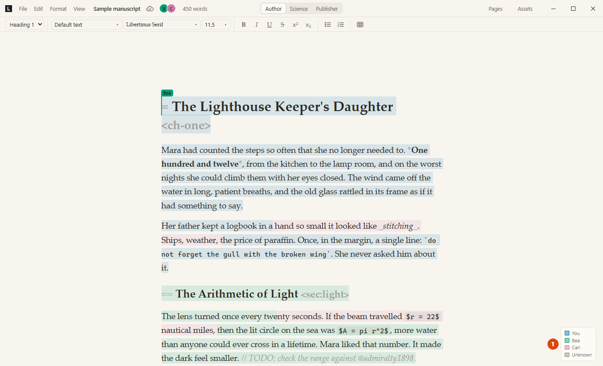
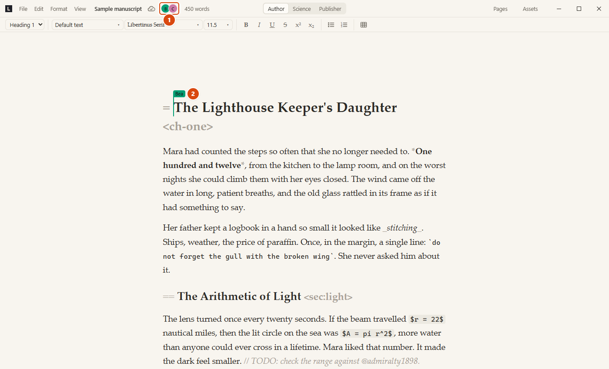
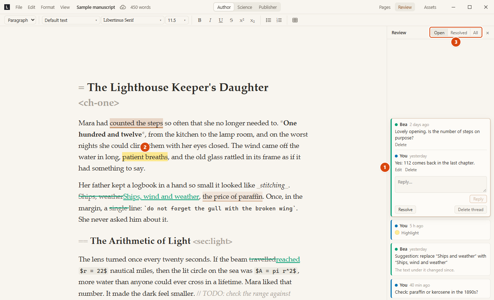
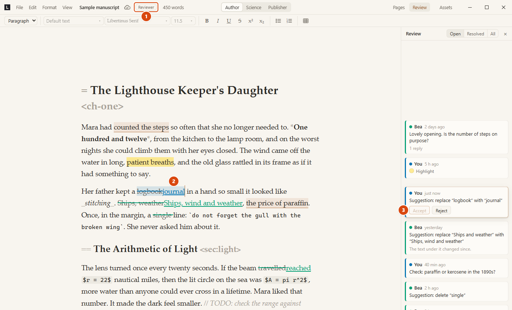
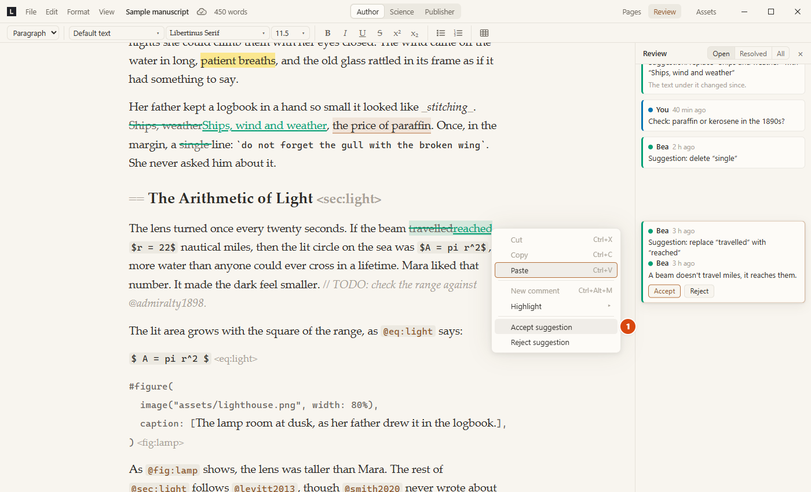

# Collaboration and sync

Decision record for collaboration and multi-device sync. Status: decided
2026-10-15; step 1 (per-device files, storage interface, bibliography,
images, named checkpoints, attribution data), step 2 (folder sync,
decided and built 2026-10-16) and step 3 (the sync server with members,
roles, key epochs, presence and "who wrote this", 2026-10-17 to 10-22) and
step 4 (review tools: comments, highlights and suggestions, 2026-10-24) are
built; accounts and the browser version are not. Open work is in the
[issue tracker](https://github.com/BechtStudio/lethora/issues); how the built parts work is in
[architecture.md](architecture.md) (section 3, "Folder sync", "Server sync"
and "Review", and section 4 (i) and (l)); running the server:
[server.md](server.md).

## 1. Goals and constraints

- **Who:** one person on several devices, and small groups (2–10 people)
  working on one project.
- **How:** both live editing (others' changes and cursors appear while
  typing) and offline work that merges when devices meet again.
- **Day 1:** live cursors and "who wrote this" (attribution per character).
- **Later:** accounts with OIDC, a browser version. (Comments, marks and
  suggestions, the review tools, came with step 4: section 10.)
- **Hosting:** easy to host, maintain and scale; no vendor lock-in (no
  Firebase, Supabase, Cloudflare Durable Objects or similar). The server runs
  on Linux, Windows and macOS, x86-64 and ARM64, as a plain binary or in a
  container, behind any reverse proxy.
- **Operator:** only us for now. The same binary allows self-hosting later.
- **Privacy:** end-to-end encrypted once a project is shared; the server
  never reads content.
- **Scale target:** about 10 people per project, about 10,000 projects per
  server.
- **Unit of sharing:** the whole project.

## 2. Overview

Loro is a CRDT: any two copies of a document merge without anyone resolving
conflicts. So the server only stores and forwards encrypted updates and never
needs to understand them. The server does not even depend on Loro.

Three ways a project can exist, all with the same files and update format:

| Mode | Transport | Encrypted |
| --- | --- | --- |
| Local only | none | no (an opt-in project setting comes later) |
| Folder sync | any tool that syncs a folder: Dropbox, OneDrive, Syncthing, Git, a USB stick | yes |
| Server sync | `lethora-server` over WebSocket | yes |

**Folder sync as built (step 2).** The project itself stays a plain local
folder; folder sync keeps an encrypted *replica* of it in a separate folder
(`<project>.lethora-sync`) that the sync tool shares. Why separate: the
local project keeps working with plain files (the `references.bib` mirror
for Zotero, crash recovery, no key needed to open it), and the replica has
exactly the shape the server will store in step 3, so server sync is the
same replica kept remotely. The replica uses the per-device layout of
section 7 (each device writes only its own files), with every record,
snapshot and blob sealed. Changes are found by polling every 2 s (a listing
and two file sizes per device when nothing changed; no file-watcher
dependency) and arrive in the open editor like a checkpoint restore, never
on the local undo stack.

A project kept inside a sync app's folder (plain-text sync, as before) is
not refused: other devices' plain files are imported live the same way, and
a one-time notice recommends encrypted sync.

Sharing mirrors the coming server share (decided after a two-PC test of
the first version): new projects go to a default projects folder
(`Documents/Lethora`, or `~/Lethora` when Documents itself is synced, so
nothing syncs in plain text by default); Share / Sync offers the sync apps
found on the device (Dropbox, OneDrive, iCloud Drive, Google Drive) as
one-click targets plus "Other folder…"; another device uses "Open shared
project…" and pastes only the project code, which finds its replica in the
sync apps' folders. Since step 3 the same box also takes an invite link,
and a "Lethora server" option goes first in Share / Sync. A device never
keeps two local copies of one synced project (they would be two writers of
the same replica files), so joining a project already on the device opens
that one instead.

## 3. Roles

| Role | Reads | Writes |
| --- | --- | --- |
| Owner | everything | everything; invites and removes members, changes roles |
| Editor | everything | content, layout, review (also accepts suggestions) |
| Reviewer | everything | review only: comments, marks, suggestions |
| Reader | everything | nothing |

Separate Author and Layout roles were considered and dropped as impractical;
Editor covers content and layout together.

In the app: Owners and Editors edit the text and the layout, comment and
highlight, can switch suggest mode on, and accept or reject suggestions. A
Reviewer comments and highlights, and edits the text only as suggestions
(suggest mode is always on; the title bar shows "Reviewer"). A Reader sees
the text and every review item and changes nothing ("Read only · Reader").
A role change applies live. Folder sync has no roles: whoever has the
project code is an Editor (section 8). Details: section 10.

## 4. Documents: permission boundary = document boundary

With end-to-end encryption the server cannot see what an update changes, so
it cannot stop a Reviewer from rewriting a chapter inside a single document.
Clients cannot reject such an update afterwards either: once later changes
build on a Loro update, it cannot be dropped. So every write permission gets
its own document, and the server checks only "may this device write to this
document?", which it can do without reading anything.

| Document | Kind | Holds | Writers |
| --- | --- | --- | --- |
| `main` | Loro | today's document (`content`, `layout`, `meta`, `overrides`, `layout_custom`) plus the bibliography, the image index and named checkpoints | Owner, Editor |
| `review` | Loro | comments, marks, suggestions (format in `crates/core/src/review.rs`) | Owner, Editor, Reviewer |
| `members` | signed append-only log, not Loro | members, roles, device keys, invites, key epochs | Owner; any member for itself: adding and removing its devices (leaving), its profile, revoking its own invites; any current device: key epochs |

Notes:

- Content and layout stay in one document, so undo, checkpoints and
  exception anchors work as today. `review` gets its own undo history.
- Review items anchor in `main`'s text with Loro cursors, resolved against
  `main`, the same mechanism the exceptions use.
- Checkpoints cover `main` only; restoring one does not touch the review.
- `members` is a plain log because mostly owners write it, order matters,
  and the server must read its public part to enforce roles (section 6).
- **Bibliography:** a `bibliography` text in `main` instead of the
  `references.bib` file, so two people adding sources at the same time both
  keep theirs. The compiler gets the text as a file at compile time.
  `references.bib` stays as a mirror for Zotero/JabRef: written after
  changes, and outside edits are merged back in.
- **Images:** stored as immutable blobs `assets/<hash>` (keyed hash, so
  encryption does not reveal identical files); `main` maps the name used in
  the text to the blob. Two different `figure1.png` can no longer
  overwrite each other, and duplicates are stored once. A figure's image is
  changed with "Replace image…", not by editing files in place.
- **Checkpoints:** named ones go into `main` (shared); automatic ones stay in
  a per-device file so they don't flood other devices.

## 5. Identity and attribution

- **Device:** each device creates a key pair on first start (Ed25519 to
  sign, X25519 for key exchange), kept in the app config directory (the OS
  keystore is an option later).
- **User:** an id, a display name and a colour, with one or more devices.
  In a server-shared project the name and colour are the user's profile
  in the members log, sealed. Colours come from a palette of 8; a new
  member gets the first one no other current member has (a hash of the
  user id when all are taken) and can pick its own on the members screen.
  One colour per user and project: all of a user's devices show it.
- **Guest:** a user who joined through a link, with only local keys.
- **Account (later):** a server record that links a user's device keys to a
  login (email/password or OIDC) and owns projects. Once accounts exist, the
  owner of a shared project needs one; everyone else can be a guest or use
  their own account. Keys stay the identity, so accounts and OIDC are an
  add-on, not a redesign.
- **Loro peer ids** stay random per session (Loro forbids reusing a peer id
  concurrently, and a crash could otherwise reuse counters). Each document
  gets a `peers` map: the peer's first change in a session records
  peer id → device key, signed by the device.
- **"Who wrote this":** Loro's `LoroText::get_editor_at_unicode_pos` gives
  the peer that inserted a character, then peer → device → user. We keep the
  full history, so this works for every character. It works for local-only
  projects too (one user, several devices). Shown since 3f with View →
  Show authors in server-shared projects: a faint background in each
  author's colour in the author and science views, a legend, and the name
  and time on hover (the menu item is disabled elsewhere).

  

## 6. Encryption

- **When:** folder sync and server sync are always encrypted. Local-only
  projects are not, until a project setting to encrypt them exists (later).
- **Primitives:** only well-known ones from audited Rust crates:
  XChaCha20-Poly1305 for content, Ed25519 for signatures, X25519 for key
  exchange, keyed SHA-256 for blob names, Argon2id for any key derived
  from a password later. No self-made cryptography.
- **Keys:** one project key per epoch. Removing a member starts a new epoch
  with a new key. A removed member keeps what they had already seen; no
  system can prevent that. MLS (RFC 9420, OpenMLS) replaces this when groups
  or membership churn grow. Built in 3d: [key-epochs.md](key-epochs.md).
- **Update envelope:** document, epoch, device key, nonce, ciphertext and
  signature, plus the sync metadata the server needs in clear (peer and
  counter ranges).
- **Folder sync until step 3 (built):** XChaCha20-Poly1305 with the project
  key only, no device keys or signatures yet: without the `members` log a
  signature would prove nothing. The envelope is versioned and carries the
  epoch (fixed at 1 for now) and a random nonce; its associated data binds it
  to the project, the kind (log record, snapshot, blob, key check) and the
  writing device or blob name, so nothing can be moved to another place
  unnoticed. Envelope version 3 adds the feature level (section 8,
  "Versions"); the server's (2, now 4) adds signatures; a new epoch rotates
  the key. Replaying a device's older records is possible and harmless.
- **Pairing (folder sync, built):** a second device gets the project key as
  the **project code**: the 32 key bytes plus 3 check bytes in Crockford
  base32 (56 characters in groups of 4), shown at setup with Copy and
  pasted on the other device. The code is also the recovery key. Keys live
  only in the app config directory (`keys/<project id>.key`), never in a
  project or sync folder. Invite links (below) replace pasting the code once
  the server exists; a QR code stays possible.
- **Server enforcement:** the public part of `members` (device keys, roles,
  signatures) is readable by the server; names and colours are encrypted. The
  server checks each envelope's signature and the device's role before
  storing it. Clients verify the same and ignore what fails.
- **Invites:** links like
  `https://<host>/join/<project-id>/<invite-id>#<secret>` (the project id
  tells the joining device where to say hello). The part after `#` never
  reaches the server; it unlocks the project keys for the new member. An
  invite carries role, expiry and number of uses; owners can revoke it.
- **Compaction:** a device with write access uploads an encrypted snapshot
  that covers a version; the server then drops the envelopes it covers.
- **What the server sees:** project and document ids, device public keys
  and roles, sizes, times, sync metadata, who is online, IP addresses (and
  the account, later). Details: [server.md](server.md), section 9.
- **Recovery:** the server cannot recover lost keys. Local copies are the
  backup (local-first); an account-based key backup can come later.
- **Certifications:** ISO 27001, SOC 2, BSI C5 and GDPR certify the operator
  (processes, audits, hosting), not the code. The software makes them
  reachable: end-to-end encryption, collecting only what sync needs, EU
  hosting, audit logs. Before offering the service to companies or research
  institutes, have the encryption audited externally.

## 7. Files on disk

Every device writes only its own files, so folder-sync tools never see two
writers on one file:

| Path | Role |
| --- | --- |
| `project.json` | Format number; its presence marks a project. |
| `main/<device>.snapshot` | This device's snapshot of `main` (everything it knows). |
| `main/<device>.log` | This device's append-only update log (today's record format). |
| `review/<device>.snapshot`, `review/<device>.log` | The same for `review`. |
| `members.log` | The signed members log (written by owners only). |
| `assets/<hash>` | Immutable image blobs. |
| `checkpoints/<device>.json` | This device's automatic checkpoints. |
| `<device>.lock` | OS lock while this device has the project open. |

Opening a project loads the own snapshot and log, then imports every other
device's snapshot and log (importing known updates again is harmless).
Compaction rewrites only the own snapshot and truncates only the own log. A
local-only project uses the same layout, so sharing it later needs no
conversion. Projects in today's format are converted on open.

Built in step 1 as listed, except `members.log` and the device keys of
section 5 (step 3; the log is `server/members.log`, kept only in
server-shared projects) and `review/` (step 4). Named checkpoints live in
`main`; `state/<device>.json` holds the device's own state (what it last
mirrored into `references.bib`, where it syncs).

The folder-sync replica (step 2) is a separate folder with the same
per-device idea: `replica.json` (format, random project id, a key check),
`main/<device>.snapshot` and `main/<device>.log` (sealed records), the same
under `review/` (since step 4), and `assets/<hash>` (sealed blobs). Automatic checkpoints, device state and the
`references.bib` mirror stay local. A device whose files grow is read from
where it left off; a changed snapshot or a shorter log (compaction) is read
again from scratch. Details: [architecture.md](architecture.md), section 3.

`crates/core` reads and writes through a small storage interface instead of
the filesystem directly, so a browser version can store projects in browser
storage later.

## 8. Sync server

Built in step 3 (3b–3f); how to run it: [server.md](server.md).

- **Binary:** `lethora-server` (`crates/server`), one Rust program with one
  config file and environment variables. Runs as a plain binary, a systemd
  service or a container (examples in `deploy/`).
- **Transport:** WebSocket (`/v1/ws`) for updates, members log entries and
  presence; HTTP for snapshots, image blobs, invite keys and deleting a
  project, with a token that lives as long as the device's WebSocket
  connection. Plain HTTP/1: TLS comes from a reverse proxy (Caddy, nginx);
  built-in TLS may come later.
- **Protocol:** small, versioned, our own. A device proves its key in a
  handshake; for each document it says what it has, the server sends what
  it lacks, then changes stream live.
- **Versions (decided 2026-10-25, built before the first release):** a
  client never moves past data it can't understand, and never writes data
  an older client would get wrong. Three numbers: the protocol version
  (the wire encoding; the server serves a range; challenge and refusal
  have a frozen layout, so any app can read "update the app"), the
  feature level (`lethora_protocol::LEVEL`, raised by one per feature that
  needs it) and the app version (SemVer from the workspace `Cargo.toml`
  plus the git hash, for people and bug reports only). Every record,
  snapshot and blob names the level it needs (envelopes v3/v4); writers
  seal at the project's level, not their own, so older members keep
  reading a project that uses no newer feature. A project's minimum is the
  members log's `require` entry (with the first app version that has it),
  appended by the first member to use such a feature, never lowered; the
  server then closes the connections below it before anything else goes
  out and refuses hellos below it. A client meeting a record of a higher
  level or a newer envelope version stops that stream before it (no
  skipping, its read position kept) and shows "This project now needs
  Lethora <app> or later"; editing goes on as offline and the changes are
  pushed after the update. A members entry of an op the client doesn't
  know counts as "needs a newer app", not corruption; the server refuses
  such entries until it is updated ("This server needs an update for this
  feature"). The server keeps each device's last hello level, so a client
  can warn before raising the minimum (the warning dialog comes with the
  first feature that raises the level). Folder sync has no members log:
  there the level comes from the records read plus the device's own raised
  level (in its own state file), with the same stop-don't-skip. Accepted
  trade-off: the first use of a feature locks out members who haven't
  updated until they do, instead of silent drift.
- **Loro's protocol, checked 2026-10-17 and not used:** `loro-dev/protocol`
  (wire protocol v1) has an encrypted variant (`%ELO`) marked experimental,
  whose records each hold one peer's counter span; its Rust server depends
  on Loro, keeps encrypted rooms in memory only and has no key handshake,
  signatures, compaction, blobs or encrypted presence. Ours is shaped like
  the folder replica instead: per document, each device appends sealed
  records to its own stream, and a client catches up by asking for each
  device's stream from the offset it has read, so the server stores exactly
  a replica's files. On the server a device's stream holds only its own
  changes, its compaction snapshot too (since step 4, so who wrote what
  rests on the stream that brought it; the sharer's first snapshot holds
  everything). Borrowed: batch ids acknowledged by the server.
- **Who may create a project (until accounts):** any device; it becomes the
  owner. The server config sets quotas and rate limits. One owner per
  project; transferring ownership comes later.
- **Folder sync keeps "project code = Editor":** no roles, `members` log or
  signatures there, since nothing in a shared folder could enforce them.
- **Storage backends:** one interface (`crates/server/src/store.rs`); the
  filesystem is the only backend built. SQLite and S3-compatible stores
  come later behind the same interface.
- **Scale:** projects are independent. One process covers the target and
  is what is built; beyond that, several processes behind a router that
  sends each project to the same process, sharing S3 storage (later).
- **Sync client:** written in Rust next to `crates/core`, not in
  TypeScript, so the browser version can reuse it.

## 9. Live presence

Built in 3e. Each device publishes its view (author, science or publisher)
and its cursor and selection, as Loro cursors so they follow concurrent
edits, in a Loro `EphemeralStore`. Its updates are sealed like records
(envelope v2 with the newest epoch's key, kind `presence`) and sent as
`Presence`; the server forwards them to the project's other connections and
never stores them (rate-limited per connection). Receivers accept them only
from current member devices and take only the sender's own entry. Sent on
cursor moves, edits and view switches (at most ~10 a second), plus a
keep-alive every 10 s; an entry not refreshed for ~30 s goes, as do all of
them when the connection ends. Names and colours come from the sealed
profiles (section 5). Read-only members publish too. Folder sync has no
presence.

In the app: other members' carets and selections in their colour in the
author and science views, with a name flag on hover and briefly after the
caret moves, and a row of coloured initials of who is online in the title
bar (tooltip: name, role, view; up to five, then "+N"). The publisher view
shows no carets.

## 10. Review tools

Built in step 4 (2026-10-24): comments, highlights (marks) and suggestions,
kept in the `review` document (section 4) and anchored in the text. How
they work inside: [architecture.md](architecture.md), section 3 "Review"
and section 4 (l). Open limitations:
[known-issues.md](known-issues.md#review-tools) and
[the user manual](https://github.com/BechtStudio/lethora/blob/main/docs/manual/known-limitations.md#comments-and-suggestions).

- **Review panel** (View → Review, or "Review" in the title bar; author and
  science views): a card per item beside its line, Word-style. Cards push
  each other down; the active one sits at its line and shows the whole
  thread, the reply box and its actions (the others show the first
  message). Clicking a card selects its text; putting the caret in marked
  text opens its card. The filter shows Open, Resolved (resolved threads,
  accepted or rejected suggestions) or All. Authors show as "You", a
  member's name in their colour, "Someone" (not a member) or "Unknown"
  (not verifiable, section 5).
- **Comments and highlights:** select text, then Edit → New comment
  (Ctrl+Alt+M) or Highlight ▸ (yellow, green, blue, pink), also on
  right-click. Adding a note to a highlight makes it a comment. Highlights
  and suggestions show in the text only while the panel is open, and only
  for the items the filter shows.
- **Who may do what** (checked by the app's core: inside one document the
  server can't tell one change from another):

  | Action | Who |
  | --- | --- |
  | comment, highlight, suggest, reply, resolve, reopen | Owner, Editor, Reviewer |
  | edit a message, change a highlight's colour | its author |
  | delete a message, remove a highlight or a thread, reject a suggestion | its author, an Owner or an Editor |
  | accept a suggestion | Owner, Editor (never a Reviewer) |

  Readers see every item, read only. In a project that isn't shared on a
  server, you have every right.
- **Suggest mode** (Edit → Suggest changes, Ctrl+Shift+X): edits in the
  text become suggestions and the text stays as it is. Inserted text shows
  underlined, deleted text struck through, in the author's colour. Typing
  on at your own open suggestion extends it; Backspace takes back what you
  typed. Owners and Editors switch it on and off (title bar: "Suggesting");
  for Reviewers it is always on. Formatting, headings, tables, Replace and
  equations make suggestions too; style, font and size stay off (they are
  layout).
- **Accept and Reject**, on a suggestion's card or on right-click.
  Accepting makes the change in the text, one undo step of whoever
  accepted; rejecting leaves the text as it is. Accept is never offered to
  Reviewers, nor for a stale suggestion: one whose text changed since
  ("The text under it changed since.") or was deleted. Those can only be
  rejected.
- **Detached items:** when all of an item's text is deleted, the item stays
  where its text was, marked "Its text was deleted.". Nothing is dropped.
- **Undo:** the review has its own history. Ctrl+Z in the panel, in suggest
  mode, and anywhere for a Reviewer undoes the last review step (a
  comment, a reply, a resolve, a run of typed suggestions); elsewhere it
  undoes the text. An accepted suggestion is undone like any text change
  (Ctrl+Z in the text with suggest mode off).
- **Checkpoints** cover the text only: making or restoring one never
  touches the review.
- **Publisher view:** shows no review items; the panel lives in the author
  and science views.

## 11. Browser version (later)

Loro and Typst both run as WebAssembly, and the web view already talks to a
mock backend (`app/src/devmock.ts`). What it needs from now on: the storage
interface in `crates/core` (section 7) and the sync client in Rust
(section 8). The rest is packaging: the compile worker as a Web Worker,
bundled fonts, an estimated 10–20 MB compressed download. Goal: open the app
in a browser and try it immediately.

## 12. Open questions

Decided when the milestone that needs them is planned:

- Transferring ownership (one owner per project for now, decided
  2026-10-17).
Decided since: Readers see comments, marks and suggestions, read only
(2026-10-24, with the review tools' plan in Milestone 5 step 4); a second device gets the project key in folder sync through
the project code (section 6, "Pairing"); "who wrote this" is a toggle,
View → Show authors, with coloured backgrounds, a legend and name and time
on hover (section 5, built in 3f, 2026-10-22).
