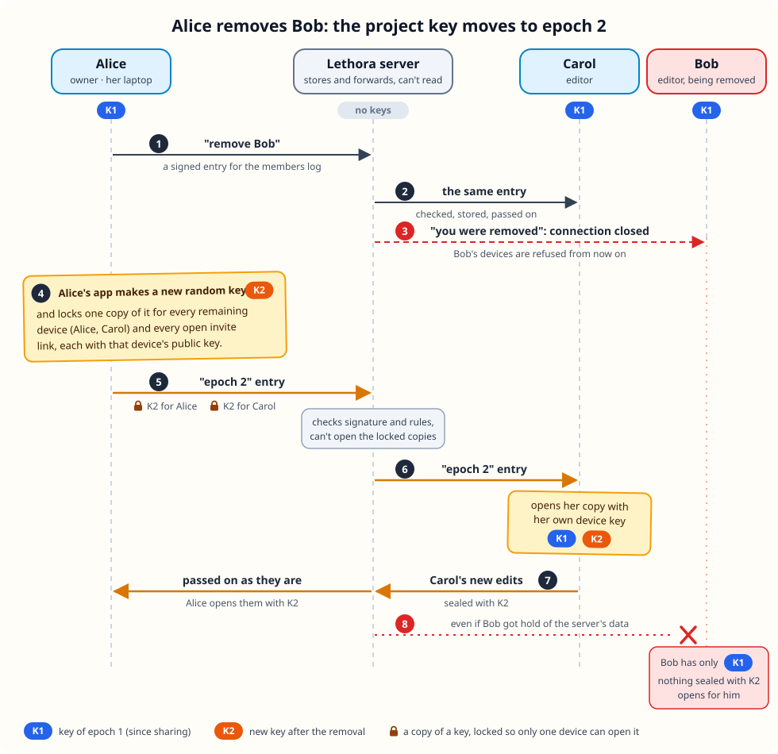
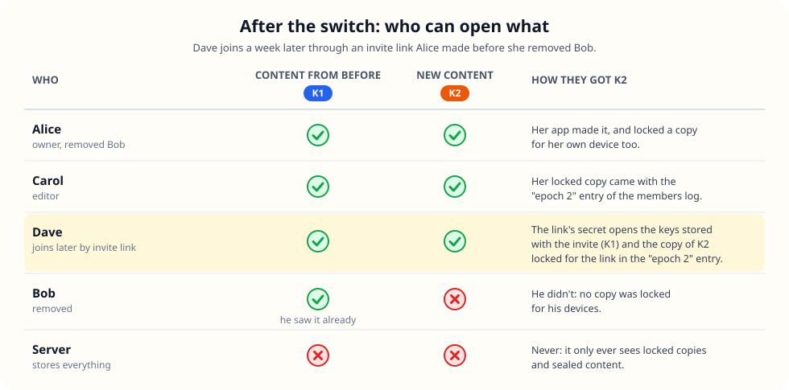

# Key epochs: a new project key after a removal

What happens to a shared project's encryption when someone leaves or is
removed. Status: built 2026-10-22 (Milestone 5 step 3d), server sync only
(folder sync keeps one key). Code: `crates/protocol/src/keys.rs` (sealed
keys), `members.rs` (the `epoch` entry and its rules), `invite.rs` (keys
in invites), `crates/core/src/server.rs` ("Key epochs": when a device
starts one).

## 1. The problem

Everything in a shared project (text, snapshots, images, names) is
encrypted with one project key, and every member's device has a copy.
Removing someone makes the server refuse their devices, but they still
hold the key. If they later got hold of the project's data some other way
(a leaked server, a careless admin, an old backup), they could read
everything written after they left.

## 2. The idea

A removal starts a new **epoch**: a new random project key. New content is
encrypted with the new key only, and the removed person never gets it.
Older content keeps its older key, so current members keep every key and
history still opens. What the removed person already saw stays readable to
them. No system can take that back.

The new key travels in the members log, the signed list of who belongs to
the project. It holds one locked copy per remaining device. Each copy is
locked with that device's public key, so only that device can open it. The
server stores and forwards the copies but can't open any of them.

## 3. The flow, by example

Alice (owner), Carol and Bob share a project; Alice removes Bob.

1. Alice's app sends "remove Bob" to the server as a signed members-log
   entry.
2. The server checks the signature and the rules (only the owner removes
   other people), stores the entry and passes it on to Carol.
3. Bob's devices are disconnected and refused from now on.
4. Alice's app notices "someone was removed after the last epoch" and makes
   a new random key, K2. It locks one copy for each remaining device (her
   own and Carol's) and one for each invite link that is still open.
5. The locked copies go to the server as an "epoch 2" entry. The server
   checks it: signed by a current member, the next epoch number, a copy for
   every current device, none for removed ones. It can't look inside.
6. Carol receives the entry and opens her copy with her own device key. She
   now holds K1 and K2.
7. From now on everyone encrypts with the newest key. Carol's new edits are
   sealed with K2, and the server passes them on unchanged.
8. Bob only has K1. Even with all of the server's data, nothing written from
   epoch 2 on opens for him.

Whoever notices a removal first starts the new epoch. Usually that's the
remover itself. If someone leaves on their own, it's the first remaining
device that comes online. If two devices try at the same moment, the server
takes the first, the second sees the epoch already exists and drops its
own. Until a current device has been online, new edits still use the old
key.

## 4. Who can open what afterwards

Dave joins a week later with an invite link Alice made before removing Bob.

An invite link carries a secret after the `#` that never reaches the
server. From it, Dave's app unlocks the keys the inviter left with the
invite (K1 here), and the copy of K2 that the "epoch 2" entry locked for
that link. After joining, later epochs are locked for Dave's device
directly. So links made before a removal keep working.

## 5. Details

- **Lock:** each copy is sealed to the recipient's X25519 key with a fresh
  ephemeral key per epoch entry (HKDF-SHA256, XChaCha20-Poly1305), bound to
  the project, the epoch and the recipient. The exact format is in the
  module docs of `keys.rs`.
- **On disk:** `keys/<project>.key` in the app's config folder holds one
  `epoch:hex` line per key (a bare line is epoch 1). Keys sealed to this
  device are also found again in the members log when a project opens.
- **Unchanged:** asset (blob) names, folder sync, and what the server can
  see (who is a member, sizes, times; never content).
- **Limits:** someone who fetched an open invite's keys without joining
  keeps them. Revoking an invite doesn't start a new epoch. Every device
  that sees a removal at once tries to rotate, and all but one get a
  "stale" answer. A current member could write an epoch whose copies don't
  open for the others; the members log shows who wrote it.
