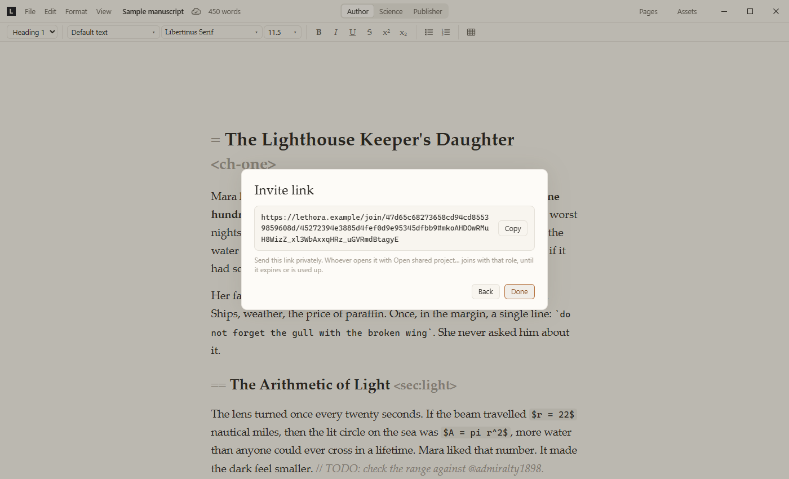
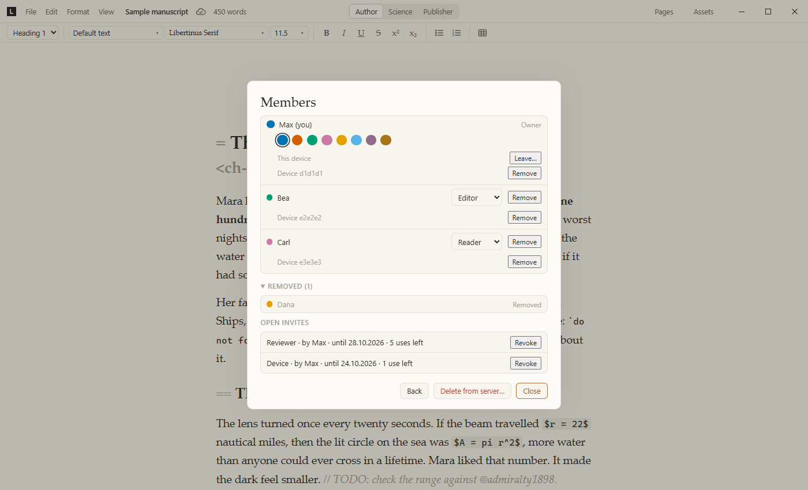

# Lethora server

How to run `lethora-server`, the sync server for projects shared with
Share / Sync → "Lethora server". Status: built in Milestone 5 step 3
(protocol and server 3b, members and roles 3c2, key epochs 3d, presence
3e). Decisions: [collaboration.md](collaboration.md), section 8; how it
works inside: [architecture.md](architecture.md), section 3 ("Server
sync"). Deployment files are in [`deploy/`](https://github.com/BechtStudio/lethora/tree/main/deploy).

## 1. What it is

- One binary, `lethora-server` (`crates/server`), with one config file and
  `LETHORA_*` environment variables. It depends only on
  `lethora-protocol`, not on Loro or the editor.
- Plain HTTP/1 and WebSocket on one port: the apps' WebSocket at `/v1/ws`,
  HTTP under `/v1/projects/...` for snapshots, images, invite keys and
  project deletion, and `GET /healthz` (answers `ok` with the server's
  version, the protocol versions it serves and its feature level, e.g.
  `ok (lethora-server 0.1.0, protocol 2-2, level 1)`; the same line is
  logged at startup).
- No TLS of its own: put a reverse proxy in front that terminates HTTPS
  (Caddy or nginx, section 4). Built-in TLS may come later.
- It stores and forwards sealed records and checks signatures and roles;
  it never reads content (section 8).

## 2. Build and run

```bash
cargo build --release -p lethora-server
target/release/lethora-server                       # reads ./lethora-server.toml
target/release/lethora-server --config /etc/lethora/lethora-server.toml
```

A missing config file means the defaults: listen on `127.0.0.1:8740`, data
in `./lethora-data`. Logs go to stderr, filtered by `RUST_LOG` (default
`info`, e.g. `RUST_LOG=lethora_server=debug`). Ctrl+C or SIGTERM stops it:
no new connections, open ones closed, then it exits.

Quick test on one machine: run it without a config and use
`http://127.0.0.1:8740` as the server address in the app. On a local
network: `listen = "0.0.0.0:8740"` and `public_url =
"http://<LAN IP>:8740"` (plain http is allowed only for local addresses;
the app shows a warning).

## 3. Configuration

`lethora-server.toml` (TOML), then the environment: every key has a
`LETHORA_<KEY>` variable that wins over the file. Limits sit in a
`[limits]` table, their variables have no `LIMITS_` prefix. Sizes are in
bytes, durations in seconds. Unknown keys in the file are an error
(unknown `LETHORA_*` variables are ignored); `token_seconds`
from older files is ignored (tokens now last as long as their
connection). A commented example with every key:
[`deploy/lethora-server.example.toml`](https://github.com/BechtStudio/lethora/blob/main/deploy/lethora-server.example.toml)
(a test checks it against the defaults).

| Key | Type | Default | Variable | Meaning |
| --- | --- | --- | --- | --- |
| `listen` | address | `127.0.0.1:8740` | `LETHORA_LISTEN` | Address and port to listen on. |
| `data_dir` | path | `lethora-data` | `LETHORA_DATA_DIR` | Where projects are stored (relative to the working directory). |
| `public_url` | origin | none | `LETHORA_PUBLIC_URL` | The address the apps use, `https://host[:port]`, no path. Signed in every hello, so it must be exactly what people type in the app. Required unless `listen` is a loopback address (then `http://127.0.0.1:<port>`). Plain `http` only for local network hosts. |
| `trusted_proxies` | list of IPs | `[]` | `LETHORA_TRUSTED_PROXIES` (comma-separated) | Reverse proxies whose `X-Forwarded-For` names the client. |
| `limits.message_bytes` | integer | 4194304 (4 MiB) | `LETHORA_MESSAGE_BYTES` | Largest WebSocket message (at least 1024). |
| `limits.asset_bytes` | integer | 104857600 (100 MiB) | `LETHORA_ASSET_BYTES` | Largest snapshot or image upload (one HTTP body). |
| `limits.project_bytes` | integer | 2147483648 (2 GiB) | `LETHORA_PROJECT_BYTES` | Storage per project. |
| `limits.projects_per_ip_per_day` | integer | 10 | `LETHORA_PROJECTS_PER_IP_PER_DAY` | New projects per client IP in 24 hours. |
| `limits.connections_per_ip` | integer | 20 | `LETHORA_CONNECTIONS_PER_IP` | Open WebSocket connections per client IP. |
| `limits.messages_per_second` | integer | 50 | `LETHORA_MESSAGES_PER_SECOND` | Messages a connection may send per second; more are read later, not refused. |
| `limits.message_burst` | integer | 200 | `LETHORA_MESSAGE_BURST` | The same, in a burst. |
| `limits.bytes_per_second` | integer | 2097152 (2 MiB) | `LETHORA_BYTES_PER_SECOND` | Bytes a connection may send per second. |
| `limits.byte_burst` | integer | 16777216 (16 MiB) | `LETHORA_BYTE_BURST` | The same, in a burst (at least `message_bytes`). |
| `limits.presence_per_second` | integer | 20 | `LETHORA_PRESENCE_PER_SECOND` | Presence messages per second; more are dropped. |
| `limits.presence_bytes` | integer | 65536 (64 KiB) | `LETHORA_PRESENCE_BYTES` | Largest presence message. |
| `limits.chunk_bytes` | integer | 1048576 (1 MiB) | `LETHORA_CHUNK_BYTES` | Largest catch-up message (above 0, at most `message_bytes` / 2). |
| `limits.hello_seconds` | integer | 10 | `LETHORA_HELLO_SECONDS` | Time to answer the challenge. |
| `limits.idle_seconds` | integer | 120 | `LETHORA_IDLE_SECONDS` | A connection that sends nothing this long is closed (apps ping every 30 s). |
| `limits.unload_seconds` | integer | 300 | `LETHORA_UNLOAD_SECONDS` | An unused project is unloaded from memory after this long. |

## 4. Reverse proxy

The proxy terminates HTTPS and passes everything to `lethora-server`, at
the root of a host (the server address has no path). What it must do:

- pass WebSocket upgrades on `/v1/ws`;
- set `X-Forwarded-For`, and the server must list the proxy's address in
  `trusted_proxies`, else every client counts as the proxy's IP for the
  per-IP limits (the server takes the last address that isn't a trusted
  proxy);
- accept request bodies up to `asset_bytes` (100 MiB);
- keep idle connections longer than `idle_seconds` (120 s).

**Caddy** (gets and renews the certificate itself, handles WebSockets and
`X-Forwarded-For`, no body limit or idle timeout by default):

```text
sync.example.org {
	reverse_proxy 127.0.0.1:8740
}
```

with `public_url = "https://sync.example.org"` and `trusted_proxies =
["127.0.0.1"]`. [`deploy/Caddyfile`](https://github.com/BechtStudio/lethora/blob/main/deploy/Caddyfile) is the same for
Docker Compose.

**nginx**: [`deploy/nginx.conf`](https://github.com/BechtStudio/lethora/blob/main/deploy/nginx.conf), a file for
`/etc/nginx/conf.d/`. The parts that matter:

```nginx
client_max_body_size 100m;                 # asset_bytes; nginx's default is 1 MiB
location / {
    proxy_pass http://127.0.0.1:8740;
    proxy_http_version 1.1;
    proxy_set_header Upgrade $http_upgrade;
    proxy_set_header Connection $connection_upgrade;   # from a map in the file
    proxy_set_header X-Forwarded-For $proxy_add_x_forwarded_for;
    proxy_read_timeout 300s;               # above idle_seconds
    proxy_send_timeout 300s;
}
```

## 5. Docker

[`deploy/Dockerfile`](https://github.com/BechtStudio/lethora/blob/main/deploy/Dockerfile) builds the server with the
official `rust` image and runs it on `debian:trixie-slim` as an
unprivileged user (about 85 MB). The build context is the repository root
(Cargo needs the whole workspace and `vendor/loro-internal`);
`deploy/Dockerfile.dockerignore` keeps it to the Rust sources.

```bash
docker build -f deploy/Dockerfile -t lethora-server .
docker run -d --name lethora -p 8740:8740 -v lethora-data:/data \
  -e LETHORA_PUBLIC_URL=https://sync.example.org lethora-server
```

The image sets `LETHORA_LISTEN=0.0.0.0:8740` and `LETHORA_DATA_DIR=/data`
(a volume); `LETHORA_PUBLIC_URL` must be given. Other settings as
`LETHORA_*` variables, or a config file mounted at
`/etc/lethora/lethora-server.toml` (the variables still win).

**With Caddy** ([`deploy/docker-compose.yml`](https://github.com/BechtStudio/lethora/blob/main/deploy/docker-compose.yml)):
point the domain's DNS at the machine, open ports 80 and 443, then

```bash
LETHORA_DOMAIN=sync.example.org docker compose -f deploy/docker-compose.yml up -d
```

Caddy gets the certificate and is the only way in; it has a fixed address
in the compose network (`172.30.0.10`), which the server trusts
(`LETHORA_TRUSTED_PROXIES`). Change the subnet in the file if it is taken.

## 6. systemd

[`deploy/lethora-server.service`](https://github.com/BechtStudio/lethora/blob/main/deploy/lethora-server.service):

```bash
cargo build --release -p lethora-server
sudo install -m 755 target/release/lethora-server /usr/local/bin/
sudo install -D -m 644 deploy/lethora-server.example.toml /etc/lethora/lethora-server.toml
sudoedit /etc/lethora/lethora-server.toml    # public_url, trusted_proxies
sudo install -m 644 deploy/lethora-server.service /etc/systemd/system/
sudo systemctl daemon-reload
sudo systemctl enable --now lethora-server
journalctl -u lethora-server -f
```

The unit runs as a dynamic user that can write only its state directory,
`/var/lib/lethora` (the working directory, so the default `data_dir` is
`/var/lib/lethora/lethora-data`), with a read-only system, no
capabilities and a system call filter. An absolute `data_dir` elsewhere
needs a `ReadWritePaths=` line. Not tested on a Linux host yet.

## 7. Connecting the apps

In the app: Share / Sync (the cloud next to the project name) → "Lethora
server" → **Server address**, e.g. `https://sync.example.org`: the
server's `public_url`, as written there (a different spelling of the
host or port fails the hello's signature). Then a display name (asked
once) and Share. The owner invites people with "Invite people…" (role,
expiry, uses → a link) and their own other devices with "Add my other
device…"; the other side pastes the link into "Open shared project…".



Members… (in the same dialog, or File → Members…) lists who is in the
project, with their devices and open invites. The owner changes roles,
removes members, revokes invites and deletes the project from the
server; anyone removes their own devices, leaves, or picks their own
colour (the swatches under the own row). Removed members fold away under
"Removed (N)".



## 8. Data, backups, updates

**Layout** of `data_dir` (each project in its own folder, written by the
server only; details in the module docs of `crates/server/src/project.rs`):

| Path | Holds |
| --- | --- |
| `projects/<project id>/members.log` | The signed members log, records as appended. A damaged tail found at load is cut and kept as `members.log.damaged`. |
| `projects/<project id>/main/<device>.log`, `review/<device>.log` | Each device's stream: sealed records as appended. |
| `projects/<project id>/main/<device>.snapshot` | The stream's latest compaction snapshot (sealed). |
| `projects/<project id>/assets/<64 hex>` | Sealed images, never changed once written. |
| `projects/<project id>/invites/<invite id>.key` | The wrapped keys of an open invite; deleted once it is used up, revoked or found expired. |
| `projects/<project id>/meta.json` | Bytes used, per stream its generation, length and last batch id, and per device the feature level and app version of its last hello. Rewritten after every change. |

Writes are appends with `fsync` or atomic replaces (a `<name>.tmp` renamed
over the file). Nothing else is kept on disk: tokens, presence and the
per-IP counters live in memory and reset on restart (the apps reconnect).

**Backup:** stop the server, copy `data_dir` (e.g. `tar czf`), start it
again. A copy taken while it runs can catch a log and its `meta.json` at
different moments. The data is sealed, so a backup holds no readable
content, but it shows the same metadata the server sees (section 9).
The devices' local copies are the main backup: the server can't recover
lost keys, and every member has the whole project.

**Restore:** stop the server, replace `data_dir` with the backup, start
it. Restoring an older state than the devices have seen is not tested:
member changes made since (joins, removals, key epochs) are gone from the
server, and devices may refuse the older members log or push their own
changes again.

**Updating:** stop the server, replace the binary (or `docker compose
build` and `up -d`), start it. The data needs no migration.

**Versions:** three numbers (see `lethora_protocol`, "Versions"). The
protocol version is the wire's: the server serves a range and refuses an
app outside it ("Update Lethora", or "Ask its admin to update it" when the
server is the older one). The feature level is what synced data an app
understands; a project's minimum rises (a members `require` entry) when
the first member uses a feature that needs it. From then on the server
refuses apps below it ("This project needs Lethora <version> or later"),
closing their open connections first, and refuses records above it. A
members entry of a kind the server doesn't know yet (a newer app's) is
refused with "This server needs an update for this feature (ask its
admin)", so update the server before or with the apps. The app version
(`/healthz`, Help → About Lethora) is for people and bug reports only.

## 9. What the server can and can't see

It can't read: the text, layout, sources, images, checkpoints, names and
colours (sealed profiles), cursors and views (sealed presence) or who
wrote what. Everything is sealed on the devices with the project key of
the current epoch ([key-epochs.md](key-epochs.md)); the part of invite
links after `#` never reaches it.

It sees: project, document, device, user and invite ids; device public
keys, roles and invites (expiry, uses) from the members log; sizes and
times of records, snapshots and images; who is online; IP addresses. A
malicious server can still withhold, delay, reorder or replay records,
and delete data; it can't forge or change them (each is signed by its
device).

## 10. Current limits

- Storage on the filesystem only (SQLite and S3-compatible stores later,
  behind the same interface).
- One process: projects, tokens and counters live in its memory; no
  clustering yet. Logs are read whole when a project loads; snapshots
  and images are held in memory while they pass (capped by
  `asset_bytes`).
- No accounts: any device can create a project and becomes its owner.
  Abuse is limited per IP (`projects_per_ip_per_day`,
  `connections_per_ip`) and per project (`project_bytes`); there is no
  per-owner or global quota. Hellos and HTTP requests are not
  rate-limited (only connections per IP).
- TLS only through a reverse proxy; HTTP/1 only.
- The members log is never compacted; expired invite keys are swept only
  in loaded projects.
